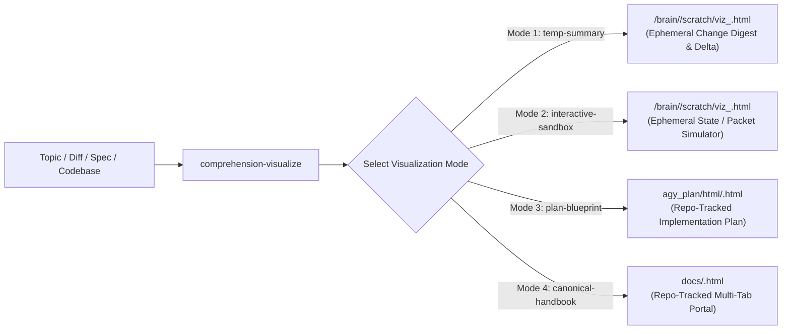

## User Input
```text
$ARGUMENTS
```

## 1. Purpose & Unified Architecture

`comprehension-visualize` is the single unified HTML visualization engine for technical comprehension, change summaries, interactive state/network sandboxes, Spec-Kit implementation plans, and canonical architecture handbooks. It replaces standalone ad-hoc HTML pages and supersedes `comprehension-sandbox`.



---

## 2. Four Visualization Modes & Lifecycle Rules

Always choose the mode matching the user's intent:

| Mode | Trigger / Use Case | Output Path | Git Status Impact | Required Core Views |
| :--- | :--- | :--- | :--- | :--- |
| **Mode 1: `temp-summary`** (`diff-digest`) | User asks to summarize recent changes, a PR/branch, or a spec/feature in a temporary/disposable HTML file. | `<appDataDir>/brain/<conversation-id>/scratch/viz_<slug>.html` | **0 impact** (outside repo worktree; includes copyable `rm -f` cleanup command) | 1. **Executive Delta (`ACTION`/`CAUSE`/`EFFECT`/`VERIFY` + Before/After)**<br/>2. **Interactive Flow / Policy Simulator**<br/>3. **File Impact Matrix & Code Diffs**<br/>4. **Interactive Verification Playbook (Copyable CLI)** |
| **Mode 2: `interactive-sandbox`** | User wants to visually explore or stress-test state machines, network packet flows, auth routing, or budget math. | `<appDataDir>/brain/<conversation-id>/scratch/viz_<slug>.html` | **0 impact** (outside repo worktree) | 1. **Interactive Parameter / Scenario Controls**<br/>2. **Live Animated SVG / Canvas Visualizer**<br/>3. **Real-Time Verdict & Event Trace Log** |
| **Mode 3: `plan-blueprint`** | Triggered during `/plan` or `/speckit-plan` to render an executable technical implementation plan. | `agy_plan/html/<plan-name>.html` | **Tracked in repo** | 1. **Architecture & Data-Flow Diagrams (SVG/Mermaid)**<br/>2. **Scope & Resource Budget Breakdown**<br/>3. **Proposed Code Diffs**<br/>4. **Automated Verification Gate Commands** |
| **Mode 4: `canonical-handbook`** | Updating or creating a persistent system architecture portal (e.g., `docs/platform-architecture.html`). | `docs/<name>.html` | **Tracked & Hook-Enforced** | Full multi-tab interactive architecture handbook synchronized with repo invariants. |

---

## 3. Shared Visual Design System (Rich Interactive Hybrid)

Every HTML file generated by `comprehension-visualize` MUST be a **self-contained single-file `.html` document** (zero build step) adhering to these visual standards:

1. **Typography & Palette (`slate-950` Dark Engineering Theme)**:
   - Include Tailwind CSS via CDN (`https://cdn.tailwindcss.com`).
   - Load Google Fonts: `Inter` (UI/body) and `JetBrains Mono` (code, paths, ports, metrics, CLI commands).
   - Base background: `#020617` (`bg-slate-950 text-slate-100`), cards: `bg-slate-900/90 border border-slate-800 rounded-2xl`, accents:
     - **Cyan (`#38bdf8` / `cyan-400`)**: Primary navigation, active node selection, architecture highlights.
     - **Emerald (`#34d399` / `emerald-400`)**: `FORWARDED` / `ALLOWED` / `PASSED` verdicts and additions.
     - **Rose (`#fb7185` / `rose-400`)**: `DROPPED` / `DENIED` / `REJECTED` verdicts and removals.
     - **Amber (`#fbbf24` / `amber-400`)**: Ephemeral warnings, resource budgets, and preflight gates.

2. **Interactive Navigation & Components**:
   - **Sticky Header**: Title, mode badge (`EPHEMERAL TEMP SUMMARY`, `INTERACTIVE SANDBOX`, `IMPLEMENTATION PLAN`, or `CANONICAL HANDBOOK`), metadata pills, and tab bar (`switchTab('<id>')`).
   - **Animated SVG Topology / Flow Simulator**:
     - Use CSS keyframe `dashForward` (`stroke-dasharray: 6 6; animation: dashForward 1.1s linear infinite;`) on active SVG edges.
     - Provide scenario selector buttons that highlight active nodes/edges, dim inactive paths (`.dimmed { opacity: 0.16; }`), and append structured entries to a live verdict/event log panel.
   - **Mermaid.js Integration (Optional/Hybrid)**:
     - When rendering sequence or DAG diagrams alongside custom SVG simulators, load `https://cdn.jsdelivr.net/npm/mermaid@10/dist/mermaid.min.js` with `theme: 'dark'`.
   - **One-Click Copyable CLI & Cleanup Blocks**:
     - Every verification command and ephemeral cleanup command (`rm -f ...`) MUST have a `Copy` button using `navigator.clipboard.writeText(...)` with visual `"Copied!"` feedback, plus interactive checkboxes so the operator can track local test progress in the browser.

---

## 4. Execution & Delivery Procedure

1. **Select Mode & Target Path**:
   - For ephemeral requests (`Mode 1: temp-summary` or `Mode 2: interactive-sandbox`), write to `<appDataDir>/brain/<conversation-id>/scratch/viz_<slug>.html`.
   - For persistent plans (`Mode 3: plan-blueprint`), write to `agy_plan/html/<plan-name>.html`.
2. **Validate Self-Containment**:
   - Confirm all tabs, scenario simulators, and copy buttons have complete inline JS functions with zero external local asset dependencies.
3. **Deliver in Response**:
   - Provide a direct clickable link: `[viz_<slug>.html](file:///absolute/path/to/viz_<slug>.html)`.
   - Provide the quick-open command (`xdg-open /absolute/path/to/viz_<slug>.html`) and, for ephemeral files, the one-line cleanup command (`rm -f /absolute/path/to/viz_<slug>.html`).
