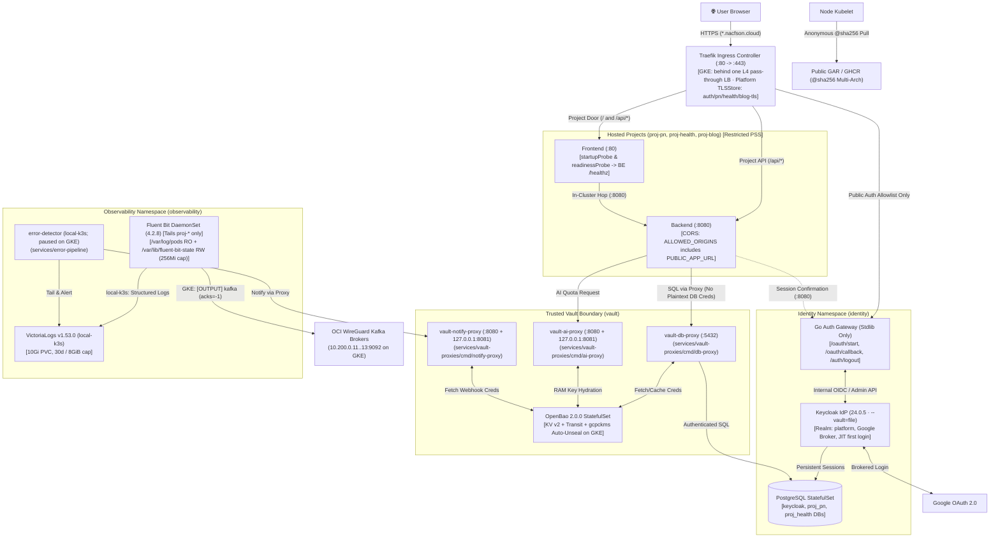
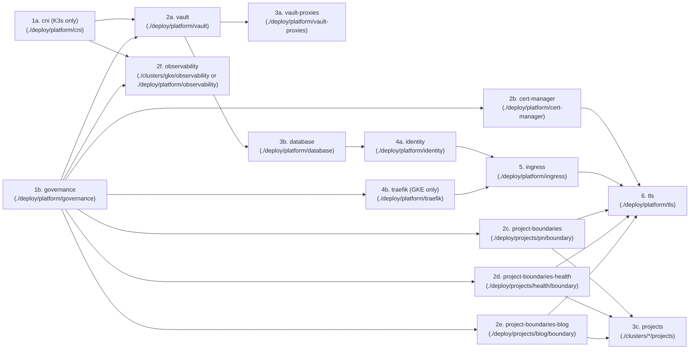
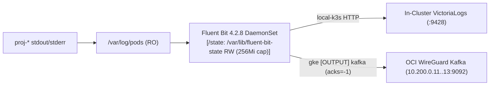
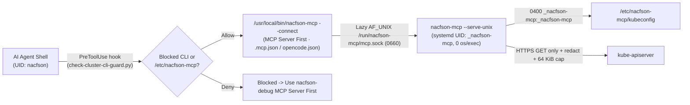

# nacfson_pipeline System Architecture

This document summarizes the runtime topology, GitOps reconciliation layers, security boundaries, and request flows of **`nacfson_pipeline`**.

For supreme governance rules, read [`.specify/memory/constitution.md`](.specify/memory/constitution.md) (`v2.4.1`). For deep-dive subsystem docs, see [`INDEX.md`](INDEX.md).

---

## 1. High-Level Runtime Topology

The platform runs across cloud-agnostic Kubernetes environments:
- **`clusters/gke/` (Primary Cloud Target — Spec 012 Design 1)**: Zonal GKE Standard in GCP project **`nacfson-pipeline`**, zone **`asia-northeast3-a`** (`1 × e2-standard-2` On-Demand `ondemand-core` hosting all 24/7 stateful/auth/tenant workloads + `1 × e2-small` Spot `spot-controllers` hosting stateless `cert-manager` & `flux-system` controllers, `--logging=NONE --monitoring=NONE`, `Traefik v3.3.4` behind a single GKE L4 pass-through LoadBalancer on the Terraform-reserved address `gke-ingress-ip` (Spec 015); infrastructure in `infra/gcp/`).
- **`clusters/local-k3s/` (Lockstep Local Verification Target)**: Single-node Linux K3s (`v1.35.9+k3s1`) running Cilium eBPF CNI and in-cluster VictoriaLogs.
- **`clusters/vps-k3s/` (Transitional Until Gate 4 Cutover)**: Legacy Oracle Cloud ARM64 K3s node. After the Gate 4 DNS cutover it is deleted, and its Always Free A1 capacity is recreated as Kafka VM A1-1 (`10.200.0.11`, Spec 013).

---

## 2. FluxCD GitOps Reconciliation DAG (`clusters/*/layers.yaml`)

All cluster state is reconciled continuously from Git (`main` branch) by in-cluster FluxCD controllers (`source-controller` and `kustomize-controller`). Manual cluster edits to platform-managed namespaces are blocked by [`deploy/platform/governance/manual-change-policy.yaml`](deploy/platform/governance/manual-change-policy.yaml) (which allowlists Flux, `cert-manager` HTTP-01 solvers, and K3s/GKE control-plane system principals).

### Key Layer Invariants
- **Single-Copy Ingress Allowlist**: Public auth routes live in [`deploy/platform/ingress/ingress-allowlist.yaml`](deploy/platform/ingress/ingress-allowlist.yaml). Flux `postBuild` variable substitution is permitted **only** on the `ingress` Kustomization for `AUTH_HOST`.
- **Environment Overlays**: Environment-specific hostnames (`COOKIE_DOMAIN`, `KEYCLOAK_PUBLIC_URL`, `PROJECT_RETURN_HOSTS`, `PUBLIC_APP_URL`, `ALLOWED_ORIGINS`, certificate `dnsNames`/`issuerRef`, and per-pool resource right-sizing) are patched in [`clusters/gke/`](clusters/gke/), [`clusters/local-k3s/`](clusters/local-k3s/), and transitional [`clusters/vps-k3s/`](clusters/vps-k3s/).
- **Vault Unseal Lifecycle**: On `local-k3s`, an operator unseals OpenBao via [`scripts/vault/vault-init.sh`](scripts/vault/vault-init.sh). On `gke` (Constitution Amendment `2.3.0`), `openbao-0` runs with `ServiceAccount/openbao` Workload Identity (`openbao-kms@nacfson-pipeline.iam.gserviceaccount.com`) and Cloud KMS `seal "gcpckms"` (`asia-northeast3`) so routine GKE node maintenance unseals `openbao-0` unattended.

---

## 3. Core Architectural Subsystems

### 3.1 Edge TLS Termination & Single L4 LoadBalancer Ingress (Constitution Principle V, Specs 008, 012 & 015)
- **Platform-Owned Certificate Inventory**: All public TLS certificates (`auth-tls`, `pn-tls`, `health-tls`, `blog-tls`) and the default Traefik `TLSStore` reside exclusively in the `platform` namespace ([`deploy/platform/tls/`](deploy/platform/tls/)).
- **GKE Edge Ingress (`deploy/platform/traefik/`, Spec 015)**: On GKE, non-root `Traefik v3.3.4` (`UID 65532`, `Recreate` strategy, no `hostPort`, no `hostNetwork`) runs on `ondemand-core` and is exposed by exactly one `LoadBalancer` Service, `platform/traefik` (`loadBalancerClass: networking.gke.io/l4-regional-external`, `externalTrafficPolicy: Local`, reserved address `gke-ingress-ip` named by annotation; about \$18/mo). Google passes TCP through without decrypting; TLS terminates at Traefik. The address and the web firewall rule are owned by Terraform (`infra/gcp/gke`); GKE builds the forwarding rule and health check. `scripts/ci/platform-preflight.py` and `scripts/ci/render-invariants.py` (shared rules in `scripts/ci/gke_edge.py`) reject every other `LoadBalancer`, any `NodePort`, and project `LoadBalancer` Services. Contract: [`specs/015-gke-terraform-infra/contracts/traefik-l4-edge.md`](specs/015-gke-terraform-infra/contracts/traefik-l4-edge.md).
- **Zero Project TLS Objects**: Hosted projects MUST NOT declare `Certificate`, `Issuer`, `TLSStore`, `TLSOptions`, or TLS `Secret` resources. Project `IngressRoute` manifests specify `tls: {}` and select their certificate automatically by SNI.
- **Edge Key Exception**: Only edge TLS keys in `platform` and ACME account keys in `cert-manager` may exist as Kubernetes `Secret` objects; all backend credentials remain strictly inside OpenBao.
- **Reference**: [`docs/tls-certificates.md`](docs/tls-certificates.md) | [`specs/008-platform-tls-termination/`](specs/008-platform-tls-termination/)

### 3.2 Project Door Separation & Persistent Shared Sign-In (Constitution Principle III, Specs 001, 006, 009 & 012)
- **Direct Project Door**: Visitors reach a project (`https://pn.nacfson.cloud`, `https://health.nacfson.cloud`, `https://blog.nacfson.cloud`) directly through its own `IngressRoute` without ForwardAuth blocking the front door.
- **Sign-In Declaration (`sign-in.yaml`)**: Each project declares `mode: none` or `mode: shared` in [`deploy/projects/<project>/sign-in.yaml`](deploy/projects/pn/sign-in.yaml).
- **PostgreSQL Realm & User Persistence**: `Deployment/keycloak` (`24.0.5`) persists realm configuration, federated Google links, and offline tokens in `postgres-0` (`keycloak` DB) across [`scripts/ops/cutover-bundle.sh`](scripts/ops/cutover-bundle.sh) cross-cluster restores (`--features=persistent-user-sessions` requires Keycloak `25+` and is deferred post-cutover).
- **Public Auth Surface Allowlist**: On `auth.nacfson.cloud`, Traefik exposes **only** `/oauth/start`, `/oauth/callback`, `/auth/logout`, and `/realms/platform/{protocol/openid-connect/*,login-actions*,broker/*}` + `/resources/*`. Keycloak `/admin/*`, master realm, metrics (`:9000`), and internal JWKS are strictly blocked at the edge.
- **Identity Tuple**: Platform identity is strictly `(issuer, subject)`. Email is never used as a primary key, and authentication never grants implicit app-admin privileges.
- **Reference**: [`docs/architecture-auth-routing.md`](docs/architecture-auth-routing.md) | [`docs/project-auth-verification.md`](docs/project-auth-verification.md)

### 3.3 Zero-Plaintext Cluster Vault, Proxies & Public GAR (Constitution Principle V, Specs 002, 005 & 012)
- **No Backend Secrets in Pods or Images**: Project pods and K8s Secrets never hold database passwords, OAuth client secrets, webhook URLs, or signing keys. Because container images contain zero secrets, Spec 012 retires `vault-registry-proxy` in favor of anonymous `@sha256`-pinned multi-arch pulls from public Google Artifact Registry (`asia-northeast3-docker.pkg.dev/nacfson-pipeline/nacfson-public/*`, built by [`deploy/gcp/cloudbuild.yaml`](deploy/gcp/cloudbuild.yaml) and pruned under `< 0.5 GB` Free Tier by [`deploy/gcp/gar-cleanup-policy.json`](deploy/gcp/gar-cleanup-policy.json)) and `ghcr.io/nacfson/*`.
- **In-Cluster Proxy Execution (`services/vault-proxies/`)**:
  - `vault-db-proxy` (`cmd/db-proxy`): Authenticates project workloads and proxies PostgreSQL connections (`proj_pn`, `proj_health`) using credentials held only inside the Vault boundary.
  - `vault-ai-proxy` (`cmd/ai-proxy`): Verifies calling project pod identity via `kube-apiserver`, enforces per-project daily quotas and loopback Kill Switch (`127.0.0.1:8081`), and injects the OpenBao Gemini API key in RAM (zeroing bytes with `0x00` when disabled) ([`docs/internal-ai-gateway.html`](docs/internal-ai-gateway.html)).
  - `vault-notify-proxy` (`cmd/notify-proxy`): Pod-attributed notification gateway (`POST /v1/notify/{channel}`) holding Discord webhook URLs exclusively inside the Vault boundary; callers include `observability/error-detector` and `observability/ops-relay`.
  - **Transit Engine**: Signs tokens asymmetrically inside OpenBao without exporting private signing keys.

### 3.4 Multi-Node Workload Isolation & $1/n$ Resource Budgeting (Constitution Principles II & IV, Spec 012)
- **Restricted Pod Security**: Every project namespace enforces `pod-security.kubernetes.io/enforce: restricted`, `runAsNonRoot: true`, `allowPrivilegeEscalation: false`, `capabilities.drop: ["ALL"]`, `automountServiceAccountToken: false`, and `ClusterIP`-only Services.
- **Multi-Node Per-Pool Placement & $1/n$ Slicing**:
  $$\text{Project Slice} = \frac{\sum_{\text{pools}} \text{Allocatable} - \text{Platform Reservation (incl. } N_{\text{nodes}} \times \text{DaemonSets)}}{n_{\text{projects}}}$$
  On GKE Design 1 (`2870m / 7158Mi` across `2` nodes, `platformReservations = 1940m / 4872Mi` including the `oci-link` slot agent and `ops-relay`), each of the $n = 3$ projects receives **`310m` CPU / `762Mi` RAM**. `scripts/ci/platform-preflight.py` validates per-pool CPU/memory fit, forbids `RWO` PVCs or `keycloak`/`proj-*` pods on `spot-controllers`, and enforces `>= 50m` CPU / `>= 192Mi` memory backup headroom on `ondemand-core`.

### 3.5 Dependent Workload Probes & Browser CORS Contract (Constitution Principle VII & Spec 007)
- **Three Probe Roles**: `startupProbe` (initial cluster hop to backend), `readinessProbe` (continuous cluster hop / disconnect signal), and `livenessProbe` (process-local only), with `restartPolicy: Always` and `PUBLIC_APP_URL` inside backend `ALLOWED_ORIGINS`.

### 3.6 Portable `NetworkPolicy` & Local Cilium CNI (Specs 010 & 012)
- **Cloud-Agnostic `networking.k8s.io/v1` `NetworkPolicy`**: Spec 012 replaces Cilium-only `CiliumNetworkPolicy` manifests so identical network isolation rules enforce cleanly on both `local-k3s` (Cilium eBPF with `policy-cidr-match-mode: "nodes"` in [`deploy/platform/cni/kustomization.yaml`](deploy/platform/cni/kustomization.yaml)) and `gke` (GKE Dataplane V2 / Calico NetworkPolicy):
  - `openbao-ingress-policy` ([`deploy/platform/vault/network-policy.yaml`](deploy/platform/vault/network-policy.yaml)) permits `kube-apiserver` control-plane egress (RFC1918 `:443/:6443`, plus GKE Workload Identity `169.254.169.254/32:80,988` and Private Google Access `199.36.153.8/30:443` for Cloud KMS in `clusters/gke/layers.yaml`), while strictly forbidding `0.0.0.0/0` on `openbao`.
  - `pn-backend-translation-egress`, `ai-proxy-egress`, and `notify-proxy-egress` permit TCP `:443` to `0.0.0.0/0` **minus** RFC1918 (`10.0.0.0/8`, `172.16.0.0/12`, `192.168.0.0/16`), link-local metadata (`169.254.169.254/32`), and CGNAT (`100.64.0.0/10`).
- **Local Hubble Observability**: On `local-k3s`, Cilium `v1.20.3` + Hubble UI `v0.13.6` stream packet verdicts over private loopback [`scripts/ops/open-hubble-ui.sh`](scripts/ops/open-hubble-ui.sh) (`127.0.0.1:12000`).
- **Private Operator Access Only**: `Service/hubble-ui` and `Service/hubble-relay` are strictly `ClusterIP` with zero public `IngressRoute`; run automated 5-point live verification via `./scripts/ops/open-hubble-ui.sh --verify`.
- **Reference**: [`specs/010-cilium-hubble-observability/`](specs/010-cilium-hubble-observability/) | [`specs/012-gke-platform-migration/`](specs/012-gke-platform-migration/)

### 3.7 Crash-Resilient Project Log Collection & Off-Cluster Sink (Specs 011 & 012)

Hosted project stdout and stderr (`proj-*` only) conform to [`contracts/CONTRACT_LOG_SCHEMA.md`](contracts/CONTRACT_LOG_SCHEMA.md) (`v3`). Platform component logs stay live-only.

- **Node-Local Recovery State (Solution B — Constitution Amendment `2.3.0`)**: `DaemonSet/fluent-bit` tolerates `cloud.google.com/gke-spot=true:NoSchedule` so it runs on every node, mounting `/var/log/pods` (`readOnly: true`) and `/var/lib/fluent-bit-state` (`DirectoryOrCreate`, `readOnly: false` at `/state`). SQLite WAL `/state/tail.db` and `/state/chunks` filesystem buffering (`256 MiB` max per node) guarantee zero lost or duplicated records across pod crashes and downstream sink outages without multi-node `ReadWriteOnce` PVC scheduling deadlocks.
- **Environment Sinks**:
  - **`local-k3s`**: Ships to in-cluster `StatefulSet/victorialogs` (`v1.53.0`, `10Gi` PVC, `30d` / `8 GiB` cap) and `Deployment/error-detector`.
  - **`gke`** ([`clusters/gke/observability/`](clusters/gke/observability/)): Deletes in-cluster `StatefulSet/victorialogs` (moving onto the two shared A1 VMs in Spec 014; there is no separate OCI VM 4), pauses `Deployment/error-detector` at `replicas: 0` (retaining `PVC/error-detector-state` and its pre-reserved `25m/64Mi` budget slot until Spec 014 switches it to Kafka `logs.proj.errors`), and ships `proj.*` (`192M` cap -> `logs.proj.valid`) and `quarantine.*` (`64M` cap -> `logs.proj.quarantine`) via idempotent `[OUTPUT] kafka` (`acks=-1`, `Retry_Limit False`).
- **OCI Kafka cluster (Spec 013)**: Kafka `4.3.2` in KRaft mode on the four Always Free VMs, declared once in [`infra/kafka/cluster.yaml`](infra/kafka/cluster.yaml) and built with [`infra/oci/terraform/`](infra/oci/terraform/) (operator) and [`infra/oci/ansible/`](infra/oci/ansible/) (control center).
  - **Layout**: brokers on A1-1 (`10.200.0.11`), A1-2 (`.12`), and Micro-1 (`.13`); controller voters on A1-1, A1-2, and Micro-2 (`.14`). Each group spans three fault domains, so losing any one VM keeps writes going. `logs.*` topics keep 3 replicas and need 2 in sync.
  - **Path from GKE**: each GKE node's `wg-slot-agent` ([`clusters/gke/oci-link/`](clusters/gke/oci-link/)) claims a WireGuard key slot through a Lease, peers with the three brokers' reserved public IPs on UDP `51820`, and source-NATs pod traffic to its slot address `10.201.0.<n+1>`. Every Kafka connection then uses mutual TLS from `ClusterIssuer/kafka-mtls-ca`, with deny-by-default ACLs.
  - **Health**: an ops agent on each VM writes events and 30 s metrics to `ops.platform.events` / `ops.platform.metrics`; `ops-relay` in GKE sends one Discord message per state change and serves `ops-relay status` through `kubectl exec`. Runbook: [`docs/runbooks/oci-kafka.md`](docs/runbooks/oci-kafka.md).
- **Error Detector**: [`deploy/platform/observability/error-detector.yaml`](deploy/platform/observability/error-detector.yaml) (`services/error-pipeline/cmd/error-detector`) tails VictoriaLogs, persists SQLite state on PVC `error-detector-state`, and dispatches alerts via `vault-notify-proxy`.
- **Access**: [`scripts/ops/open-observe.sh`](scripts/ops/open-observe.sh) (transitional `vps-k3s`) and [`scripts/ops/open-victorialogs-ui.sh`](scripts/ops/open-victorialogs-ui.sh) (`local-k3s`) port-forward to loopback only. No public route.
- **Reference**: [`specs/011-project-log-contract/spec.md`](specs/011-project-log-contract/spec.md) | [`docs/operations-runbook.md`](docs/operations-runbook.md) §15–16 | [`specs/012-gke-platform-migration/`](specs/012-gke-platform-migration/)

### 3.8 Workstation Read-Only Debug MCP Layer (`1B` OS Isolation) & Script Layout

To inspect cluster health without exposing Kubernetes credentials or cluster/cloud-console CLIs (`kubectl`, `k3s`, `oc`, `flux`, `helm`, `k9s`, `kubectx`/`kubens`, `stern`, `crictl`, `cilium`/`hubble`, `argocd`, `velero`, `ssh`/`scp`/`sftp`, `gcloud`/`gsutil`/`bq`/`gke-gcloud-auth-plugin`/`cloud-sql-proxy`, `oci`, `aws`/`eksctl`, `az`, `doctl`, `linode-cli`, `ansible*`, `kcat`/`kafkacat`, `wg*`, `tailscale`, `sudo`/`su`/`doas`/`pkexec`, and mutating `terraform`/`tofu`) inside agent shells, the workstation isolates cluster access across a hard Linux kernel UID boundary:

- **Pure Go Stdlib MCP Daemon ([`services/debug-mcp/`](services/debug-mcp/))**: Built with Go 1.22 standard library only (`0` third-party dependencies, `0` `os/exec` imports). Registered as `nacfson-debug` in [`.mcp.json`](.mcp.json) and [`opencode.json`](opencode.json) (`--connect` acts as a lazy-dial stdio bridge so all 6 tools remain discoverable via `tools/list` even when the daemon is stopped, returning an actionable start prompt on `tools/call` without CLI fallback). Exposes 6 bounded read-only tools (`cluster_overview`, `list_workloads`, `describe_pod`, `get_events`, `get_flux_status`, `get_pod_logs`) with secret scrubbing (`Bearer`, `JWT`, `AIza`, `sk-`, KV fields), container `env[].value` stripping, `32 KiB` raw log / `64 KiB` JSON payload caps, untrusted-data framing on logs, `10s` HTTP timeouts, max `4` concurrent requests, and live `SIGHUP`/`mtime` kubeconfig reload.
- **Systemd Host Isolation & Ephemeral Sessions ([`infra/workstation/nacfson-mcp.service`](infra/workstation/nacfson-mcp.service), [`scripts/mcp/`](scripts/mcp/), [`.agents/skills/debug-mcp-session/SKILL.md`](.agents/skills/debug-mcp-session/SKILL.md))**: [`scripts/mcp/install-daemon.sh`](scripts/mcp/install-daemon.sh) sets up `_nacfson-mcp` (`nologin`), `/etc/nacfson-mcp` (`0750 root:_nacfson-mcp`), `/usr/local/bin/nacfson-mcp`, and `nacfson-mcp.service` (disabled on boot by default unless `--enable` is passed, `Restart=no`, `RuntimeMaxSec=2h`, and `ExecStopPost=+/bin/rm -f /etc/nacfson-mcp/kubeconfig` cleanup on stop). Operators start temporary auto-expiring sessions with `sudo ./scripts/mcp/mcp-session.sh start <gke|local-k3s> --ttl 2h` and tear them down early with `sudo ./scripts/mcp/mcp-session.sh stop`. [`scripts/mcp/refresh-kubeconfig.sh`](scripts/mcp/refresh-kubeconfig.sh) mints short-lived credentials into `0400 /etc/nacfson-mcp/kubeconfig` and defaults `--service-account` to `governance/operator-readonly` (introducing a dedicated `governance/ai-readonly` ServiceAccount is tracked in GitHub issue [#190](https://github.com/nacfson/nacfson_pipeline/issues/190)).
- **Multi-Agent `PreToolUse` CLI Guard & MCP-First Rule ([`scripts/hooks/check-cluster-cli-guard.py`](scripts/hooks/check-cluster-cli-guard.py), [`.agents/rules/cluster-debug-mcp.md`](.agents/rules/cluster-debug-mcp.md))**: Wired into [`scripts/hooks/universal-agent-hook.py`](scripts/hooks/universal-agent-hook.py), [`.omp/extensions/arch-doc-sync.ts`](.omp/extensions/arch-doc-sync.ts), and [`.opencode/plugins/arch-doc-sync.js`](.opencode/plugins/arch-doc-sync.js) to block direct Kubernetes and cloud-console terminal invocations, chained subshells, wrapper bypasses (`sudo`, `env`, `timeout`, `xargs`, `bash -c`), inline `ALLOW_CLUSTER_CLI=1` self-bypasses, `/etc/nacfson-mcp` access, and `nacfson-mcp --serve-unix`, directing callers to the `nacfson-debug` MCP server first while permitting offline repo scripts, read-only `terraform`/`tofu`, and host-environment `ALLOW_CLUSTER_CLI=1` operator break-glass commands.
- **Reorganized `scripts/` Domain Hierarchy**:

| Directory | Purpose |
| :--- | :--- |
| `scripts/ci/` | Render validation, preflight checks, GKE edge & Kafka declaration tools (`render-validate.sh`, `platform-preflight.py`, `render-invariants.py`) |
| `scripts/hooks/` | Multi-agent `SessionStart` / `PreToolUse` / `Stop` adapters, `check-arch-doc-sync.py`, `check-cluster-cli-guard.py`, `review-cycle.py` |
| `scripts/images/` | Digest pinning and `image-bump` automation (`image-pin.py`, `image-bump-request.py`) |
| `scripts/mcp/` | Workstation MCP daemon installer (`install-daemon.sh`), ephemeral session controller (`mcp-session.sh`), and kubeconfig minting (`refresh-kubeconfig.sh`) |
| `scripts/ops/` | Private tunnels, DB/cutover bundles, gateway/notify helpers, rollback (`open-*.sh`, `operator-kubeconfig.sh`, `cutover-bundle.sh`) |
| `scripts/vault/` | OpenBao initialization, rotation, K8s auth configuration, and seal rehearsal (`vault-*.sh`, `rehearse-openbao-seal-migration.sh`) |
| `scripts/verify/` | Live platform, identity, isolation, TLS, persistence, and backup verification suites (`verify-*.sh`, `smoke-auth-chain.sh`) |
| `scripts/lib/`, `scripts/comprehension/` | Shared OpenBao status/fixture Python helpers and explainer video scripts |

