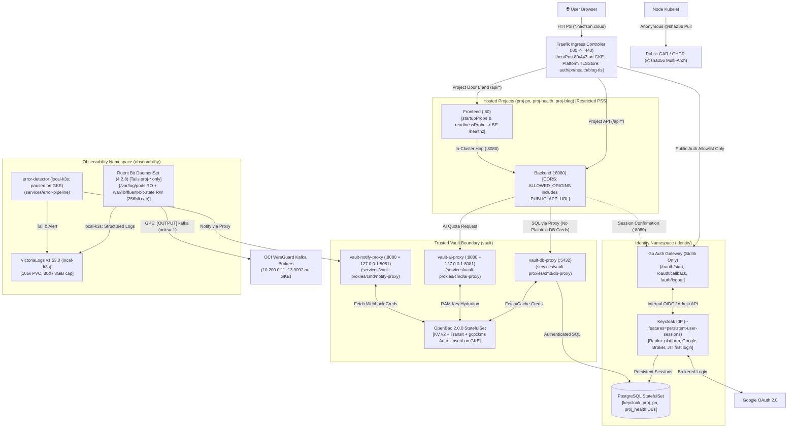
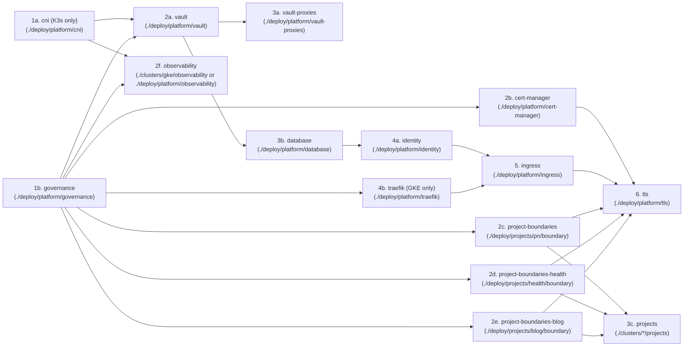
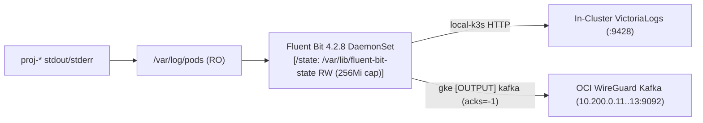

# nacfson_pipeline System Architecture

This document summarizes the runtime topology, GitOps reconciliation layers, security boundaries, and request flows of **`nacfson_pipeline`**.

For supreme governance rules, read [`.specify/memory/constitution.md`](.specify/memory/constitution.md) (`v2.3.0`). For deep-dive subsystem docs, see [`INDEX.md`](INDEX.md).

---

## 1. High-Level Runtime Topology

The platform runs across cloud-agnostic Kubernetes environments:
- **`clusters/gke/` (Primary Cloud Target — Spec 012 Design 1)**: Zonal GKE Standard in GCP project **`nacfson-pipeline`**, zone **`asia-northeast3-a`** (`1 × e2-medium` On-Demand `ondemand-core` hosting all 24/7 stateful/auth/tenant workloads + `1 × e2-small` Spot `spot-controllers` hosting stateless `cert-manager` & `flux-system` controllers, `--logging=NONE --monitoring=NONE`, `Traefik v3.3.4` `hostPort: 80/443` with zero GCP LoadBalancer).
- **`clusters/local-k3s/` (Lockstep Local Verification Target)**: Single-node Linux K3s (`v1.35.9+k3s1`) running Cilium eBPF CNI and in-cluster VictoriaLogs.
- **`clusters/vps-k3s/` (Transitional Until Gate 4 Cutover)**: Legacy Oracle Cloud ARM64 K3s node, repurposed into OCI Kafka Broker VM 1 (`10.200.0.11`) immediately after Gate 4 DNS cutover.

---

## 2. FluxCD GitOps Reconciliation DAG (`clusters/*/layers.yaml`)

All cluster state is reconciled continuously from Git (`main` branch) by in-cluster FluxCD controllers (`source-controller` and `kustomize-controller`). Manual cluster edits to platform-managed namespaces are blocked by [`deploy/platform/governance/manual-change-policy.yaml`](deploy/platform/governance/manual-change-policy.yaml) (which allowlists Flux, `cert-manager` HTTP-01 solvers, and K3s/GKE control-plane system principals).

### Key Layer Invariants
- **Single-Copy Ingress Allowlist**: Public auth routes live in [`deploy/platform/ingress/ingress-allowlist.yaml`](deploy/platform/ingress/ingress-allowlist.yaml). Flux `postBuild` variable substitution is permitted **only** on the `ingress` Kustomization for `AUTH_HOST`.
- **Environment Overlays**: Environment-specific hostnames (`COOKIE_DOMAIN`, `KEYCLOAK_PUBLIC_URL`, `PROJECT_RETURN_HOSTS`, `PUBLIC_APP_URL`, `ALLOWED_ORIGINS`, certificate `dnsNames`/`issuerRef`, and per-pool resource right-sizing) are patched in [`clusters/gke/`](clusters/gke/), [`clusters/local-k3s/`](clusters/local-k3s/), and transitional [`clusters/vps-k3s/`](clusters/vps-k3s/).
- **Vault Unseal Lifecycle**: On `local-k3s`, an operator unseals OpenBao via [`scripts/vault-init.sh`](scripts/vault-init.sh). On `gke` (Constitution Amendment `2.3.0`), `openbao-0` runs with `ServiceAccount/openbao` Workload Identity (`openbao-kms@nacfson-pipeline.iam.gserviceaccount.com`) and Cloud KMS `seal "gcpckms"` (`asia-northeast3`) so routine GKE node maintenance unseals `openbao-0` unattended.

---

## 3. Core Architectural Subsystems

### 3.1 Edge TLS Termination & Zero-LoadBalancer Ingress (Constitution Principle V, Specs 008 & 012)
- **Platform-Owned Certificate Inventory**: All public TLS certificates (`auth-tls`, `pn-tls`, `health-tls`, `blog-tls`) and the default Traefik `TLSStore` reside exclusively in the `platform` namespace ([`deploy/platform/tls/`](deploy/platform/tls/)).
- **Zero-Cost GKE Edge Ingress (`deploy/platform/traefik/`)**: On GKE, non-root `Traefik v3.3.4` (`UID 65532`, `ClusterIP` Service, `Recreate` strategy) binds `hostPort: 80` and `hostPort: 443` on `ondemand-core` Node 1's static IPv4 address. `scripts/platform-preflight.py` and `scripts/render-invariants.py` reject `Service` `type: LoadBalancer` in `clusters/gke/` to prevent \$18/mo forwarding rules.
- **Zero Project TLS Objects**: Hosted projects MUST NOT declare `Certificate`, `Issuer`, `TLSStore`, `TLSOptions`, or TLS `Secret` resources. Project `IngressRoute` manifests specify `tls: {}` and select their certificate automatically by SNI.
- **Edge Key Exception**: Only edge TLS keys in `platform` and ACME account keys in `cert-manager` may exist as Kubernetes `Secret` objects; all backend credentials remain strictly inside OpenBao.
- **Reference**: [`docs/tls-certificates.md`](docs/tls-certificates.md) | [`specs/008-platform-tls-termination/`](specs/008-platform-tls-termination/)

### 3.2 Project Door Separation & Persistent Shared Sign-In (Constitution Principle III, Specs 001, 006, 009 & 012)
- **Direct Project Door**: Visitors reach a project (`https://pn.nacfson.cloud`, `https://health.nacfson.cloud`, `https://blog.nacfson.cloud`) directly through its own `IngressRoute` without ForwardAuth blocking the front door.
- **Sign-In Declaration (`sign-in.yaml`)**: Each project declares `mode: none` or `mode: shared` in [`deploy/projects/<project>/sign-in.yaml`](deploy/projects/pn/sign-in.yaml).
- **Database-Persisted Sessions**: `Deployment/keycloak` runs with `--features=persistent-user-sessions` (Spec 012) so active user and client sessions live in `postgres-0` (`keycloak` DB) across Keycloak pod restarts, GKE node upgrades, and `cutover-bundle.sh` cross-cluster restores.
- **Public Auth Surface Allowlist**: On `auth.nacfson.cloud`, Traefik exposes **only** `/oauth/start`, `/oauth/callback`, `/auth/logout`, and `/realms/platform/{protocol/openid-connect/*,login-actions*,broker/*}` + `/resources/*`. Keycloak `/admin/*`, master realm, metrics (`:9000`), and internal JWKS are strictly blocked at the edge.
- **Identity Tuple**: Platform identity is strictly `(issuer, subject)`. Email is never used as a primary key, and authentication never grants implicit app-admin privileges.
- **Reference**: [`docs/architecture-auth-routing.md`](docs/architecture-auth-routing.md) | [`docs/project-auth-verification.md`](docs/project-auth-verification.md)

### 3.3 Zero-Plaintext Cluster Vault, Proxies & Public GAR (Constitution Principle V, Specs 002, 005 & 012)
- **No Backend Secrets in Pods or Images**: Project pods and K8s Secrets never hold database passwords, OAuth client secrets, webhook URLs, or signing keys. Because container images contain zero secrets, Spec 012 retires `vault-registry-proxy` in favor of anonymous `@sha256`-pinned multi-arch pulls from public Google Artifact Registry (`asia-northeast3-docker.pkg.dev/nacfson-pipeline/nacfson-public/*`, built by [`deploy/gcp/cloudbuild.yaml`](deploy/gcp/cloudbuild.yaml) and pruned under `< 0.5 GB` Free Tier by [`deploy/gcp/gar-cleanup-policy.json`](deploy/gcp/gar-cleanup-policy.json)) and `ghcr.io/nacfson/*`.
- **In-Cluster Proxy Execution (`services/vault-proxies/`)**:
  - `vault-db-proxy` (`cmd/db-proxy`): Authenticates project workloads and proxies PostgreSQL connections (`proj_pn`, `proj_health`) using credentials held only inside the Vault boundary.
  - `vault-ai-proxy` (`cmd/ai-proxy`): Verifies calling project pod identity via `kube-apiserver`, enforces per-project daily quotas and loopback Kill Switch (`127.0.0.1:8081`), and injects the OpenBao Gemini API key in RAM (zeroing bytes with `0x00` when disabled) ([`docs/internal-ai-gateway.html`](docs/internal-ai-gateway.html)).
  - `vault-notify-proxy` (`cmd/notify-proxy`): Pod-attributed notification gateway (`POST /v1/notify/{channel}`) holding Discord webhook URLs exclusively inside the Vault boundary; callers include `observability/error-detector`.
  - **Transit Engine**: Signs tokens asymmetrically inside OpenBao without exporting private signing keys.

### 3.4 Multi-Node Workload Isolation & $1/n$ Resource Budgeting (Constitution Principles II & IV, Spec 012)
- **Restricted Pod Security**: Every project namespace enforces `pod-security.kubernetes.io/enforce: restricted`, `runAsNonRoot: true`, `allowPrivilegeEscalation: false`, `capabilities.drop: ["ALL"]`, `automountServiceAccountToken: false`, and `ClusterIP`-only Services.
- **Multi-Node Per-Pool Placement & $1/n$ Slicing**:
  $$\text{Project Slice} = \frac{\sum_{\text{pools}} \text{Allocatable} - \text{Platform Reservation (incl. } N_{\text{nodes}} \times \text{DaemonSets)}}{n_{\text{projects}}}$$
  On GKE Design 1 (`1880m / 4408Mi` across `2` nodes, `platformReservations = 970m / 3152Mi`), each of the $n = 3$ projects receives **`303m` CPU / `418Mi` RAM**. `scripts/platform-preflight.py` validates per-pool CPU/memory fit, forbids `RWO` PVCs or `keycloak`/`proj-*` pods on `spot-controllers`, and enforces `>= 50m` CPU / `>= 192Mi` memory backup headroom on `ondemand-core`.

### 3.5 Dependent Workload Probes & Browser CORS Contract (Constitution Principle VII & Spec 007)
- **Three Probe Roles**: `startupProbe` (initial cluster hop to backend), `readinessProbe` (continuous cluster hop / disconnect signal), and `livenessProbe` (process-local only), with `restartPolicy: Always` and `PUBLIC_APP_URL` inside backend `ALLOWED_ORIGINS`.

### 3.6 Portable `NetworkPolicy` & Local Cilium CNI (Specs 010 & 012)
- **Cloud-Agnostic `networking.k8s.io/v1` `NetworkPolicy`**: Spec 012 replaces Cilium-only `CiliumNetworkPolicy` manifests so identical network isolation rules enforce cleanly on both `local-k3s` (Cilium eBPF with `policy-cidr-match-mode: "nodes"` in [`deploy/platform/cni/kustomization.yaml`](deploy/platform/cni/kustomization.yaml)) and `gke` (GKE Dataplane V2 / Calico NetworkPolicy):
  - `openbao-ingress-policy` ([`deploy/platform/vault/network-policy.yaml`](deploy/platform/vault/network-policy.yaml)) permits `kube-apiserver` control-plane egress (RFC1918 `:443/:6443`, plus GKE Workload Identity `169.254.169.254/32:80,988` and Private Google Access `199.36.153.8/30:443` for Cloud KMS in `clusters/gke/layers.yaml`), while strictly forbidding `0.0.0.0/0` on `openbao`.
  - `pn-backend-translation-egress`, `ai-proxy-egress`, and `notify-proxy-egress` permit TCP `:443` to `0.0.0.0/0` **minus** RFC1918 (`10.0.0.0/8`, `172.16.0.0/12`, `192.168.0.0/16`), link-local metadata (`169.254.169.254/32`), and CGNAT (`100.64.0.0/10`).
- **Local Hubble Observability**: On `local-k3s`, Cilium `v1.20.3` + Hubble UI `v0.13.6` stream packet verdicts over private loopback [`scripts/open-hubble-ui.sh`](scripts/open-hubble-ui.sh) (`127.0.0.1:12000`).
- **Private Operator Access Only**: `Service/hubble-ui` and `Service/hubble-relay` are strictly `ClusterIP` with zero public `IngressRoute`; run automated 5-point live verification via `./scripts/open-hubble-ui.sh --verify`.
- **Reference**: [`specs/010-cilium-hubble-observability/`](specs/010-cilium-hubble-observability/) | [`specs/012-gke-platform-migration/`](specs/012-gke-platform-migration/)

### 3.7 Crash-Resilient Project Log Collection & Off-Cluster Sink (Specs 011 & 012)

Hosted project stdout and stderr (`proj-*` only) conform to [`contracts/CONTRACT_LOG_SCHEMA.md`](contracts/CONTRACT_LOG_SCHEMA.md) (`v3`). Platform component logs stay live-only.

- **Node-Local Recovery State (Solution B — Constitution Amendment `2.3.0`)**: `DaemonSet/fluent-bit` tolerates `cloud.google.com/gke-spot=true:NoSchedule` so it runs on every node, mounting `/var/log/pods` (`readOnly: true`) and `/var/lib/fluent-bit-state` (`DirectoryOrCreate`, `readOnly: false` at `/state`). SQLite WAL `/state/tail.db` and `/state/chunks` filesystem buffering (`256 MiB` max per node) guarantee zero lost or duplicated records across pod crashes and downstream sink outages without multi-node `ReadWriteOnce` PVC scheduling deadlocks.
- **Environment Sinks**:
  - **`local-k3s`**: Ships to in-cluster `StatefulSet/victorialogs` (`v1.53.0`, `10Gi` PVC, `30d` / `8 GiB` cap) and `Deployment/error-detector`.
  - **`gke`** ([`clusters/gke/observability/`](clusters/gke/observability/)): Deletes in-cluster `StatefulSet/victorialogs` (moving to OCI VM 4 in Spec 014), pauses `Deployment/error-detector` at `replicas: 0` (retaining `PVC/error-detector-state` and its pre-reserved `25m/64Mi` budget slot until Spec 014 switches it to Kafka `logs.proj.errors`), and ships `proj.*` (`192M` cap -> `logs.proj.valid`) and `quarantine.*` (`64M` cap -> `logs.proj.quarantine`) via idempotent `[OUTPUT] kafka` (`acks=-1`, `Retry_Limit False`).
- **Error Detector**: [`deploy/platform/observability/error-detector.yaml`](deploy/platform/observability/error-detector.yaml) (`services/error-pipeline/cmd/error-detector`) tails VictoriaLogs, persists SQLite state on PVC `error-detector-state`, and dispatches alerts via `vault-notify-proxy`.
- **Access**: [`scripts/open-observe.sh`](scripts/open-observe.sh) (transitional `vps-k3s`) and [`scripts/open-victorialogs-ui.sh`](scripts/open-victorialogs-ui.sh) (`local-k3s`) port-forward to loopback only. No public route.
- **Reference**: [`specs/011-project-log-contract/spec.md`](specs/011-project-log-contract/spec.md) | [`docs/operations-runbook.md`](docs/operations-runbook.md) §15–16 | [`specs/012-gke-platform-migration/`](specs/012-gke-platform-migration/)

