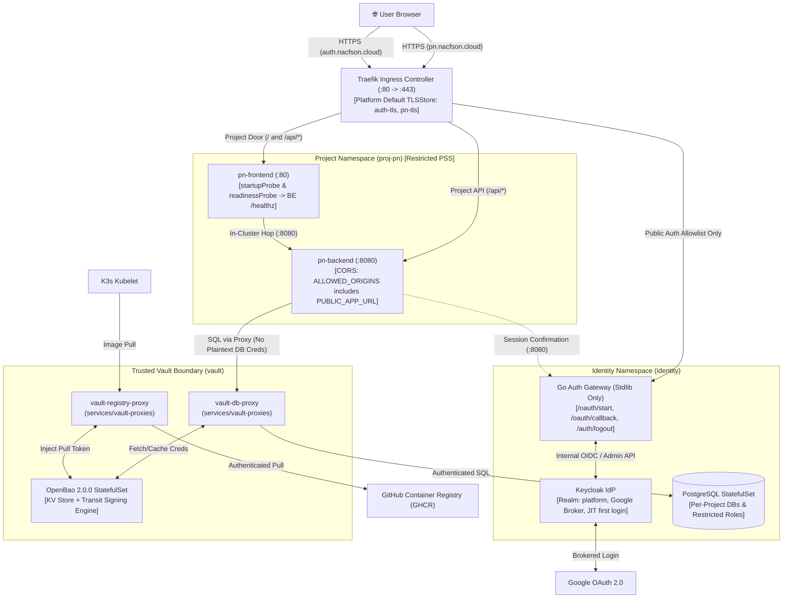
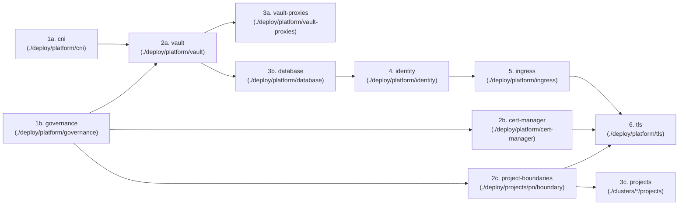
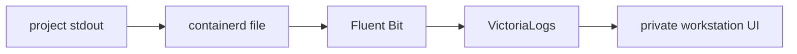

# nacfson_pipeline System Architecture

This document summarizes the runtime topology, GitOps reconciliation layers, security boundaries, and request flows of **`nacfson_pipeline`**.

For supreme governance rules, read [`.specify/memory/constitution.md`](.specify/memory/constitution.md). For deep-dive subsystem docs, see [`INDEX.md`](INDEX.md).

---

## 1. High-Level Runtime Topology

The platform runs on a single native K3s node (Oracle Cloud Always Free ARM64 VPS in `vps-k3s`, or local Linux K3s in `local-k3s`) while maintaining environmental portability to EKS/GKE.

---

## 2. FluxCD GitOps Reconciliation DAG (`clusters/*/layers.yaml`)

All cluster state is reconciled continuously from Git (`main` branch) by in-cluster FluxCD controllers (`source-controller` and `kustomize-controller`). Manual cluster edits to platform-managed namespaces are blocked by [`deploy/platform/governance/manual-change-policy.yaml`](deploy/platform/governance/manual-change-policy.yaml).

### Key Layer Invariants
- **Single-Copy Ingress Allowlist**: Public auth routes live in [`deploy/platform/ingress/ingress-allowlist.yaml`](deploy/platform/ingress/ingress-allowlist.yaml). Flux `postBuild` variable substitution is permitted **only** on the `ingress` Kustomization for `AUTH_HOST` (`auth.nacfson.cloud` on VPS, `auth.localhost` locally).
- **Environment Overlays**: Environment-specific hostnames (`COOKIE_DOMAIN`, `KEYCLOAK_PUBLIC_URL`, `PROJECT_RETURN_HOSTS`, `PUBLIC_APP_URL`, `ALLOWED_ORIGINS`, and certificate `dnsNames`/`issuerRef`) are patched in [`clusters/vps-k3s/`](clusters/vps-k3s/) and [`clusters/local-k3s/`](clusters/local-k3s/).
- **Pause on Sealed Vault**: `vault` layer health checks wait on the `openbao` StatefulSet; after VM reboot or initial install, an operator unseals OpenBao via [`scripts/vault-init.sh`](scripts/vault-init.sh).

---

## 3. Core Architectural Subsystems

### 3.1 Edge TLS Termination (Constitution Principle V & Spec 008)
- **Platform-Owned Certificate Inventory**: All public TLS certificates (`auth-tls`, `pn-tls`) and the default Traefik `TLSStore` reside exclusively in the `platform` namespace ([`deploy/platform/tls/`](deploy/platform/tls/)).
- **Zero Project TLS Objects**: Hosted projects MUST NOT declare `Certificate`, `Issuer`, `TLSStore`, `TLSOptions`, or TLS `Secret` resources. Project `IngressRoute` manifests ([`deploy/projects/pn/workloads/ingress-route.yaml`](deploy/projects/pn/workloads/ingress-route.yaml)) bind to `websecure` (`tls: {}`) and select their certificate automatically by hostname from the platform `TLSStore`.
- **Edge Key Exception**: Only edge TLS keys in `platform` and ACME account keys in `cert-manager` may exist as Kubernetes `Secret` objects; all backend credentials remain strictly inside OpenBao.
- **Reference**: [`docs/tls-certificates.md`](docs/tls-certificates.md) | [`specs/008-platform-tls-termination/`](specs/008-platform-tls-termination/)

### 3.2 Project Door Separation & Shared Sign-In (Constitution Principle III, Specs 001, 006 & 009)
- **Direct Project Door**: Visitors reach a project (`https://pn.nacfson.cloud`) directly through its own `IngressRoute` without ForwardAuth blocking the front door.
- **Sign-In Declaration (`sign-in.yaml`)**: Each project declares `mode: none` or `mode: shared` in [`deploy/projects/<project>/sign-in.yaml`](deploy/projects/pn/sign-in.yaml).
  - `mode: none`: Project has zero network path or runtime dependency on the sign-in service.
  - `mode: shared`: Project owns its login UI/button, initiates OIDC via `/oauth/start`, and verifies confirmed sessions with the gateway.
- **Public Auth Surface Allowlist**: On `auth.nacfson.cloud`, Traefik exposes **only**:
  - Gateway routes: `/oauth/start`, `/oauth/callback`, `/auth/logout`
  - Keycloak OIDC broker routes: `/realms/platform/protocol/openid-connect/*`, `/realms/platform/broker/*`, `/resources/*`
  - Keycloak `/admin/*`, master realm, metrics (`:9000`), and internal JWKS are strictly blocked at the edge.
- **Identity Tuple**: Platform identity is strictly `(issuer, subject)`. Email is never used as a primary key, and authentication never grants implicit app-admin privileges.
- **Reference**: [`docs/architecture-auth-routing.md`](docs/architecture-auth-routing.md) | [`docs/project-auth-verification.md`](docs/project-auth-verification.md) | [`specs/006-separate-project-auth/`](specs/006-separate-project-auth/) | [`specs/009-host-scoped-shared-auth/`](specs/009-host-scoped-shared-auth/)

### 3.3 Zero-Plaintext Cluster Vault & Proxies (Constitution Principle V, Specs 002 & 005)
- **No Backend Secrets in Pods**: Project pods and K8s Secrets never hold database passwords, GHCR pull tokens, OAuth client secrets, or signing keys.
- **In-Cluster Proxy Execution**:
  - `vault-db-proxy` (`services/vault-proxies/cmd/db-proxy`): Authenticates project workloads and executes/proxies PostgreSQL connections using credentials held only inside the Vault boundary.
  - `vault-registry-proxy` (`services/vault-proxies/cmd/registry-proxy`): Injects GHCR pull tokens on behalf of the K3s kubelet.
  - **Transit Engine**: Signs tokens asymmetrically inside OpenBao without exporting private signing keys.
- **Reference**: [`docs/spec002-vault-guide.md`](docs/spec002-vault-guide.md) | [`specs/002-internal-cluster-vault/`](specs/002-internal-cluster-vault/)

### 3.4 Workload Isolation & $1/n$ Resource Budgeting (Constitution Principles II & IV)
- **Restricted Pod Security**: Every project namespace enforces `pod-security.kubernetes.io/enforce: restricted`, `runAsNonRoot: true`, `allowPrivilegeEscalation: false`, `capabilities.drop: ["ALL"]`, `automountServiceAccountToken: false`, and `ClusterIP`-only Services.
- **Deterministic $1/n$ Slicing**:
  $$\text{Project Slice} = \frac{\text{Node Allocatable} - \text{System Reserved} - \text{Platform Reservation}}{n_{\text{projects}}}$$
- **Guaranteed QoS**: Every container must set `requests.cpu == limits.cpu` and `requests.memory == limits.memory`. Verified statically before merge by [`scripts/platform-preflight.py`](scripts/platform-preflight.py).

### 3.5 Dependent Workload Probes & Browser CORS Contract (Constitution Principle VII & Spec 007)
- **Three Probe Roles**:
  1. `startupProbe` (Frontend): Proves the frontend can reach the backend's process-availability endpoint (`/healthz` / `/api/healthz`) at least once before starting.
  2. `readinessProbe` (Frontend): Continuously monitors the frontend-to-backend cluster hop; readiness failure is the durable "unconnected from backend" signal and withholds traffic without restarting the container.
  3. `livenessProbe` (Frontend & Backend): Checks only local process health; never depends on peer or database reachability.
- **Always-Restart Policy**: Always-on project Deployments explicitly declare `restartPolicy: Always`.
- **Browser API Origin Allowlist**: Public browser SPAs calling `/api` must have `PUBLIC_APP_URL` declared and included inside the backend's `ALLOWED_ORIGINS` env var per environment overlay ([`clusters/*/projects/proj-pn.yaml`](clusters/vps-k3s/projects/proj-pn.yaml)).
- **Reference**: [`specs/007-pn-readiness-restart/`](specs/007-pn-readiness-restart/)

### 3.6 Cilium + Hubble CNI & Visual Network Observability (Constitution Principles I, II, IV, V & Spec 010)
- **Git-Owned CNI & Bootstrap Staging**: K3s runs with `--flannel-backend=none --disable-network-policy`. [`bootstrap/tasks/install.yml`](bootstrap/tasks/install.yml) applies the Git-vendored [`deploy/platform/cni/`](deploy/platform/cni/) bundle so pod networking and CoreDNS come up before Flux starts, after which the Flux `cni` Kustomization (`vault.spec.dependsOn: [cni, governance]`) continuously reconciles it.
- **Phased Visual Observability (`Hubble UI` Now, `Grafana` Later)**: Deploys Cilium `v1.20.3`, Hubble Relay `v1.20.3`, and Hubble UI `v0.13.6` with zero Prometheus/Grafana/Loki pods today (`+225m` CPU request, `+1248Mi` memory limit in `platformReservations`), while exposing internal OpenMetrics (`:9965/metrics` with `dns,drop,tcp,flow`) and gRPC (`:4245`) for future Grafana attachment.
- **OpenBao API-Server Egress Tightening**: Replaces OpenBao's `0.0.0.0/0` egress exception on `:443/:6443` with [`CiliumNetworkPolicy/openbao-apiserver-egress`](deploy/platform/vault/network-policy.yaml) (`toEntities: ["kube-apiserver"]`), while keeping all `proj-*` tenant policies on portable `networking.k8s.io/v1` `NetworkPolicy`.
- **Project PN Translation Egress**: Portable `proj-*` policies stay on `networking.k8s.io/v1`. [`CiliumNetworkPolicy/pn-backend-translation-egress`](deploy/projects/pn/boundary/translation-egress.yaml) names only `api.wiktapi.dev` and `generativelanguage.googleapis.com` on TCP 443 for `pn-backend`. Other world destinations stay dropped. There is no `0.0.0.0/0` fallback.
- **Private Operator Access Only**: `Service/hubble-ui` and `Service/hubble-relay` are strictly `ClusterIP` with zero public `IngressRoute`. Operators access Hubble UI via [`scripts/open-hubble-ui.sh`](scripts/open-hubble-ui.sh) (`127.0.0.1:12000`) and run automated 5-point live verification via `./scripts/open-hubble-ui.sh --verify`.
- **Reference**: [`specs/010-cilium-hubble-observability/`](specs/010-cilium-hubble-observability/)

### 3.7 Project Log History (VictoriaLogs)

Hosted project stdout and stderr are the only stored history. Platform component logs stay live-only. The Flux layer `observability` (`deploy/platform/observability/`) depends on `cni` and `governance`. Namespace `observability` is privileged so the collector may mount `/var/log/pods` read-only. That `hostPath` is a platform exception, not a project mount. The envelope is [`contracts/CONTRACT_LOG_SCHEMA.md`](contracts/CONTRACT_LOG_SCHEMA.md). The observability reservation is not yet measured and must not be added by hand.

- **Store**: VictoriaLogs `victoriametrics/victoria-logs:v1.53.0`, ClusterIP only, 10Gi PVC, 30-day retention, 8 GiB disk cap. Lines past either limit are dropped with no alert.
- **Collector**: Fluent Bit `fluent/fluent-bit:4.2.8` tails `proj-*` only. Tail bookmark PVC `fluent-bit-state` is 1Gi. It survives a collector restart, not node-disk loss.
- **Access**: On this workstation, [`scripts/open-observe.sh`](scripts/open-observe.sh) SSHes only the VPS API to `127.0.0.1:16443` (local k3s already owns `6443`), then port-forwards Hubble `127.0.0.1:12000` and VictoriaLogs `http://127.0.0.1:9428/select/vmui/`. `local-k3s` uses [`scripts/open-victorialogs-ui.sh`](scripts/open-victorialogs-ui.sh). No public route. Do not SSH-forward `12000` or `9428`.
- **Accepted risks**: disk loss, residual volume fill, viewer down with the node, `local-k3s` disk not checked, only `proj-*` stored. First step up is an off-node copy.
- **Reference**: [`docs/operations-runbook.md`](docs/operations-runbook.md) §15 | [`docs/superpowers/specs/2026-10-22-log-viewer-design.md`](docs/superpowers/specs/2026-10-22-log-viewer-design.md)
