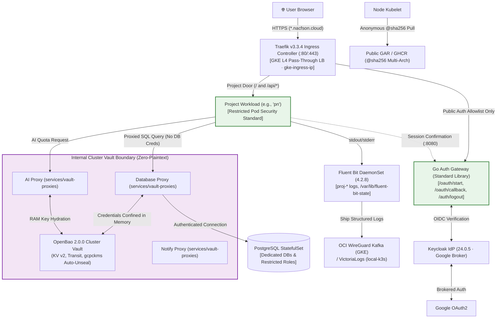
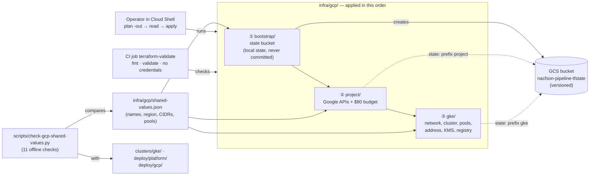
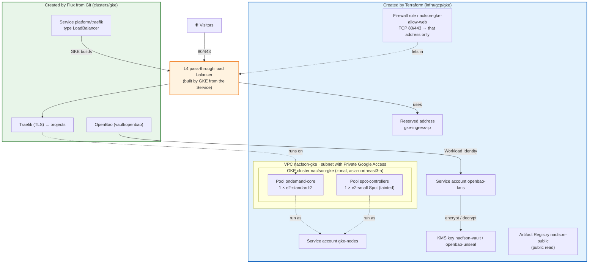

# nacfson_pipeline: Personal Project Platform

[](.specify/memory/constitution.md)
[](specs/)
[](.specify/memory/constitution.md)
[](specs/002-internal-cluster-vault/spec.md)

A multi-tenant Kubernetes platform for running personal projects on modest compute resources (zonal GKE Standard in `nacfson-pipeline` / `asia-northeast3-a` as the primary production target, with lockstep local Linux K3s in `local-k3s` and transitional `vps-k3s`). 

The platform guarantees **shared Google-backed Single Sign-On (SSO)**, **strict workload isolation via Kubernetes Restricted Pod Security Standards**, **deterministic 1/n QoS resource budgeting**, **persistent tenant-isolated PostgreSQL**, and a **zero-plaintext self-hosted internal cluster Vault**.

---

## 1. Documentation Architecture & Markdown Structure

To maintain consistency across human engineers and AI coding agents, this repository enforces a **4-tier Markdown Documentation Architecture** based on the Diátaxis framework and Spec-Driven Engineering:

```
nacfson_pipeline/
├── README.md                                    # Tier 2: Master System Portal & Index
├── SPEC.md                                      # Tier 2: Initial Platform Specification Baseline
├── TROUBLESHOOTING.md                           # Tier 4: Incident Runbook (CPU budget, OpenBao, GHCR pulls, OAuth callback)
├── .specify/memory/constitution.md              # Tier 1: Authoritative Invariants & Governance Rules
│
├── specs/                                       # Tier 3: Feature Specifications (SpecKit Packages 001..015)
│   ├── 001-project-platform/                    #   ├── Ingress, Auth Gateway & Workload Sandboxing
│   ├── 002-internal-cluster-vault/              #   ├── Zero-Plaintext OpenBao Vault & Proxies
│   ├── 003-minimal-vm-bootstrap/                #   ├── Host OS, Networking & K3s Bootstrap
│   ├── 004-flux-gitops-reconciliation/          #   ├── FluxCD GitOps Layers & Preflight Gate
│   ├── 005-post-vault-automation/               #   ├── Post-Unseal Workload Wiring
│   ├── 006-separate-project-auth/               #   ├── Project Door vs Shared Sign-In
│   ├── 007-pn-readiness-restart/                #   ├── Separate Startup/Readiness/Liveness Probes & CORS
│   ├── 008-platform-tls-termination/            #   ├── Platform-Owned Edge TLS
│   ├── 009-host-scoped-shared-auth/             #   ├── Host-Scoped Cookies & Direct OIDC
│   ├── 010-cilium-hubble-observability/         #   ├── Cilium eBPF CNI & Hubble Observability
│   ├── 011-project-log-contract/                #   ├── Fluent Bit, VictoriaLogs & Error Detector
│   ├── 012-gke-platform-migration/              #   ├── Multi-Node GKE Portability & Cloud KMS Unseal
│   └── 015-gke-terraform-infra/                 #   └── GKE Terraform Infrastructure & L4 LoadBalancer Edge
│
├── contracts/                                   # Tier 2: Canonical Preflight-Enforced Contracts (CONTRACT_*.md)
│
└── docs/                                        # Tier 4: Operations, Guides & Visual Explanations
    ├── platform-architecture.html               #   ├── Canonical Interactive Architecture Handbook (Hook-Synced)
    ├── operations-runbook.md                    #   ├── Production deployment sequence & incident triage
    ├── spec002-vault-guide.md                   #   ├── Internal Cluster Vault concepts & rotation lifecycle
    ├── bootstrap-scope.md                       #   ├── Ansible VM bootstrap prerequisites and boundaries
    └── ghcr-token-lifecycle.html                #   └── Interactive visual diagram of GHCR token lifecycle
```

### Documentation Tiers & Governing Rules

| Tier | Category | Scope & Purpose | Precedence & Rules |
| :--- | :--- | :--- | :--- |
| **Tier 1** | **Constitution & Invariants** | Immutable architectural laws, security boundaries, and QoS invariants. | **Supreme Authority**: Any manifest, spec, or code change that contradicts [`.specify/memory/constitution.md`](.specify/memory/constitution.md) MUST fail review. |
| **Tier 2** | **System Architecture & Navigation** | Global mental model, canonical contracts, and master index. | High-level system orientation ([`README.md`](README.md), [`INDEX.md`](INDEX.md), [`ARCHITECTURE.md`](ARCHITECTURE.md), [`contracts/README.md`](contracts/README.md), and [`SPEC.md`](SPEC.md)). |
| **Tier 3** | **Feature Specifications (`specs/`)** | SpecKit packages detailing user stories, contracts, and execution tasks. | Formal contract: `spec.md` specifies *what* (requirements), `plan.md` specifies *how* (architecture), `contracts/` specifies *protocols*, `tasks.md` tracks *execution*. |
| **Tier 4** | **Operations & Runbooks (`docs/`)** | Day-2 operations, disaster recovery drills, and procedural runbooks. | Practical guidance for human operators executing deployment scripts and incident triage. |

---

## 2. Constitutional Invariants & Non-Negotiable Constraints

All platform components and project workloads strictly adhere to the 7 principles ratified in [`.specify/memory/constitution.md`](.specify/memory/constitution.md):

* **[Principle I: Declarative Phased GitOps](.specify/memory/constitution.md)**: Git is the single source of truth. Continuous reconciliation via 14-layer Flux GitOps controllers with automated drift detection and correction. Images MUST use immutable `@sha256:...` digests (projects) or pinned exact version tags (infrastructure).
* **[Principle II: Workload Isolation & Restricted Pod Security](.specify/memory/constitution.md)**: Project namespaces MUST enforce the Kubernetes `Restricted` Pod Security profile (audit/warn modes strictly prohibited). Containers run non-root, drop all capabilities (allowing at most `NET_BIND_SERVICE`), and use dedicated platform ServiceAccounts with auto-token-mount disabled. Project services are `ClusterIP` only.
* **[Principle III: Defense-in-Depth Identity & Standard-Library Gateway](.specify/memory/constitution.md)**: Ingress exposes only public browser-facing login/callback routes and current-session revocation. Keycloak admin, metrics (port 9000), and internal JWKS are strictly private. The Authentication Gateway is written in pure standard-library Go with **zero runtime third-party dependencies** and fails closed (HTTP 503).
* **[Principle IV: Bounded 1/n Resource Budgeting](.specify/memory/constitution.md)**: Containers MUST enforce strict `requests == limits`. Compute is sliced equally across projects ($1/n$). Candidate deployments exceeding budgets or lowering existing memory limits during the interim freeze are rejected by the platform-preflight CI gate ([`scripts/platform-preflight.py`](scripts/platform-preflight.py)).
* **[Principle V: Zero Plaintext Secrets & Centralized Cluster Vault](.specify/memory/constitution.md)**: Plaintext secrets are NEVER committed to Git, embedded in Helm/Kustomize, or delivered to application pods via Kubernetes Secrets or volume mounts (with the sole constitutional exception of platform-owned edge TLS Secrets in `platform` and ACME account keys in `cert-manager`). Applications invoke authorized operations via internal Vault Proxies (`ai-proxy`, `db-proxy`, `notify-proxy`), receiving sanitized results without ever holding backend credentials. Spec 012 retired `registry-proxy` in favor of anonymous `@sha256`-pinned pulls from public GAR and GHCR.
* **[Principle VI: Environmental Portability](.specify/memory/constitution.md)**: Zero application code changes across single-VPS K3s, local Linux K3s, AWS EKS, and GCP GKE.
* **[Principle VII: Distinct Lifecycle Signals for Dependent Project Workloads](.specify/memory/constitution.md)**: Dependent project workloads separate `startupProbe` (initial cluster dependency hop), `readinessProbe` (continuous cluster hop / disconnect signal), and `livenessProbe` (process-local only), declare `restartPolicy: Always`, and include `PUBLIC_APP_URL` in backend `ALLOWED_ORIGINS`.

---

## 3. System Architecture & Topology

The platform coordinates ingress traffic, identity negotiation, credential isolation, and persistent storage across a two-node zonal GKE Standard cluster (`ondemand-core` `e2-standard-2` + `spot-controllers` `e2-small`, with `local-k3s` for local verification):



### 3.1 Domain-Based Project Naming & Identity Rule

All hosted projects and authentication handoffs MUST derive project names, return hosts, and OAuth/JWT audiences deterministically from the **configured public domain under the platform's main domain** (`nacfson.cloud` in `gke` and `vps-k3s`, `example.com` in `local-k3s`), and **NEVER** from internal Kubernetes service hostnames (`pn-backend`, `pn-backend.proj-pn.svc:8080`, or `gateway.identity.svc:8080`):

| Identifier | Naming Rule | Production (`gke`) Example | Local (`local-k3s`) Example |
| :--- | :--- | :--- | :--- |
| **Main Platform Domain** | `<main-domain>` | `nacfson.cloud` | `example.com` |
| **Central Auth Domain** | `auth.<main-domain>` | `auth.nacfson.cloud` | `auth.example.com` |
| **Canonical Issuer (`iss`)** | `https://auth.<main-domain>/realms/platform` | `https://auth.nacfson.cloud/realms/platform` | `https://auth.example.com/realms/platform` |
| **Project Public Host** | `<project-slug>.<main-domain>` | `pn.nacfson.cloud` | `pn.example.com` |
| **Project Origin (`PUBLIC_APP_URL`)** | `https://<project-slug>.<main-domain>` | `https://pn.nacfson.cloud` | `https://pn.example.com` |
| **Gateway Host Header (`X-Forwarded-Host`)** | Must equal the hostname of `PUBLIC_APP_URL` (`<project-slug>.<main-domain>`) | `pn.nacfson.cloud` | `pn.example.com` |
| **Project Audience (`aud` / `X-Project-Audience`)** | `project-<project-slug>` (first label of `<project-slug>.<main-domain>`) | `project-pn` | `project-pn` |

> **Non-Negotiable Rule**: Project backends calling `http://gateway.identity.svc:8080/auth/exchange` or `http://gateway.identity.svc:8080/auth` MUST resolve their effective host from their configured `PUBLIC_APP_URL` (`<project-slug>.<main-domain>`) rather than raw `r.Host` headers. Using an internal service name (such as `pn-backend`) produces `project-pn-backend` instead of `project-pn` and causes session confirmation to fail. See [`TROUBLESHOOTING.md`](TROUBLESHOOTING.md) §10 for full details.

### 3.2 GKE Infrastructure as Code (Terraform, Spec 015)

The Google Cloud resources that `clusters/gke/` runs on are defined with Terraform in [`infra/gcp/`](infra/gcp/). There are three folders ("roots"), applied in order from Cloud Shell. CI only checks them; it holds no Google credentials and never applies anything. Step-by-step guide: [`docs/runbooks/gke-terraform.md`](docs/runbooks/gke-terraform.md).

**How the code is organized and applied:**



**What `gke/` creates, and who owns each part:**



Terraform stops at an empty cluster. Flux creates everything inside it, and the Spec 012 restore (run from the control center) brings the data over. Terraform also owns the only internet firewall opening (TCP 80/443 to the reserved address); GKE's automatic load balancer firewall rule is turned off, so every opening is reviewed in Git. The cluster, KMS key, registry and state bucket are protected against deletion; the address and firewall rule are not, so a rehearsal can be removed without leaving charges.

### 3.3 Planned Observability & Private UI Access Direction (Spec 014)

Beyond the Spec 013 OCI Kafka cluster, the planned observability layer ([`docs/designs/spec014-observability-and-ai-proxy.md`](docs/designs/spec014-observability-and-ai-proxy.md)) keeps one self-hosted, vendor-neutral OSS architecture focused on error detection and incident triage:
- **Kafka as Source of Truth & Loki as Observation Store:** OCI Kafka retains 7 days of durable logs; Vector on OCI `A1-2` routes Kafka streams into single-binary Grafana Loki (fixed `10 GiB` loopback local filesystem, 14-day default retention, native mTLS on `:3100`, no OCI Object Storage); Grafana on OCI `A1-1` queries `A1-2` Loki over VCN mTLS for both logs and low-cardinality `ops.platform.metrics`.
- **Direct Kafka Error Detection & Vault-Backed Discord Relay (`alerts.errors`):** `error-detector` on OCI `A1-2` consumes `logs.proj.valid` and `logs.proj.quarantine` directly from local OCI Kafka `:9092` (catching delayed logs, raw non-JSON crashes, and quarantine lines), caches signatures (ignoring timestamp) in bounded RAM for 10 minutes, and publishes redacted alert envelopes to Kafka `alerts.errors` (`64 MiB` retention). GKE `ops-relay` (on `ondemand-core`) consumes `alerts.errors` over its existing `wg0:9092` link and posts through GKE OpenBao `vault-notify-proxy` (zero Discord webhooks on OCI; zero GKE-to-OCI Loki polling).
- **Private Grafana Access (Raw WireGuard First, Revisable):** Spec 014 uses the **raw WireGuard protocol** directly (avoiding third-party SaaS VPN dependencies, with `nftables` restricting operator peer IPs `10.201.1.0/28` to Grafana `:3000` on `A1-1` and `$0` GCP outbound egress) with local admin password mounted read-only via `GF_SECURITY_ADMIN_PASSWORD__FILE` (`/etc/grafana/admin-password`, `0400`). If static per-device WireGuard key management becomes an operational bottleneck (>3 devices or mobile clients), it will migrate to OCI Bastion + Keycloak PKCE OIDC.

---

## 4. Master Specification & Contract Index

All features follow the SpecKit methodology. See [`INDEX.md`](INDEX.md#3-feature-specifications-specs) for the full `001`–`012` catalog and [`contracts/README.md`](contracts/README.md) for the consolidated preflight-enforced contracts (`CONTRACT_*.md`). Core baseline phases:

### Phase 0: Infrastructure & Host Provisioning
* **Feature Package**: [`specs/003-minimal-vm-bootstrap/`](specs/003-minimal-vm-bootstrap/)
* **Specification**: [`specs/003-minimal-vm-bootstrap/spec.md`](specs/003-minimal-vm-bootstrap/spec.md) | **Plan**: [`specs/003-minimal-vm-bootstrap/plan.md`](specs/003-minimal-vm-bootstrap/plan.md) | **Tasks**: [`specs/003-minimal-vm-bootstrap/tasks.md`](specs/003-minimal-vm-bootstrap/tasks.md)
* **Contracts**:
  * [`contracts/bootstrap.md`](specs/003-minimal-vm-bootstrap/contracts/bootstrap.md) — Ansible playbook specification for VM preparation and K3s installation.
* **Scope Guide**: [`docs/bootstrap-scope.md`](docs/bootstrap-scope.md)

### Phase 1: Core Platform & Workload Sandboxing
* **Feature Package**: [`specs/001-project-platform/`](specs/001-project-platform/)
* **Specification**: [`specs/001-project-platform/spec.md`](specs/001-project-platform/spec.md) | **Plan**: [`specs/001-project-platform/plan.md`](specs/001-project-platform/plan.md) | **Tasks**: [`specs/001-project-platform/tasks.md`](specs/001-project-platform/tasks.md)
* **Contracts**:
  * [`contracts/gateway-forwardauth.md`](specs/001-project-platform/contracts/gateway-forwardauth.md) — ForwardAuth protocol between Traefik and Go Gateway.
  * [`contracts/session-revocation.md`](specs/001-project-platform/contracts/session-revocation.md) — Real-time CSRF-protected session revocation across active projects.
* **Runbook**: [`docs/operations-runbook.md`](docs/operations-runbook.md)

### Phase 2: Zero-Plaintext Internal Cluster Vault
* **Feature Package**: [`specs/002-internal-cluster-vault/`](specs/002-internal-cluster-vault/)
* **Specification**: [`specs/002-internal-cluster-vault/spec.md`](specs/002-internal-cluster-vault/spec.md) | **Plan**: [`specs/002-internal-cluster-vault/plan.md`](specs/002-internal-cluster-vault/plan.md) | **Tasks**: [`specs/002-internal-cluster-vault/tasks.md`](specs/002-internal-cluster-vault/tasks.md)
* **Contracts**:
  * [`contracts/database-proxy.md`](specs/002-internal-cluster-vault/contracts/database-proxy.md) — Query proxy isolating PostgreSQL credentials from applications.
  * [`contracts/registry-proxy.md`](specs/002-internal-cluster-vault/contracts/registry-proxy.md) — *(Retired in Spec 012)* Historical image pull proxy prior to public GAR/GHCR `@sha256` pulls.
  * [`contracts/database-provisioning-backup.md`](specs/002-internal-cluster-vault/contracts/database-provisioning-backup.md) — Automated database provisioning and snapshot verification.
  * [`contracts/google-oauth-broker.md`](specs/002-internal-cluster-vault/contracts/google-oauth-broker.md) — Keycloak broker client secret injection without plaintext leaks.
  * [`contracts/transit-signing.md`](specs/002-internal-cluster-vault/contracts/transit-signing.md) — Asymmetric token signing via Vault Transit Engine.
* **Guide & Visualizer**: [`docs/spec002-vault-guide.md`](docs/spec002-vault-guide.md) | [`docs/ghcr-token-lifecycle.html`](docs/ghcr-token-lifecycle.html)

---

## 5. End-to-End Traceability Matrix

The table below maps constitutional requirements to contracts, code modules, and automated verification suites:

| Capability | Governing Contract | Implementation Path | Verification Harness | Constitutional Anchor |
| :--- | :--- | :--- | :--- | :--- |
| **Host K3s Bootstrap** | [`contracts/bootstrap.md`](specs/003-minimal-vm-bootstrap/contracts/bootstrap.md) | [`bootstrap/`](bootstrap/) | [`bootstrap/tasks/verify.yml`](bootstrap/tasks/verify.yml) | [Principle VI](.specify/memory/constitution.md) |
| **Authentication ForwardAuth** | [`contracts/gateway-forwardauth.md`](specs/001-project-platform/contracts/gateway-forwardauth.md) | [`gateway/`](gateway/) | [`gateway/tests/contract_test.go`](gateway/tests/contract_test.go) | [Principle III](.specify/memory/constitution.md) |
| **Online Session Revocation** | [`contracts/session-revocation.md`](specs/001-project-platform/contracts/session-revocation.md) | [`gateway/internal/auth/`](gateway/internal/auth/) | [`scripts/verify-revocation.sh`](scripts/verify-revocation.sh) | [Principle III](.specify/memory/constitution.md) |
| **Restricted Workload Sandboxing** | [`specs/001-project-platform/spec.md`](specs/001-project-platform/spec.md) | [`deploy/platform/governance/`](deploy/platform/governance/) | [`scripts/verify-isolation.sh`](scripts/verify-isolation.sh) | [Principle II](.specify/memory/constitution.md) |
| **1/n Resource Budget Gating** | [`contracts/platform-preflight.md`](specs/004-flux-gitops-reconciliation/contracts/platform-preflight.md) | [`clusters/`](clusters/) | [`scripts/platform-preflight.py`](scripts/platform-preflight.py) | [Principle IV](.specify/memory/constitution.md) |
| **Zero-Plaintext DB Proxy** | [`contracts/database-proxy.md`](specs/002-internal-cluster-vault/contracts/database-proxy.md) | [`services/vault-proxies/`](services/vault-proxies/) | [`tests/vault/test_db_proxy.sh`](tests/vault/test_db_proxy.sh) | [Principle V](.specify/memory/constitution.md) |
| **GKE Infrastructure & L4 Edge** | [`contracts/traefik-l4-edge.md`](specs/015-gke-terraform-infra/contracts/traefik-l4-edge.md) | [`infra/gcp/`](infra/gcp/), [`deploy/platform/traefik/`](deploy/platform/traefik/) | [`scripts/check-gcp-shared-values.py`](scripts/check-gcp-shared-values.py) | [Principle VI](.specify/memory/constitution.md) |
| **Public GAR Multi-Arch Delivery** | [`contracts/portable-network-policy-and-gar.md`](specs/012-gke-platform-migration/contracts/portable-network-policy-and-gar.md) | [`deploy/gcp/cloudbuild.yaml`](deploy/gcp/cloudbuild.yaml) | [`scripts/platform-preflight.py`](scripts/platform-preflight.py) | [Principle I & V](.specify/memory/constitution.md) |
| **Zero-Downtime Credential Rotation** | [`specs/002-internal-cluster-vault/spec.md`](specs/002-internal-cluster-vault/spec.md) | [`scripts/vault-rotate.sh`](scripts/vault-rotate.sh) | [`tests/vault/test_rotation_drill.sh`](tests/vault/test_rotation_drill.sh) | [Principle V](.specify/memory/constitution.md) |
| **Disaster Recovery & Backup Restore** | [`contracts/database-provisioning-backup.md`](specs/002-internal-cluster-vault/contracts/database-provisioning-backup.md) | [`scripts/verify-backup.sh`](scripts/verify-backup.sh) | [`tests/vault/test_disaster_recovery.sh`](tests/vault/test_disaster_recovery.sh) | [Quality Gates](.specify/memory/constitution.md) |

---

## 6. Repository Layout

```text
.
├── .agents/                   # Specialized agent skills, review prompts & hooks
├── .github/workflows/         # CI, GitOps, lint, secret-scan & review workflows
├── .specify/                  # SpecKit memory, constitution, templates & workflows
├── agy_plan/                  # Generated HTML implementation plans
├── bootstrap/                 # Ansible automation for local Linux K3s VM and Flux reconciler
├── clusters/                  # Flux GitOps entrypoints and layer declarations (gke, local-k3s, vps-k3s)
├── config/                    # Image-pin source mappings and review risk policy
├── contracts/                 # Canonical preflight-enforced contracts (CONTRACT_*.md)
├── deploy/                    # Base platform, GCP CI, and project workload manifests
│   ├── gcp/                   #   ├── Google Cloud Build multi-arch pipeline & GAR cleanup policy
│   ├── platform/              #   ├── cert-manager, cni, database, governance, identity, ingress, observability, tls, traefik, vault, vault-proxies
│   └── projects/              #   └── tenant projects (pn, health, blog)
├── docs/                      # Operations runbooks, conceptual guides & HTML architecture handbook
├── gateway/                   # Go standard-library authentication gateway service
├── infra/gcp/                 # Terraform for the GKE environment (bootstrap, project, gke roots; Spec 015)
├── services/                  # Cluster auxiliary services
│   └── vault-proxies/         #   └── Zero-plaintext ai-proxy, db-proxy & notify-proxy
├── scripts/                   # Operator release, rotation, observability, and validation scripts
├── specs/                     # Formal SpecKit specifications (001 through 012, 015)
└── tests/                     # Preflight, observability, skills, review-cycle, hooks & vault test suites
```

---

## 7. Operational Quickstart

Follow this deployment progression when provisioning the GKE environment or a local K3s verification cluster:

### Step 1: Provision GKE Infrastructure via Terraform (Spec 015) or Local K3s via Ansible (Spec 003)
On GKE, apply the three Terraform roots in order (`bootstrap/` -> `project/` -> `gke/`) from Cloud Shell or your own PC, following [`docs/runbooks/gke-deploy.md`](docs/runbooks/gke-deploy.md) (short) or [`docs/runbooks/gke-terraform.md`](docs/runbooks/gke-terraform.md) (full). Then install FluxCD from the manifests in Git. No GitHub token is needed: the repository is public and Flux reads it over HTTPS with no credential. Do not use `flux bootstrap github`, which stores a repository key in the cluster and pushes to `main` (Principle I):
```bash
kubectl apply --server-side -f clusters/gke/flux-system/gotk-components.yaml
kubectl wait --for=condition=Established crd --all --timeout=120s
kubectl apply --server-side -k clusters/gke/flux-system
```

For local Linux K3s verification (`local-k3s`), run the Ansible bootstrap playbook:
```bash
ansible-playbook -i "<target-ip>," bootstrap/bootstrap.yml \
  -e ansible_user="ubuntu" \
  -e k3s_version="v1.35.9+k3s1" \
  -e gitops_environment="local-k3s"
```

### Step 2: Automated GitOps Reconciliation & OpenBao Initialization (Spec 004, 002 & 012)
Flux reconciles platform layers continuously. On GKE, `openbao-0` auto-unseals via Cloud KMS (`gcpckms`) Workload Identity, and the Spec 012 cutover bundle restores databases, OpenBao secrets, and TLS certificates from the control center:
```bash
# 1. Inspect Flux reconciliation layers
flux get kustomizations -A

# 2. On local-k3s, initialize/unseal OpenBao and reconcile policies
./scripts/vault-init.sh
./scripts/vault-seed-inventory.sh
./scripts/vault-reconcile.sh
```

### Step 3: Execute Verification Drills
Run the end-to-end acceptance tests to ensure compliance with the Constitution:
```bash
# Verify Restricted Pod Security & NetworkPolicy isolation
./scripts/verify-isolation.sh

# Verify online session revocation
./scripts/verify-revocation.sh

# Execute zero-downtime secret rotation drills
./tests/vault/test_rotation_drill.sh

# Run full Vault integration matrix
./tests/vault/test_matrix_verification.sh
```
