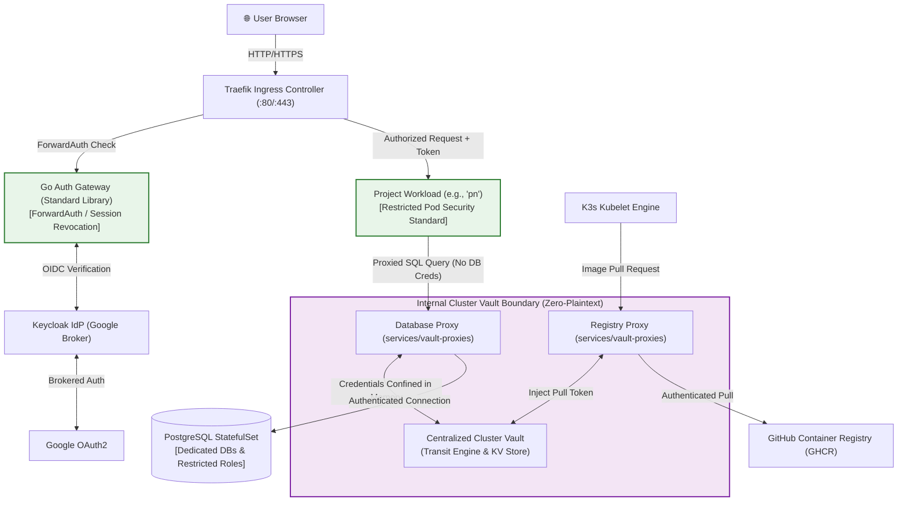

# nacfson_pipeline: Personal Project Platform

[](.specify/memory/constitution.md)
[](specs/)
[](.specify/memory/constitution.md)
[](specs/002-internal-cluster-vault/spec.md)

A secure, multi-tenant Kubernetes platform for running personal projects on modest compute resources (single Oracle Cloud Always Free VPS running native K3s, with portability to local Linux K3s, EKS, and GKE). 

The platform guarantees **shared Google-backed Single Sign-On (SSO)**, **strict workload isolation via Kubernetes Restricted Pod Security Standards**, **deterministic 1/n QoS resource budgeting**, **persistent tenant-isolated PostgreSQL**, and a **zero-plaintext self-hosted internal cluster Vault**.

---

## 1. Documentation Architecture & Markdown Structure

To maintain consistency across human engineers and AI coding agents, this repository enforces a **4-tier Markdown Documentation Architecture** based on the Diátaxis framework and Spec-Driven Engineering:

```
nacfson_pipeline/
├── README.md                                    # Tier 2: Master System Portal & Index
├── SPEC.md                                      # Tier 2: Initial Platform Specification Baseline
├── TROUBLESHOOTING.md                           # Tier 4: Incident Runbook (CPU budget, OpenBao, GHCR pulls, OAuth callback)
├── .specify/memory/constitution.md              # Tier 1: Authoritative Invariants & Governance Rules
│
├── specs/                                       # Tier 3: Feature Specifications (SpecKit Packages 001..012)
│   ├── 001-project-platform/                    #   ├── Ingress, Auth Gateway & Workload Sandboxing
│   ├── 002-internal-cluster-vault/              #   ├── Zero-Plaintext OpenBao Vault & Proxies
│   ├── 003-minimal-vm-bootstrap/                #   ├── Host OS, Networking & K3s Bootstrap
│   ├── 004-flux-gitops-reconciliation/          #   ├── 14-Layer FluxCD GitOps & Preflight Gate
│   ├── 005-post-vault-automation/               #   ├── Post-Unseal Workload Wiring
│   ├── 006-separate-project-auth/               #   ├── Project Door vs Shared Sign-In
│   ├── 007-pn-readiness-restart/                #   ├── Separate Startup/Readiness/Liveness Probes & CORS
│   ├── 008-platform-tls-termination/            #   ├── Platform-Owned Edge TLS
│   ├── 009-host-scoped-shared-auth/             #   ├── Host-Scoped Cookies & Direct OIDC
│   ├── 010-cilium-hubble-observability/         #   ├── Cilium eBPF CNI & Hubble Observability
│   ├── 011-project-log-contract/                #   ├── Fluent Bit, VictoriaLogs & Error Detector
│   └── 012-gke-platform-migration/              #   └── Multi-Node GKE Portability & Cloud KMS Unseal
│
├── contracts/                                   # Tier 2: Canonical Preflight-Enforced Contracts (CONTRACT_*.md)
│
└── docs/                                        # Tier 4: Operations, Guides & Visual Explanations
    ├── platform-architecture.html               #   ├── Canonical Interactive Architecture Handbook (Hook-Synced)
    ├── operations-runbook.md                    #   ├── Production deployment sequence & incident triage
    ├── spec002-vault-guide.md                   #   ├── Internal Cluster Vault concepts & rotation lifecycle
    ├── bootstrap-scope.md                       #   ├── Ansible VM bootstrap prerequisites and boundaries
    └── ghcr-token-lifecycle.html                #   └── Interactive visual diagram of GHCR token lifecycle
```

### Documentation Tiers & Governing Rules

| Tier | Category | Scope & Purpose | Precedence & Rules |
| :--- | :--- | :--- | :--- |
| **Tier 1** | **Constitution & Invariants** | Immutable architectural laws, security boundaries, and QoS invariants. | **Supreme Authority**: Any manifest, spec, or code change that contradicts [`.specify/memory/constitution.md`](.specify/memory/constitution.md) MUST fail review. |
| **Tier 2** | **System Architecture & Navigation** | Global mental model, canonical contracts, and master index. | High-level system orientation ([`README.md`](README.md), [`INDEX.md`](INDEX.md), [`ARCHITECTURE.md`](ARCHITECTURE.md), [`contracts/README.md`](contracts/README.md), and [`SPEC.md`](SPEC.md)). |
| **Tier 3** | **Feature Specifications (`specs/`)** | SpecKit packages detailing user stories, contracts, and execution tasks. | Formal contract: `spec.md` specifies *what* (requirements), `plan.md` specifies *how* (architecture), `contracts/` specifies *protocols*, `tasks.md` tracks *execution*. |
| **Tier 4** | **Operations & Runbooks (`docs/`)** | Day-2 operations, disaster recovery drills, and procedural runbooks. | Practical guidance for human operators executing deployment scripts and incident triage. |

---

## 2. Constitutional Invariants & Non-Negotiable Constraints

All platform components and project workloads strictly adhere to the 7 principles ratified in [`.specify/memory/constitution.md`](.specify/memory/constitution.md):

* **[Principle I: Declarative Phased GitOps](.specify/memory/constitution.md)**: Git is the single source of truth. Continuous reconciliation via 14-layer Flux GitOps controllers with automated drift detection and correction. Images MUST use immutable `@sha256:...` digests (projects) or pinned exact version tags (infrastructure).
* **[Principle II: Workload Isolation & Restricted Pod Security](.specify/memory/constitution.md)**: Project namespaces MUST enforce the Kubernetes `Restricted` Pod Security profile (audit/warn modes strictly prohibited). Containers run non-root, drop all capabilities (allowing at most `NET_BIND_SERVICE`), and use dedicated platform ServiceAccounts with auto-token-mount disabled. Project services are `ClusterIP` only.
* **[Principle III: Defense-in-Depth Identity & Standard-Library Gateway](.specify/memory/constitution.md)**: Ingress exposes only public browser-facing login/callback routes and current-session revocation. Keycloak admin, metrics (port 9000), and internal JWKS are strictly private. The Authentication Gateway is written in pure standard-library Go with **zero runtime third-party dependencies** and fails closed (HTTP 503).
* **[Principle IV: Bounded 1/n Resource Budgeting](.specify/memory/constitution.md)**: Containers MUST enforce strict `requests == limits`. Compute is sliced equally across projects ($1/n$). Candidate deployments exceeding budgets or lowering existing memory limits during the interim freeze are rejected by the platform-preflight CI gate ([`scripts/platform-preflight.py`](scripts/platform-preflight.py)).
* **[Principle V: Zero Plaintext Secrets & Centralized Cluster Vault](.specify/memory/constitution.md)**: Plaintext secrets are NEVER committed to Git, embedded in Helm/Kustomize, or delivered to application pods via Kubernetes Secrets or volume mounts (with the sole constitutional exception of platform-owned edge TLS Secrets in `platform` and ACME account keys in `cert-manager`). Applications invoke authorized operations via internal Vault Proxies (`ai-proxy`, `db-proxy`, `notify-proxy`, `registry-proxy`), receiving sanitized results without ever holding backend credentials.
* **[Principle VI: Environmental Portability](.specify/memory/constitution.md)**: Zero application code changes across single-VPS K3s, local Linux K3s, AWS EKS, and GCP GKE.
* **[Principle VII: Distinct Lifecycle Signals for Dependent Project Workloads](.specify/memory/constitution.md)**: Dependent project workloads separate `startupProbe` (initial cluster dependency hop), `readinessProbe` (continuous cluster hop / disconnect signal), and `livenessProbe` (process-local only), declare `restartPolicy: Always`, and include `PUBLIC_APP_URL` in backend `ALLOWED_ORIGINS`.

---

## 3. System Architecture & Topology

The platform coordinates ingress traffic, identity negotiation, credential isolation, and persistent storage on a single host node:



### 3.1 Domain-Based Project Naming & Identity Rule

All hosted projects and authentication handoffs MUST derive project names, return hosts, and OAuth/JWT audiences deterministically from the **configured public domain under the platform's main domain** (`nacfson.cloud` in `vps-k3s`, `example.com` in `local-k3s`), and **NEVER** from internal Kubernetes service hostnames (`pn-backend`, `pn-backend.proj-pn.svc:8080`, or `gateway.identity.svc:8080`):

| Identifier | Naming Rule | Production (`vps-k3s`) Example | Local (`local-k3s`) Example |
| :--- | :--- | :--- | :--- |
| **Main Platform Domain** | `<main-domain>` | `nacfson.cloud` | `example.com` |
| **Central Auth Domain** | `auth.<main-domain>` | `auth.nacfson.cloud` | `auth.example.com` |
| **Canonical Issuer (`iss`)** | `https://auth.<main-domain>/realms/platform` | `https://auth.nacfson.cloud/realms/platform` | `https://auth.example.com/realms/platform` |
| **Project Public Host** | `<project-slug>.<main-domain>` | `pn.nacfson.cloud` | `pn.example.com` |
| **Project Origin (`PUBLIC_APP_URL`)** | `https://<project-slug>.<main-domain>` | `https://pn.nacfson.cloud` | `https://pn.example.com` |
| **Gateway Host Header (`X-Forwarded-Host`)** | Must equal the hostname of `PUBLIC_APP_URL` (`<project-slug>.<main-domain>`) | `pn.nacfson.cloud` | `pn.example.com` |
| **Project Audience (`aud` / `X-Project-Audience`)** | `project-<project-slug>` (first label of `<project-slug>.<main-domain>`) | `project-pn` | `project-pn` |

> **Non-Negotiable Rule**: Project backends calling `http://gateway.identity.svc:8080/auth/exchange` or `http://gateway.identity.svc:8080/auth` MUST resolve their effective host from their configured `PUBLIC_APP_URL` (`<project-slug>.<main-domain>`) rather than raw `r.Host` headers. Using an internal service name (such as `pn-backend`) produces `project-pn-backend` instead of `project-pn` and causes session confirmation to fail. See [`TROUBLESHOOTING.md`](TROUBLESHOOTING.md) §10 for full details.

---

## 4. Master Specification & Contract Index

All features follow the SpecKit methodology. See [`INDEX.md`](INDEX.md#3-feature-specifications-specs) for the full `001`–`012` catalog and [`contracts/README.md`](contracts/README.md) for the consolidated preflight-enforced contracts (`CONTRACT_*.md`). Core baseline phases:

### Phase 0: Infrastructure & Host Provisioning
* **Feature Package**: [`specs/003-minimal-vm-bootstrap/`](specs/003-minimal-vm-bootstrap/)
* **Specification**: [`specs/003-minimal-vm-bootstrap/spec.md`](specs/003-minimal-vm-bootstrap/spec.md) | **Plan**: [`specs/003-minimal-vm-bootstrap/plan.md`](specs/003-minimal-vm-bootstrap/plan.md) | **Tasks**: [`specs/003-minimal-vm-bootstrap/tasks.md`](specs/003-minimal-vm-bootstrap/tasks.md)
* **Contracts**:
  * [`contracts/bootstrap.md`](specs/003-minimal-vm-bootstrap/contracts/bootstrap.md) — Ansible playbook specification for VM preparation and K3s installation.
* **Scope Guide**: [`docs/bootstrap-scope.md`](docs/bootstrap-scope.md)

### Phase 1: Core Platform & Workload Sandboxing
* **Feature Package**: [`specs/001-project-platform/`](specs/001-project-platform/)
* **Specification**: [`specs/001-project-platform/spec.md`](specs/001-project-platform/spec.md) | **Plan**: [`specs/001-project-platform/plan.md`](specs/001-project-platform/plan.md) | **Tasks**: [`specs/001-project-platform/tasks.md`](specs/001-project-platform/tasks.md)
* **Contracts**:
  * [`contracts/gateway-forwardauth.md`](specs/001-project-platform/contracts/gateway-forwardauth.md) — ForwardAuth protocol between Traefik and Go Gateway.
  * [`contracts/session-revocation.md`](specs/001-project-platform/contracts/session-revocation.md) — Real-time CSRF-protected session revocation across active projects.
* **Runbook**: [`docs/operations-runbook.md`](docs/operations-runbook.md)

### Phase 2: Zero-Plaintext Internal Cluster Vault
* **Feature Package**: [`specs/002-internal-cluster-vault/`](specs/002-internal-cluster-vault/)
* **Specification**: [`specs/002-internal-cluster-vault/spec.md`](specs/002-internal-cluster-vault/spec.md) | **Plan**: [`specs/002-internal-cluster-vault/plan.md`](specs/002-internal-cluster-vault/plan.md) | **Tasks**: [`specs/002-internal-cluster-vault/tasks.md`](specs/002-internal-cluster-vault/tasks.md)
* **Contracts**:
  * [`contracts/database-proxy.md`](specs/002-internal-cluster-vault/contracts/database-proxy.md) — Query proxy isolating PostgreSQL credentials from applications.
  * [`contracts/registry-proxy.md`](specs/002-internal-cluster-vault/contracts/registry-proxy.md) — Image pull proxy isolating GHCR tokens from worker nodes.
  * [`contracts/database-provisioning-backup.md`](specs/002-internal-cluster-vault/contracts/database-provisioning-backup.md) — Automated database provisioning and snapshot verification.
  * [`contracts/google-oauth-broker.md`](specs/002-internal-cluster-vault/contracts/google-oauth-broker.md) — Keycloak broker client secret injection without plaintext leaks.
  * [`contracts/transit-signing.md`](specs/002-internal-cluster-vault/contracts/transit-signing.md) — Asymmetric token signing via Vault Transit Engine.
* **Guide & Visualizer**: [`docs/spec002-vault-guide.md`](docs/spec002-vault-guide.md) | [`docs/ghcr-token-lifecycle.html`](docs/ghcr-token-lifecycle.html)

---

## 5. End-to-End Traceability Matrix

The table below maps constitutional requirements to contracts, code modules, and automated verification suites:

| Capability | Governing Contract | Implementation Path | Verification Harness | Constitutional Anchor |
| :--- | :--- | :--- | :--- | :--- |
| **Host K3s Bootstrap** | [`contracts/bootstrap.md`](specs/003-minimal-vm-bootstrap/contracts/bootstrap.md) | [`bootstrap/`](bootstrap/) | [`bootstrap/tasks/verify.yml`](bootstrap/tasks/verify.yml) | [Principle VI](.specify/memory/constitution.md) |
| **Authentication ForwardAuth** | [`contracts/gateway-forwardauth.md`](specs/001-project-platform/contracts/gateway-forwardauth.md) | [`gateway/`](gateway/) | [`gateway/tests/contract_test.go`](gateway/tests/contract_test.go) | [Principle III](.specify/memory/constitution.md) |
| **Online Session Revocation** | [`contracts/session-revocation.md`](specs/001-project-platform/contracts/session-revocation.md) | [`gateway/internal/auth/`](gateway/internal/auth/) | [`scripts/verify-revocation.sh`](scripts/verify-revocation.sh) | [Principle III](.specify/memory/constitution.md) |
| **Restricted Workload Sandboxing** | [`specs/001-project-platform/spec.md`](specs/001-project-platform/spec.md) | [`deploy/platform/governance/`](deploy/platform/governance/) | [`scripts/verify-isolation.sh`](scripts/verify-isolation.sh) | [Principle II](.specify/memory/constitution.md) |
| **1/n Resource Budget Gating** | [`contracts/platform-preflight.md`](specs/004-flux-gitops-reconciliation/contracts/platform-preflight.md) | [`clusters/`](clusters/) | [`scripts/platform-preflight.py`](scripts/platform-preflight.py) | [Principle IV](.specify/memory/constitution.md) |
| **Zero-Plaintext DB Proxy** | [`contracts/database-proxy.md`](specs/002-internal-cluster-vault/contracts/database-proxy.md) | [`services/vault-proxies/`](services/vault-proxies/) | [`tests/vault/test_db_proxy.sh`](tests/vault/test_db_proxy.sh) | [Principle V](.specify/memory/constitution.md) |
| **Zero-Plaintext Registry Proxy** | [`contracts/registry-proxy.md`](specs/002-internal-cluster-vault/contracts/registry-proxy.md) | [`services/vault-proxies/`](services/vault-proxies/) | [`tests/vault/test_registry_proxy.sh`](tests/vault/test_registry_proxy.sh) | [Principle V](.specify/memory/constitution.md) |
| **Zero-Downtime Credential Rotation** | [`specs/002-internal-cluster-vault/spec.md`](specs/002-internal-cluster-vault/spec.md) | [`scripts/vault-rotate.sh`](scripts/vault-rotate.sh) | [`tests/vault/test_rotation_drill.sh`](tests/vault/test_rotation_drill.sh) | [Principle V](.specify/memory/constitution.md) |
| **Disaster Recovery & Backup Restore** | [`contracts/database-provisioning-backup.md`](specs/002-internal-cluster-vault/contracts/database-provisioning-backup.md) | [`scripts/verify-backup.sh`](scripts/verify-backup.sh) | [`tests/vault/test_disaster_recovery.sh`](tests/vault/test_disaster_recovery.sh) | [Quality Gates](.specify/memory/constitution.md) |

---

## 6. Repository Layout

```text
.
├── .agents/                   # Specialized agent skills, review prompts & hooks
├── .github/workflows/         # CI, GitOps, lint, secret-scan & review workflows
├── .specify/                  # SpecKit memory, constitution, templates & workflows
├── agy_plan/                  # Generated HTML implementation plans
├── bootstrap/                 # Ansible automation for Linux VM, K3s installation, and Flux reconciler
├── clusters/                  # Flux GitOps entrypoints and 14-layer declarations (local-k3s, vps-k3s)
├── config/                    # Image-pin source mappings and review risk policy
├── contracts/                 # Canonical preflight-enforced contracts (CONTRACT_*.md)
├── deploy/                    # Base platform and project workload manifests
│   ├── platform/              #   ├── cert-manager, cni, database, governance, identity, ingress, observability, tls, vault, vault-proxies
│   └── projects/              #   └── tenant projects (pn, health, blog)
├── docs/                      # Operations runbooks, conceptual guides & HTML architecture handbook
├── gateway/                   # Go standard-library authentication gateway service
├── services/                  # Cluster auxiliary services
│   └── vault-proxies/         #   └── Zero-plaintext ai-proxy, db-proxy, notify-proxy & registry-proxy
├── scripts/                   # Operator release, rotation, observability, and validation scripts
├── specs/                     # Formal SpecKit specifications (001 through 012)
└── tests/                     # Preflight, observability, skills, review-cycle, hooks & vault test suites
```

---

## 7. Operational Quickstart

Follow this deployment progression when bootstrapping a fresh environment:

### Step 1: Bootstrap the Host VM & Install Flux Reconciler (Spec 003 & 004)
Prepare the host, install pinned K3s, and deploy Flux GitOps controllers via Ansible:
```bash
ansible-playbook -i "<target-ip>," bootstrap/bootstrap.yml \
  -e ansible_user="ubuntu" \
  -e k3s_version="v1.35.9+k3s1" \
  -e gitops_environment="vps-k3s"
```

### Step 2: Automated GitOps Reconciliation & Vault Initialization (Spec 004 & 002)
Flux reconciles platform layers continuously. Unseal OpenBao once the `vault` layer is ready:
```bash
# 1. Inspect Flux reconciliation layers
flux get kustomizations -A

# 2. Initialize or unseal OpenBao
./scripts/vault-init.sh
./scripts/vault-seed-inventory.sh
./scripts/vault-reconcile.sh
```

### Step 3: Initialize Internal Vault & Proxies (Spec 002)
Initialize Vault storage, populate dummy/initial credentials, and reconcile policies:
```bash
./scripts/vault-init.sh
./scripts/vault-seed-inventory.sh
./scripts/vault-reconcile.sh
```

### Step 4: Execute Verification Drills
Run the end-to-end acceptance tests to ensure compliance with the Constitution:
```bash
# Verify Restricted Pod Security & NetworkPolicy isolation
./scripts/verify-isolation.sh

# Verify online session revocation
./scripts/verify-revocation.sh

# Execute zero-downtime secret rotation drills
./tests/vault/test_rotation_drill.sh

# Run full Vault integration matrix
./tests/vault/test_matrix_verification.sh
```
