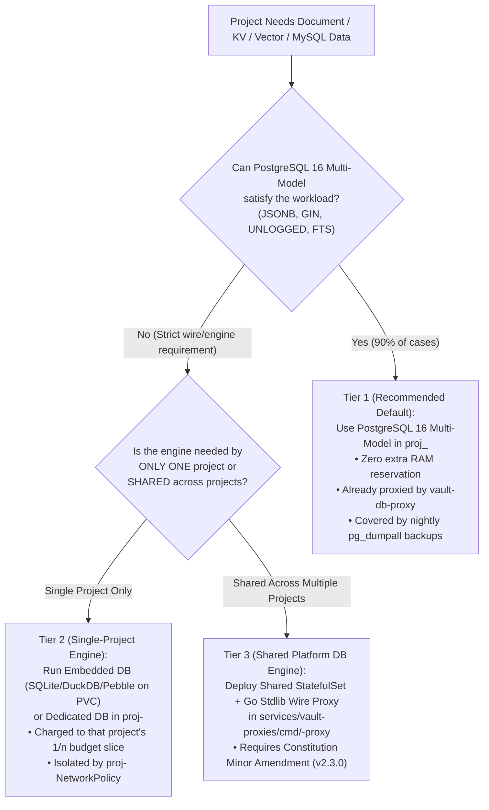

# CONTRACT_DATABASE: Standardized Project PostgreSQL, Wire Proxy & Multi-Model Persistence

**Status**: Enforced (`platform-preflight.py`, `vault-db-proxy`, `postgres-init-job`)  
**Governing Principles**: [Constitution Principles IV, V, VI, VII](../.specify/memory/constitution.md)  
**Platform Implementations**:
- Wire Proxy: [`services/vault-proxies/cmd/db-proxy/main.go`](../services/vault-proxies/cmd/db-proxy/main.go) & [`deploy/platform/vault-proxies/db-proxy.yaml`](../deploy/platform/vault-proxies/db-proxy.yaml)
- Shared PostgreSQL 16: [`deploy/platform/database/postgres-statefulset.yaml`](../deploy/platform/database/postgres-statefulset.yaml)
- Provisioning & Isolation: [`deploy/platform/database/postgres-init-job.yaml`](../deploy/platform/database/postgres-init-job.yaml)
- Nightly Backups: [`deploy/platform/database/backup-cronjob.yaml`](../deploy/platform/database/backup-cronjob.yaml)

---

## 1. Core Architectural Rule: Zero Custom Vault Code in Projects

Project repositories (such as `Project_PN` or any future tenant `proj-<slug>`) **MUST NOT** implement custom Vault/OpenBao clients, Kubernetes Secret mounts, or proprietary proxy protocols.
- Every project backend connects using a **standard off-the-shelf PostgreSQL client/ORM** (`pgx`, `database/sql`, Prisma, Drizzle, SQLAlchemy, TypeORM) reading `DATABASE_URL`.
- [`vault-db-proxy`](../services/vault-proxies/cmd/db-proxy/main.go) intercepts the PostgreSQL v3.0 wire handshake on `vault-db-proxy.vault.svc:5432`, validates the workload identity token, enforces tenant database isolation, and binds the upstream connection to the project's restricted PostgreSQL role.

---

## 2. Standardized Multi-Project Naming Convention

For any project with canonical slug `<slug>` (lowercase alphanumeric/underscore, e.g. `pn`, `blog`, `shop`):

| Resource | Standardized Identifier | Where Configured |
| :--- | :--- | :--- |
| **Kubernetes Namespace** | `proj-<slug>` (e.g. `proj-pn`) | `deploy/projects/<slug>/boundary/namespace.yaml` |
| **PostgreSQL Database** | `proj_<slug>` (e.g. `proj_pn`) | [`postgres-init-job.yaml`](../deploy/platform/database/postgres-init-job.yaml) (`PROJECT_SLUGS`) |
| **PostgreSQL Restricted Role** | `user_<slug>` (e.g. `user_pn`) | [`postgres-init-job.yaml`](../deploy/platform/database/postgres-init-job.yaml) (`PROJECT_SLUGS`) |
| **OpenBao Secret Path** | `kv/database/<slug>-user` | [`scripts/vault-seed-inventory.sh`](../scripts/vault-seed-inventory.sh) |
| **Workload Caller Identity** | `project:<slug>:workload:<component>` (e.g. `project:pn:workload:backend`) | Project Deployment `DB_USER` / `DB_TOKEN` / `DATABASE_URL` |
| **Proxy Registration** | `<slug>` in `ALLOWED_PROJECTS` | [`deploy/platform/vault-proxies/db-proxy.yaml`](../deploy/platform/vault-proxies/db-proxy.yaml) |

---

## 3. Required Project Container Environment Contract

Every database-backed project Deployment (`deploy/projects/<slug>/workloads/backend-deployment.yaml`) MUST declare:

```yaml
env:
  - name: DATABASE_URL
    value: "postgres://project%3A<slug>%3Aworkload%3Abackend:project%3A<slug>%3Aworkload%3Abackend@vault-db-proxy.vault.svc:5432/proj_<slug>?sslmode=disable"
  - name: DB_HOST
    value: "vault-db-proxy.vault.svc"
  - name: DB_PORT
    value: "5432"
  - name: DB_NAME
    value: "proj_<slug>"
  - name: DB_USER
    value: "project:<slug>:workload:backend"
  - name: DB_TOKEN
    value: "project:<slug>:workload:backend"
  - name: MIGRATIONS_PATH
    value: "file:///app/db/migrations"
```

### Preflight Enforcement ([`scripts/platform-preflight.py`](../scripts/platform-preflight.py))
`check_database_and_readiness_contract` rejects any candidate revision where a project container:
1. Sets `DB_HOST` to anything other than `vault-db-proxy.vault.svc` (direct connections to `postgres-service.identity.svc` are prohibited).
2. Sets `DB_NAME` to anything other than `proj_<slug>` (e.g., `keycloak` or another project's database).
3. Sets `DB_USER` without prefix `project:<slug>:workload:`.
4. Declares database environment variables without setting `readinessProbe.httpGet.path: /readyz` and `livenessProbe.httpGet.path: /healthz` (see [`CONTRACT_PROBES_READINESS.md`](CONTRACT_PROBES_READINESS.md)).

---

## 4. Standardized Project Backend Code Pattern (Drop-In Reference)

To guarantee portability between local development (`localhost:5432`) and Kubernetes (`vault-db-proxy.vault.svc:5432`), every project backend should implement the following 3-part database module:

### 4.1 Go (`database/sql` / `pgx`) Reference
```go
package db

import (
	"context"
	"database/sql"
	"fmt"
	"net/http"
	"os"
	"time"
)

func OpenFromEnv() (*sql.DB, error) {
	dsn := os.Getenv("DATABASE_URL")
	if dsn == "" {
		return nil, fmt.Errorf("DATABASE_URL is required")
	}
	pool, err := sql.Open("pgx", dsn)
	if err != nil {
		return nil, err
	}
	// Modest connection pool sizing for 1/n single-VPS slice
	pool.SetMaxOpenConns(10)
	pool.SetMaxIdleConns(5)
	pool.SetConnMaxLifetime(5 * time.Minute)
	return pool, nil
}

// RegisterHealthHandlers wires process-local /healthz and DB-verified /readyz
// per CONTRACT_PROBES_READINESS.md.
func RegisterHealthHandlers(mux *http.ServeMux, pool *sql.DB) {
	// Liveness (/healthz): MUST NOT query the database (prevents restart storms)
	mux.HandleFunc("/healthz", func(w http.ResponseWriter, r *http.Request) {
		w.WriteHeader(http.StatusOK)
		_, _ = w.Write([]byte("OK"))
	})

	// Readiness (/readyz): MUST verify end-to-end Backend -> vault-db-proxy -> proj_<slug> hop
	mux.HandleFunc("/readyz", func(w http.ResponseWriter, r *http.Request) {
		ctx, cancel := context.WithTimeout(r.Context(), 2*time.Second)
		defer cancel()
		if err := pool.PingContext(ctx); err != nil {
			http.Error(w, "database not ready", http.StatusServiceUnavailable)
			return
		}
		w.WriteHeader(http.StatusOK)
		_, _ = w.Write([]byte("READY"))
	})
}
```

### 4.2 Python (FastAPI / SQLAlchemy) & Node.js (TypeScript / `pg`) Equivalent Rules
- **Connection Pool**: Max `5–10` connections per replica (`max: 10` in `pg.Pool` or `pool_size=5, max_overflow=5` in SQLAlchemy).
- **`GET /healthz`**: Immediate `200 OK` without touching the connection pool.
- **`GET /readyz`**: Execute `SELECT 1` with a `2000ms` timeout; return `200 OK` on success or `503 Service Unavailable` on error.

---

## 5. Wire-Level Error & Revocation Codes (`vault-db-proxy`)

| SQLSTATE | Trigger Condition | Meaning & Operational Effect |
| :--- | :--- | :--- |
| `28000` | Invalid, expired, or revoked caller token (`/admin/revoke`) | Connection rejected at handshake or active TCP stream dropped within `100ms`. |
| `42501` | Unregistered project slug or `requestedDB != proj_<slug>` | Cross-tenant or `keycloak` access blocked before reaching PostgreSQL. |
| `08006` | `postgres-service.identity.svc:5432` unreachable | Upstream unavailable; `vault-db-proxy` `/readyz` and backend `/readyz` transition to `503` (`NotReady`). |
| `28P01` | Upstream role authentication failure | Credential mismatch between OpenBao and `postgres-init-job`; run `kubectl rollout restart job/postgres-init-job -n identity` under break-glass. |

---

## 6. Standardized Pipeline Dump Import & Export (`scripts/db-migrate-dump.sh`)

In Kubernetes GitOps (`FluxCD`), **Schema Migrations (DDL)** and **Data Dump Restores (DML / State)** are strictly separated:
1. **Schema Migrations (Continuous / Automated)**: Idempotent SQL migrations (`db/migrations/*.sql`) run automatically on backend startup from `MIGRATIONS_PATH`.
2. **Data Dump Imports (On-Demand 5-Stage Pipeline Command)**: Full or data-only dumps (`.dump`, `.dump.gz`, `.sql`, `.sql.gz`, `.tar.gz`) are **never** reconciled continuously by Flux (which would overwrite live data on every sync) and **never** committed to Git. Instead, use the project-agnostic pipeline script [`scripts/db-migrate-dump.sh`](../scripts/db-migrate-dump.sh), which executes a 5-stage zero-plaintext workflow over `kubectl exec -i` without exposing `PGPASSWORD` on the workstation:

```bash
# 1. Import a local dump (.dump, .dump.gz, .sql, .sql.gz, .tar.gz) into proj_<slug>:
./scripts/db-migrate-dump.sh --project pn --file /path/to/dump.dump.gz --mode full --yes

# 2. Import data-only into an already-migrated schema:
./scripts/db-migrate-dump.sh --project pn --file /path/to/dump.dump.gz --mode data --yes

# 3. Export proj_<slug> from the cluster to a local custom dump (.dump.gz + .sha256):
./scripts/db-migrate-dump.sh --project pn --export /tmp/proj_pn_backup.dump.gz
```

### What `scripts/db-migrate-dump.sh` Automates:
1. **Stage 1 — Pre-Flight Archive & Checksum Validation**: Verifies any `.sha256` sidecar, extracts `.gz`/`.tar.gz` in an ephemeral workdir, and auto-detects PostgreSQL custom format (`PGDMP` magic header) vs. plain SQL.
2. **Stage 2 — Automatic Pre-Migration Safety Snapshot**: Streams a pre-restore backup inside `postgres-0` (`/tmp/pre_migrate_proj_<slug>_<timestamp>.dump.gz`) before mutating the database.
3. **Stage 3 — Connection Quiesce & Streamed Restore**: Terminates active `proj_<slug>` connections (in `full` mode) and streams `pg_restore` or `psql` directly over `stdin` (`kubectl exec -i`) as `-U user_<slug> -d proj_<slug>`.
4. **Stage 4 — Role Ownership Normalization**: Runs `REASSIGN OWNED` and `GRANT ALL PRIVILEGES` to `user_<slug>` so `vault-db-proxy` connections never hit `42501 permission denied`.
5. **Stage 5 — Post-Restore Verification**: Lists restored tables under `user_<slug>`.

---

## 7. Multi-Model & Alternative Database Architecture (MySQL / NoSQL Decision Matrix)

When a project considers a non-relational (NoSQL/Document/Key-Value) or MySQL data model on `nacfson_pipeline`, follow this **3-Tier Decision Hierarchy** to respect the $1/n$ resource budget ([`CONTRACT_ISOLATION_BUDGET.md`](CONTRACT_ISOLATION_BUDGET.md)) and Zero-Plaintext Vault rules ([Constitution Principle V](../.specify/memory/constitution.md#L19-L21)):



### Tier 1 (Recommended Default): PostgreSQL 16 as a NoSQL / Document / KV Engine
On a 4-vCPU / 24-GiB single-VPS node, running a separate MongoDB (`~700MiB` idle), MySQL (`~450MiB` idle), or Redis (`~128MiB`) instance consumes memory that would otherwise go to project slices. PostgreSQL 16 natively provides:
- **Document / NoSQL Store**: `JSONB` columns with `GIN` indexes (`CREATE INDEX ON items USING gin (payload jsonb_path_ops)`), supporting schema-less JSON queries, containment (`@>`), and JSONPath at comparable or higher speed than MongoDB.
- **High-Speed Key-Value / Cache**: `UNLOGGED TABLE` (skips WAL write overhead for ephemeral cache/queue state) with TTL cleanup via indexed `expires_at` timestamps.
- **Full-Text & Vector Search**: Native `tsvector` / `GIN` full-text search.
- **Benefit**: Zero extra platform RAM, zero new proxies, automatic [`vault-db-proxy`](../services/vault-proxies/cmd/db-proxy/main.go) enforcement, and automatic nightly [`backup-cronjob.yaml`](../deploy/platform/database/backup-cronjob.yaml) coverage.

### Tier 2 (Single-Project Specific Engine): Embedded or Project-Namespace DB within $1/n$ Slice
If a single project strictly requires a non-PostgreSQL engine (e.g., an existing MySQL codebase or an embedded NoSQL store):
1. **Option 2A — Embedded Engine on a Project PVC (Preferred for SQLite / DuckDB / BadgerDB / LevelDB)**:
   - Mount a `ReadWriteOnce` PVC (`kustomize.toolkit.fluxcd.io/prune: disabled`) into the backend pod in `proj-<slug>`.
   - Zero network credentials, zero proxy needed, and minimal memory footprint.
2. **Option 2B — Dedicated Engine inside `proj-<slug>`**:
   - Run the engine inside `proj-<slug>` so its Guaranteed QoS (`requests == limits`) is accounted against **that project's own $1/n$ budget slice**, without shrinking other projects' slices.
   - Because [Constitution Principle V](../.specify/memory/constitution.md#L19-L21) forbids Kubernetes `Secret` objects for backend credentials, authenticate via a pod-local Unix domain socket (`emptyDir` shared between app container and sidecar DB container) or via a Vault proxy.

### Tier 3 (Shared Multi-Tenant Engine): Platform StatefulSet + Go Stdlib Wire Proxy
If multiple projects require a shared MySQL, MongoDB, or Redis cluster:
1. **Constitution Minor Amendment (`2.3.0`)**: Amend Principle V to register the secondary shared engine and account for its fixed CPU/memory in `platformReservations`.
2. **Go Stdlib Wire Proxy (`services/vault-proxies/cmd/<engine>-proxy`)**: Following the exact pattern of [`services/vault-proxies/cmd/db-proxy/main.go`](../services/vault-proxies/cmd/db-proxy/main.go), implement a zero-dependency Go `1.22` proxy speaking the upstream wire protocol (e.g., MySQL v10 handshake or Redis RESP `HELLO`/`AUTH`) that maps `project:<slug>:workload:backend` to restricted upstream credentials stored in OpenBao (`kv/<engine>/<slug>-user`) and exposes `/healthz` + `/readyz`.
