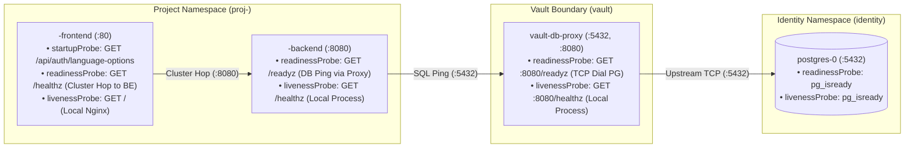

# CONTRACT_PROBES_READINESS: Startup, Readiness (`/readyz`), Liveness (`/healthz`) & Browser CORS

**Status**: Enforced (`platform-preflight.py`, `probe-matrix.md`, `db-proxy.yaml`)  
**Governing Principles**: [Constitution Principle VII (Amendment 2.1.0)](../.specify/memory/constitution.md#L28-L32)  
**Related Specs**: [`specs/007-pn-readiness-restart/`](../specs/007-pn-readiness-restart/) & [`CONTRACT_DATABASE.md`](CONTRACT_DATABASE.md)

---

## 1. End-to-End Probe Topology (Frontend → Backend → `vault-db-proxy` → PostgreSQL)

Every layer in the request and data path separates **process aliveness (`livenessProbe`)** from **dependency reachability (`readinessProbe`)** so that a downstream outage withholds traffic (`Ready=False`) without triggering cascading container restart storms (`CrashLoopBackOff`).

---

## 2. Canonical Probe Matrix Across All Workloads

| Workload | Namespace | Probe Role | Mechanism | Path / Cmd | Port | Pass Means | Fail Effect |
| :--- | :--- | :--- | :--- | :--- | :--- | :--- | :--- |
| **`<slug>-frontend`** | `proj-<slug>` | `startupProbe` | `httpGet` | `/api/auth/language-options` *(or public DB-free `/api/...` route)* | `80` | Frontend Nginx `/api/` proxy reached backend at least once | Keep Starting (up to 180s window); restart if exhausted |
| **`<slug>-frontend`** | `proj-<slug>` | `readinessProbe` | `httpGet` | `/healthz` | `80` | Continuous FE→BE cluster hop is connected (disconnect signal clear) | `Ready=False` (removed from Service endpoints; **no container restart**) |
| **`<slug>-frontend`** | `proj-<slug>` | `livenessProbe` | `httpGet` | `/` | `80` | Local Nginx process is alive | Container killed & restarted |
| **`<slug>-backend`** | `proj-<slug>` | `readinessProbe` | `httpGet` | `/readyz` | `8080` | End-to-end DB hop (`BE → vault-db-proxy → proj_<slug>`) is healthy | `Ready=False` (withholds API traffic; **no container restart**) |
| **`<slug>-backend`** | `proj-<slug>` | `livenessProbe` | `httpGet` | `/healthz` | `8080` | Local backend HTTP server is alive (**MUST NOT query DB**) | Container killed & restarted |
| **`vault-db-proxy`** | `vault` | `readinessProbe` | `httpGet` | `/readyz` | `8080` | Proxy can establish TCP connection to `postgres-service.identity.svc:5432` | `Ready=False` (withholds proxy endpoints; **no container restart**) |
| **`vault-db-proxy`** | `vault` | `livenessProbe` | `httpGet` | `/healthz` | `8080` | Local Go proxy process is alive | Container killed & restarted |
| **`vault-ai-proxy`** | `vault` | `startupProbe` | `httpGet` | `/startupz` | `8080` | 5-point live Kill-Switch & vulnerability self-audit passed (`127.0.0.1:8081` loopback, `:8080` route isolation, caller auth block, `__selftest__` RAM flip, OpenBao sync) | Quarantines pod (`Ready=False`) and halts Flux rollout |
| **`vault-ai-proxy`** | `vault` | `readinessProbe` | `httpGet` | `/readyz` | `8080` | Startup self-audit passed and `127.0.0.1:8081` loopback listener is healthy | `Ready=False` (withholds proxy endpoints; **no container restart**) |
| **`vault-ai-proxy`** | `vault` | `livenessProbe` | `httpGet` | `/healthz` | `8080` | Local Go proxy process is alive (process-local only) | Container killed & restarted |

---

## 3. Non-Negotiable Probe & Restart Invariants

1. **Database-Backed Backend Readiness (`/readyz`)**:
   - Any project container declaring `DATABASE_URL`, `DB_HOST`, `DB_NAME`, or `DB_USER` MUST declare `readinessProbe.httpGet.path: /readyz` and `livenessProbe.httpGet.path: /healthz`.
   - Enforced statically by `check_database_and_readiness_contract` in [`scripts/platform-preflight.py`](../scripts/platform-preflight.py).
   - Inside the backend application, `GET /readyz` MUST verify live connectivity through `vault-db-proxy.vault.svc:5432` (`SELECT 1` / `db.PingContext` with a `≤2s` timeout).
2. **`vault-db-proxy` Readiness (`/readyz`)**:
   - [`deploy/platform/vault-proxies/db-proxy.yaml`](../deploy/platform/vault-proxies/db-proxy.yaml) MUST set `readinessProbe.httpGet.path: /readyz` and `livenessProbe.httpGet.path: /healthz`.
   - Enforced statically by `check_database_and_readiness_contract` in [`scripts/platform-preflight.py`](../scripts/platform-preflight.py) and tested in [`services/vault-proxies/cmd/db-proxy/main_test.go`](../services/vault-proxies/cmd/db-proxy/main_test.go).
3. **Liveness Isolation Rule**:
   - `GET /healthz` on any frontend, backend, or proxy container MUST NEVER query PostgreSQL, OpenBao, Keycloak, or a peer service.
4. **Explicit Always-Restart Policy**:
   - Every always-on project `Deployment` (`frontend` and `backend`) MUST explicitly set `spec.template.spec.restartPolicy: Always`.

---

## 4. Browser API Origin Allowlist (CORS Contract)

Passing cluster-hop `readinessProbe` checks does **not** prove a browser SPA can call `/api` if CORS blocks preflight requests (`Cache-Control`, `Pragma`, `Authorization`, credentials):

1. Every public SPA project backend MUST declare `PUBLIC_APP_URL` and `ALLOWED_ORIGINS` in [`deploy/projects/<slug>/workloads/backend-deployment.yaml`](../deploy/projects/pn/workloads/backend-deployment.yaml).
2. Each environment overlay ([`clusters/local-k3s/projects/proj-<slug>.yaml`](../clusters/local-k3s/projects/proj-pn.yaml) and [`clusters/vps-k3s/projects/proj-<slug>.yaml`](../clusters/vps-k3s/projects/proj-pn.yaml)) MUST patch `PUBLIC_APP_URL` and include that exact origin inside `ALLOWED_ORIGINS`.
