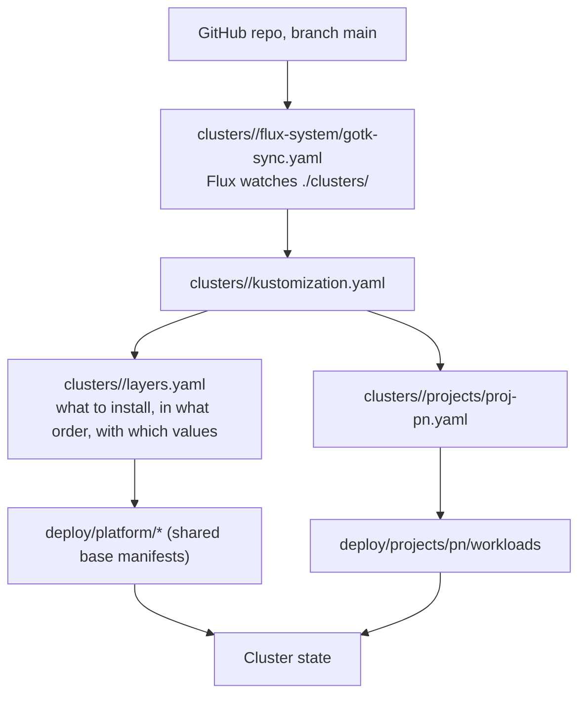
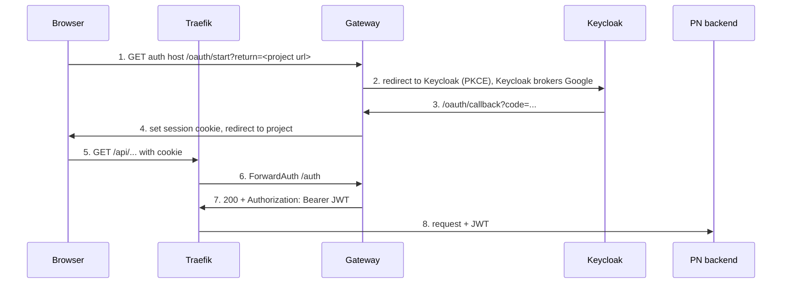

# Auth, Routing and GitOps Architecture

Status: **proposal, documented before implementation.** Sections 1-4 describe
how things work today. Section 5 is the change to make. Section 6 lists the
login fixes that depend on it.

## 1. How a change reaches the cluster



- `<cluster>` is `vps-k3s` (Oracle) or `local-k3s`.
- Flux has `prune: true`. Anything changed by hand with `kubectl` is reverted.
  Change Git, not the cluster.
- DNS records and the Oracle firewall are outside this repo and outside this chain.

## 2. File roles

| Location | Role |
|---|---|
| `deploy/platform/*` | Shared base manifests. They contain placeholder hosts (`*.example.com`). |
| `deploy/projects/pn/boundary` | pn namespace, network policies, quotas, RBAC |
| `deploy/projects/pn/workloads` | pn frontend and backend Deployments, Services, IngressRoute |
| `clusters/<cluster>/layers.yaml` | One Flux `Kustomization` per layer: path, `dependsOn` order, per-cluster patches |
| `clusters/<cluster>/projects/` | The Flux layer for each project |
| `gateway/` | Go source of the auth gateway |
| `.github/workflows/gitops.yaml` | CI render-validate before merge |

Layer order: `governance` -> `vault` -> `database` -> `identity` -> `ingress` -> `tls`;
`project-boundaries` -> `projects`.

## 3. Request path and auth components

| Component | Job |
|---|---|
| Traefik | Single entry point. Routes by host and path. Unmatched requests get 404. |
| Gateway (`gateway/`, namespace `identity`) | Login flow (`/oauth/start`, `/oauth/callback`), ForwardAuth check (`/auth`), logout (`/auth/logout`), JWKS pass-through. It never proxies app traffic. |
| Keycloak | Identity provider. Brokers Google sign-in, issues JWTs. |
| PN backend | Verifies the JWT again (signature, issuer, audience). |
| `forward-auth` middleware | Makes Traefik call the gateway's `/auth` before forwarding. 200 adds `Authorization`, `X-User-Subject`, `X-User-Issuer`. Anything else is returned to the browser unchanged. |
| `strip-forged-headers` middleware | Removes client-sent identity headers. |

Intended login flow:



## 4. Known problem: patches overwrite shared values

The base route in `deploy/platform/ingress/ingress-allowlist.yaml` allows
`/oauth/start` and `/oauth/callback`. The cluster patch in `layers.yaml` uses
`op: replace` on the whole `match` string, so it overwrites the base. The patch
was written before `/oauth/start` existed and kept only `/oauth/callback`.
Result: Traefik returns 404 for `/oauth/start` on the live cluster, and the
base file is correct but has no effect.

Rule that caused the bug: the cluster patch owned **both** the hostname and the
path list.

## 5. Change: cluster patches carry hostnames only

Ownership after the change:

| Information | Owner |
|---|---|
| Which paths are routed or allowed | Base manifest in `deploy/` (one copy for all clusters) |
| Which hostnames | `clusters/<cluster>/layers.yaml` (per cluster) |

Mechanism: Flux variable substitution.

```yaml
# deploy/platform/ingress/ingress-allowlist.yaml (base)
match: Host(`${AUTH_HOST}`) && (PathPrefix(`/oauth/start`) || PathPrefix(`/oauth/callback`))

# clusters/vps-k3s/layers.yaml, ingress layer
postBuild:
  substitute:
    AUTH_HOST: auth.nacfson.cloud
    PN_HOST: pn.nacfson.cloud
```

Rules for this change:
- Use `postBuild.substitute` only on layers whose manifests need it (`ingress`,
  pn `workloads`). Flux replaces every `${VAR}` it sees, and undefined names
  become empty. `deploy/platform/identity/gateway-deployment.yaml` contains shell
  `${VAULT_TOKEN}` and similar, so do not enable substitution on `identity`, or
  escape those as `$${VAR}`.
- Remove the `/spec/routes/N/match` replace patches for the same routes.
- Keep both clusters (`vps-k3s`, `local-k3s`) in step. Local uses `*.example.com`.
- Add a CI check that renders both clusters and fails if a rendered route is
  missing a path that the base lists.

## 6. Login fixes that follow

| # | Where | Change |
|---|---|---|
| A | `layers.yaml` (ingress) | Immediate fix, if section 5 is not done yet: `Host(...) && (PathPrefix(/oauth/start) \|\| PathPrefix(/oauth/callback))`. |
| B | `layers.yaml` (identity, gateway env) | Set `PROJECT_RETURN_HOSTS=pn.nacfson.cloud`. Unset now, defaults to `pn.example.com`, so `/oauth/start` would return 400. |
| C | pn `ingress-route.yaml` | Add `forward-auth` to `/api`. Add a protected `/login` route. Keep `/` public. Keep `/api/auth/language-options` public. |
| D | `gateway/` `/auth` | Return `302` to `/oauth/start?return=<url>` for browser navigations. Keep `401` JSON for API calls. Add tests. |
| E | Project_PN frontend | The sign-in button goes to `/login`, not `window.location.origin`. |

Verification after A and B: open
`https://auth.nacfson.cloud/oauth/start?return=https://pn.nacfson.cloud/` in a
browser. Expected: redirect to Keycloak and Google sign-in.

## 7. Open decisions

- Who starts the login redirect: gateway 302 (recommended, matches the spec) or
  the SPA calling `/oauth/start` directly.
- Whether to do section 5 before or after fixes A and B.
