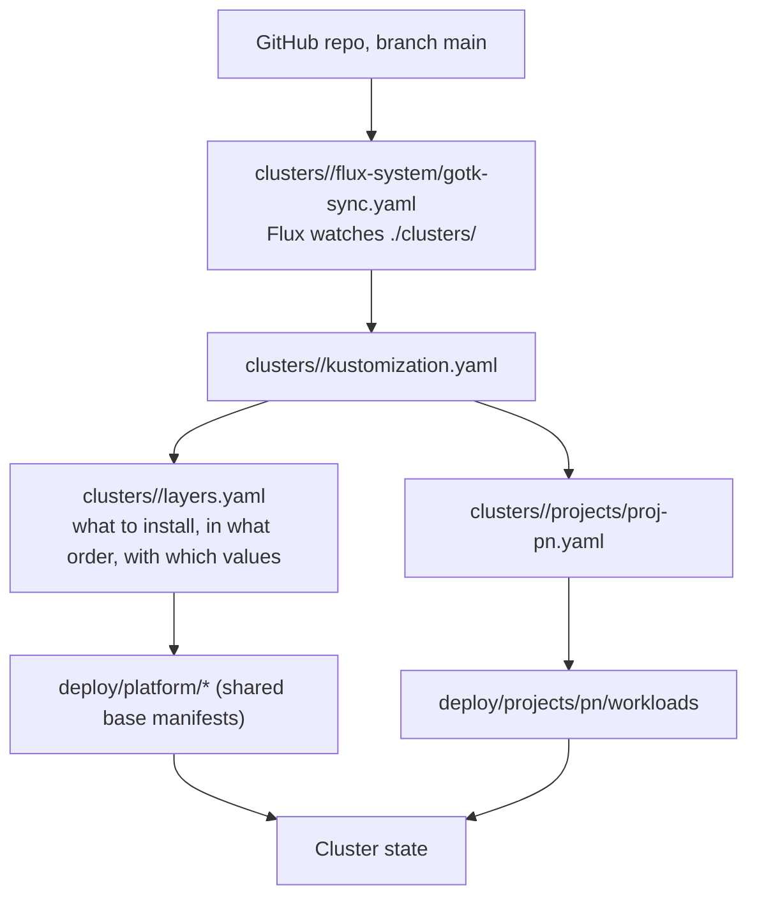
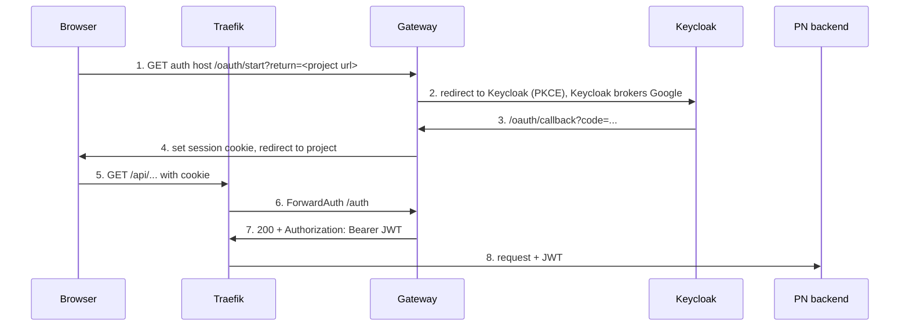

# Auth, Routing and GitOps Architecture

Status: sections 1-4 describe how things work. Section 5 is implemented (auth route
hostname substitution). Section 6 lists the remaining login fixes.

## 1. How a change reaches the cluster



- `<cluster>` is `vps-k3s` (Oracle) or `local-k3s`.
- Flux has `prune: true`. Anything changed by hand with `kubectl` is reverted.
  Change Git, not the cluster.
- DNS records and the Oracle firewall are outside this repo and outside this chain.

## 2. File roles

| Location | Role |
|---|---|
| `deploy/platform/*` | Shared base manifests. They contain placeholder hosts (`*.example.com`). |
| `deploy/projects/pn/boundary` | pn namespace, network policies, quotas, RBAC |
| `deploy/projects/pn/workloads` | pn frontend and backend Deployments, Services, IngressRoute |
| `clusters/<cluster>/layers.yaml` | One Flux `Kustomization` per layer: path, `dependsOn` order, per-cluster patches |
| `clusters/<cluster>/projects/` | The Flux layer for each project |
| `gateway/` | Go source of the auth gateway |
| `.github/workflows/gitops.yaml` | CI render-validate before merge |

Layer order: `governance` -> `vault` -> `database` -> `identity` -> `ingress` -> `tls`;
`project-boundaries` -> `projects`.

## 3. Request path and auth components

| Component | Job |
|---|---|
| Traefik | Single entry point. Routes by host and path. Unmatched requests get 404. |
| Gateway (`gateway/`, namespace `identity`) | Login flow (`/oauth/start`, `/oauth/callback`), ForwardAuth check (`/auth`), logout (`/auth/logout`), JWKS pass-through. It never proxies app traffic. |
| Keycloak | Identity provider. Brokers Google sign-in, issues JWTs. |
| PN backend | Verifies the JWT again (signature, issuer, audience). |
| `forward-auth` middleware | Makes Traefik call the gateway's `/auth` before forwarding. 200 adds `Authorization`, `X-User-Subject`, `X-User-Issuer`. Anything else is returned to the browser unchanged. |
| `strip-forged-headers` middleware | Removes client-sent identity headers. |

Intended login flow:



## 4. Known problem: patches overwrite shared values

The base route in `deploy/platform/ingress/ingress-allowlist.yaml` allows
`/oauth/start` and `/oauth/callback`. The cluster patch in `layers.yaml` uses
`op: replace` on the whole `match` string, so it overwrites the base. The patch
was written before `/oauth/start` existed and kept only `/oauth/callback`.
Result: Traefik returns 404 for `/oauth/start` on the live cluster, and the
base file is correct but has no effect.

Rule that caused the bug: the cluster patch owned **both** the hostname and the
path list.

## 5. Change: auth route paths live in one place (implemented)

Status line at the top of this file applies to section 6. This section is
implemented in the same change as spec 004 R3 amendment.

Ownership:

| Information | Owner |
|---|---|
| Which paths are routed or allowed | `deploy/platform/ingress/ingress-allowlist.yaml` (one copy for all clusters) |
| Which hostname | `clusters/<cluster>/layers.yaml`, `ingress` layer, `postBuild.substitute.AUTH_HOST` |

```yaml
# deploy/platform/ingress/ingress-allowlist.yaml (base)
match: Host(`${AUTH_HOST}`) && (PathPrefix(`/oauth/start`) || PathPrefix(`/oauth/callback`))

# clusters/vps-k3s/layers.yaml, ingress layer (local-k3s sets auth.example.com)
postBuild:
  substitute:
    AUTH_HOST: auth.nacfson.cloud
```

Why this is allowed although spec 004 R3 bans `postBuild`:
- The ban is a **project rule**, not a Kubernetes or Flux limit. It exists because Flux
  replaces every `${...}` in a layer, and other layers contain shell `${VAULT_TOKEN}`
  and Keycloak `${VAULT:...}` placeholders that were corrupted in a dry run.
- `deploy/platform/ingress/` contains no other `${`, so none of those cases apply.
  R3 now has a narrow amendment: only layer `ingress`, only `AUTH_HOST`.

Guard rails in `scripts/render-invariants.py`:
- Invariant 1: `postBuild` allowed only on `ingress`, only `substitute`, only `AUTH_HOST`, non-empty.
- Invariant 9: no rendered IngressRoute `match` with an unresolved `${` or an empty `Host()`.

Verified with `scripts/render-validate.sh` on both clusters, plus negative tests
(postBuild on `identity`, extra variable, empty `AUTH_HOST`, removed `postBuild`) that all fail.

Side effect: the old `local-k3s` patch allowed `/realms/platform/broker/google/endpoint`,
and the `vps-k3s` patch allowed `/realms/platform/broker/` (the base value). Local now
follows the base, so its broker path is `/realms/platform/broker/`.

Out of scope: `COOKIE_DOMAIN`, `PROJECT_RETURN_HOSTS`, `CENTRAL_AUTH_URL`, the pn
route hosts and the Keycloak realm JSON still use per-cluster patches.

## 6. Login fixes that follow

| # | Where | Change |
|---|---|---|
| A | `layers.yaml` / ingress base | Done (PR #34 and section 5): `/oauth/start` is routed. |
| B | `layers.yaml` (identity, gateway env) | Done in PR #34. Set `PROJECT_RETURN_HOSTS=pn.nacfson.cloud`. Unset now, defaults to `pn.example.com`, so `/oauth/start` would return 400. |
| C | pn `ingress-route.yaml` | Add `forward-auth` to `/api`. Add a protected `/login` route. Keep `/` public. Keep `/api/auth/language-options` public. |
| D | `gateway/` `/auth` | Return `302` to `/oauth/start?return=<url>` for browser navigations. Keep `401` JSON for API calls. Add tests. |
| E | Project_PN frontend | The sign-in button goes to `/login`, not `window.location.origin`. |

Verification after A and B: open
`https://auth.nacfson.cloud/oauth/start?return=https://pn.nacfson.cloud/` in a
browser. Expected: redirect to Keycloak and Google sign-in.

## 7. Open decisions

- Who starts the login redirect: gateway 302 (recommended, matches the spec) or
  the SPA calling `/oauth/start` directly.
