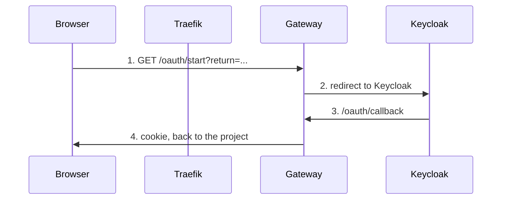

# FAQ: Points of Confusion in the Auth and GitOps Setup

Written from questions asked while debugging "Sign In does nothing" on
`pn.nacfson.cloud`. Companion to
[architecture-auth-routing.md](architecture-auth-routing.md).

## 1. What each component is

**Q: Is the gateway nginx?**
No. It is a small Go program in `gateway/` (about 1,150 lines, no third-party
libraries). It never forwards app traffic. It runs the login flow and answers
"is this user signed in?". The real nginx in this system runs inside the
`pn-frontend` pod, serves the SPA and proxies `/api/` to the backend.

**Q: Traefik vs gateway: which is the load balancer?**
Neither is "the" load balancer.

| | Traefik | Gateway |
|---|---|---|
| What | The cluster's single entry point (ingress controller) | A normal pod in namespace `identity` |
| Job | Decides where a request goes (host and path rules) | Decides who the user is and whether they are signed in |
| Balances load? | Yes, as a side effect of routing to a Service | No |

A Kubernetes **Service** (`pn-backend`) is what spreads traffic across pods.

**Q: What is `forward-auth`?**
A Traefik setting: "before forwarding this request, ask another service whether
it is allowed". Here Traefik calls the gateway at `/auth`.
- No valid session cookie: the gateway answers **401**. Traefik returns that 401
  to the browser unchanged. It does **not** turn it into a redirect.
- Valid session: the gateway answers 200 and adds `Authorization: Bearer <JWT>`,
  `X-User-Subject`, `X-User-Issuer`. Traefik copies them onto the request.

**Q: Why a gateway at all, and not Traefik or the app talking to Keycloak?**
Traefik cannot speak OIDC and Keycloak has no endpoint shaped like ForwardAuth.
The gateway translates once for all projects: login flow with PKCE, online
session check on every request, a token for the specific project (audience),
logout, fail-closed behaviour. Projects only verify a JWT.

**Q: Why not gRPC for this?**
Browsers cannot use it for the login redirect, Traefik ForwardAuth is HTTP-only,
and the per-request call is small. OIDC and JWT with JWKS are the portable
contract for any language or platform.

## 2. The files

**Q: What are `deploy/`, `clusters/` and `layers.yaml`?**

| Location | Role |
|---|---|
| `deploy/platform/*`, `deploy/projects/*` | Shared base manifests with placeholder hosts (`auth.example.com`) |
| `clusters/<cluster>/layers.yaml` | Per-cluster recipe: what to install, in what order (`dependsOn`), which values to patch |
| `clusters/<cluster>/flux-system/gotk-sync.yaml` | Tells Flux which repo and folder to watch |
| `.github/workflows/gitops.yaml` | CI checks that the rendered YAML is valid |

`<cluster>` is `vps-k3s` (Oracle) or `local-k3s`.

**Q: Is `layers.yaml` like DNS or a firewall?**
No.
- DNS (`pn.nacfson.cloud` to the public IP) lives at your DNS provider.
- The network firewall (ports 80/443) lives in Oracle Cloud and on the host.
- `layers.yaml` is the Flux deployment recipe. The closest similarity is the
  Traefik route list, which acts as an application-level allowlist of host and
  path. That is why a missing path gives a 404 from Traefik, while a DNS or
  firewall problem would give a timeout or a DNS error.

**Q: Why did `layers.yaml` re-type a line from the ingress file?** (fixed for the auth routes)
A patch with `op: replace` can only swap a whole value. The route `match` is one
string, so changing the hostname means writing the whole string again, paths
included. The patch author copied the paths as they were on 10-04.

**Q: Can the ingress file be a template, with `layers.yaml` supplying only the hostname?**
Yes, and that is now how the auth routes work: the ingress file has
`Host(`${AUTH_HOST}`)` and each cluster's `ingress` layer sets only
`postBuild.substitute.AUTH_HOST`. Notes:
- `postBuild.substitute` is a **Flux** feature, not Kustomize.
- The project banned `postBuild` in spec 004 R3 (a project rule, not a Flux or
  Kubernetes limit), because substitution corrupted `${VAULT_TOKEN}` shell
  variables and Keycloak `${VAULT:...}` placeholders in other layers. R3 now has a
  narrow exception: only the `ingress` layer, only `AUTH_HOST`.
- CI guards it: Invariant 1 (only `ingress`, only `AUTH_HOST`, non-empty) and
  Invariant 9 (no unresolved `${` or empty `Host()` in rendered routes).
- Not supported: index-style replacement such as `(0, 1, "pn", "nacfson")`.

**Q: Why not put everything in `layers.yaml`, or everything in the ingress file?**
- Everything in `layers.yaml`: every route would be written twice (one per
  cluster) and drift apart.
- Everything in the ingress file: it cannot hold real hostnames, because it is
  shared by every cluster.
- Rule: shared file owns what is the same everywhere (paths, services, ports).
  `layers.yaml` owns only what differs per cluster (hostnames, domains, issuers).

**Q: Why does editing only the ingress file change nothing?**
Flux applies the base file, then the cluster patch overwrites the route. The
base file's `/oauth/start` never reaches the cluster.

## 3. What was actually broken

Intended flow:



Broken arrow 1, for three separate reasons:

| # | Reason | Where | Fix |
|---|---|---|---|
| 1 | Traefik returns 404 for `/oauth/start`. The cluster patch lists only `/oauth/callback`. | `clusters/*/layers.yaml` | Allow both paths in the patch (PR #34) |
| 2 | Gateway `PROJECT_RETURN_HOSTS` is unset and defaults to `pn.example.com`, so `return=https://pn.nacfson.cloud/` returns 400 | gateway env in `layers.yaml` | Set it to `pn.nacfson.cloud` (PR #34) |
| 3 | Nothing sends the browser to `/oauth/start`. The Sign In button runs `window.location.href = window.location.origin`, which only reloads the SPA. The gateway's `/auth` returns 401 and never a 302. | SPA and gateway code | SPA button navigates to `/oauth/start?return=<origin>/` (Project_PN PR #67, pending merge). Optional later: gateway 302. |

Also missing: the pn route has no `forward-auth` middleware, so even after login
`/api` requests would reach the backend without the injected JWT.

Separate frontend bug found on the way: a signed-out `401` from `/api/auth/me` showed
"Could not connect to the backend server". The JSON helpers read the response body twice
on a non-refreshed 401; the second read throws `TypeError: body stream already read`,
which has no `.status`, so `checkAuth` took its connection-failure branch. Fixed in
Project_PN PR #67 (pending merge).

**Q: Why were all Kubernetes probes green while sign-in was broken?**
Probes run inside the pod. FE `/healthz` is a separate nginx block from `/api/`, and the
broken parts (Traefik route, gateway, Keycloak) are outside the pod. FE `startupProbe` now
uses `/api/auth/language-options`, and `scripts/smoke-auth-chain.sh` checks the public chain.

**Q: Can I pin the image digest from `docker images` in the manifests?**
No. That is a local image ID, and the image is not in GHCR, so the pod would hit
`ImagePullBackOff`. Merge to Project_PN `main`, let CI publish, then pin the registry
digest it prints. See `architecture-auth-routing.md` section 8.

## 4. Which problem needs which file

| Problem | Ingress file alone? |
|---|---|
| Traefik blocks `/oauth/start` | No. The cluster patch overrides it. |
| Gateway rejects the return host | No. It is a gateway env var. |
| Browser never starts login | No. It is SPA or gateway code. |

Sign-in needs all three. Fixing only routing moves the failure from 404 to 400.

## 5. Dependencies

- **Patch coupling.** The `ingress` layer finds the route object by kind and
  name, edits routes by position (`/spec/routes/1/match`), and replaces content.
  Rename, reorder or add paths in the ingress file and the patch silently breaks
  or overwrites it. Nothing warns the editor.
- **Layer order (`dependsOn`).** `governance` then `vault` then `database` then
  `identity` then `ingress` then `tls`; `project-boundaries` then `projects`.
  A failure in an early layer blocks later layers, which can look like
  "nothing is updating".
- **Undeclared links.** The same hostname appears in routes, TLS certificates,
  gateway env (`COOKIE_DOMAIN`, `PROJECT_RETURN_HOSTS`), backend env and Keycloak
  redirect URIs. Nothing checks they agree. Only `AUTH_HOST` is a variable so far.

## 6. First Google login must create the Keycloak user

**Q: Google sign-in succeeded, but there is still no Keycloak user until an admin creates or links one. Why?**

The platform realm is imported from [`deploy/platform/identity/keycloak-realm-config.yaml`](../deploy/platform/identity/keycloak-realm-config.yaml). AUTH-01 requires Keycloak to create an ordinary user the first time Google SSO succeeds.

Before the JIT flow landed, the Google IdP pointed at the built-in `first broker login` flow and set `updateProfileFirstLoginMode: "off"`. In Keycloak 24.0.5 that IdP field is ignored. The built-in flow still:

1. Runs **Review Profile** with `update.profile.on.first.login = missing` (the Keycloak 24 user-profile default requires first and last name).
2. Offers **Handle Existing Account** / Confirm Link / email or password re-auth when create-if-unique does not succeed.
3. Leaves **VERIFY_PROFILE** enabled, so even a created user can fail token grant with "Account is not fully set up".

This realm also has `registrationAllowed: false`, `resetPasswordAllowed: false`, and no SMTP, so those interactive steps cannot be completed by the visitor. An operator then created or linked the account by hand.

The import now declares a dedicated flow `google jit first broker login`: Review Profile **off**, Create User If Unique **REQUIRED**, no email auto-link, Google `trustEmail: true`, `syncMode: IMPORT`, `VERIFY_PROFILE` disabled. Config tests live in [`tests/preflight/test_keycloak_jit_provisioning.py`](../tests/preflight/test_keycloak_jit_provisioning.py).

Email is still not used as the platform identity (that remains `(issuer, subject)`). Duplicate emails fail closed instead of taking over an existing account.

**Q: I merged the realm JSON. When does a cluster pick it up?**

Only a fresh database picks it up. `kc.sh start --import-realm` imports `platform-realm.json` when the `platform` realm does not exist yet, and skips it when it does (`Realm 'platform' already exists. Import skipped`). The `-Dkeycloak.migration.strategy=OVERWRITE_EXISTING` flag on the Deployment does not change that, and bumping `platform.nacfson.io/realm-scope-sync` only restarts the pod.

So on a running cluster, a realm change in Git must also be applied to the live realm. Session lifetimes have a written procedure in [`operations-runbook.md`](operations-runbook.md) §7 (**Applying realm session lifetimes**). Users and federated identities stay in the database across restarts. The first Google login for a given Google `sub` creates the user; the next login reuses that federated identity. Do not create users in the admin console as the source of truth.

**Q: How long does a sign-in last?**

See [`contracts/CONTRACT_AUTH_DOOR.md`](../contracts/CONTRACT_AUTH_DOOR.md) §5. In short: the access token lasts 5 minutes, and the session lasts 1 hour without a refresh, up to 8 hours in total. Only a protected project API call after the access token expires renews the session. Frontend-only activity does not.

## 7. How a change reaches the cluster

`git push` to `main`, Flux (watching the repo every minute) applies
`clusters/<cluster>/`, `prune: true` reverts hand edits. Commands on the host:

```bash
flux reconcile source git flux-system
flux reconcile kustomization identity
flux reconcile kustomization ingress
kubectl rollout status deploy/gateway -n identity
```

## 8. Debugging commands used

```bash
kubectl logs -n proj-pn deploy/pn-backend -f
kubectl exec -n proj-pn deploy/pn-frontend -- wget -S -qO- -T3 http://127.0.0.1/api/auth/language-options
kubectl get ingressroute -n platform public-auth-allowlist -o yaml | grep -E "match:|name:|port:"
kubectl get ingressroute -n proj-pn project-pn-ingress -o yaml | grep -B2 -A6 middlewares
curl -sI https://auth.nacfson.cloud/oauth/start
```

Notes: BusyBox `localhost` can resolve to IPv6 and be refused (nginx listens on
IPv4 only), so use `127.0.0.1`. The backend serves `/healthz` and `/readyz`, not
`/actuator/health`. A 404 on `/api/` only means that path has no route.
