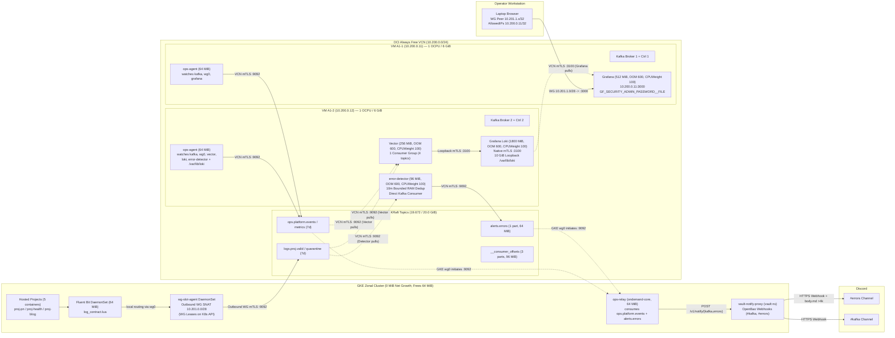

# Spec 014: Self-Hosted OCI Observability and Error Alerting Pipeline

- **Author:** nacfson
- **Date:** 2026-11-20
- **Status:** Proposed (Revised post-EGM 5-Stage Review)

---

## Overview

`nacfson_pipeline` hosts five project containers across three tenant namespaces (`proj-pn` frontend/backend, `proj-health` frontend/backend, and `proj-blog`) on two zonal GKE nodes (`ondemand-core` `e2-standard-2` and Spot `spot-controllers` `e2-small`), paired with a four-VM OCI Always Free Kafka 4.3.2 KRaft cluster (`A1-1`, `A1-2`, `Micro-1`, `Micro-2`). GKE `Fluent Bit` (`64 MiB`) ships OpenTelemetry v3 project logs over one-way WireGuard mTLS (`:9092`) into OCI Kafka (7-day retention), while OCI `ops-agent` publishes VM health to `ops.platform.events` and `ops.platform.metrics` for GKE `ops-relay` (scheduled on `ondemand-core` `e2-standard-2`) to forward to Discord `#kafka` through GKE OpenBao `vault-notify-proxy`.

This specification defines a self-hosted, vendor-neutral OSS observability and error-alerting stack deployed on OCI with **zero GKE memory growth** (freeing `64 MiB` on GKE by deleting the unused `error-detector` Deployment and PVC) and **zero Discord webhooks stored on OCI**:

- **Searchable Observation Store (`OCI A1-2` + `A1-1`):** `Vector` on `A1-2` consumes all four Kafka topics (`logs.proj.valid`, `logs.proj.quarantine`, `ops.platform.events`, `ops.platform.metrics`) and writes into single-binary `Grafana Loki` backed by a fixed `10 GiB` loopback ext4 mount (`/var/lib/loki`, 14-day default retention, native mTLS on `:3100`). Private `Grafana` on `A1-1` queries `A1-2` Loki over VCN mTLS (`:3100`, permitted via an explicit `network.tf` Security List rule applied manually by the operator before `site.yml`), accessed from operator workstations over raw WireGuard (`10.201.1.0/28` → `10.200.0.11:3000`) with `/etc/grafana/admin-password` (`0400`, UID `472:472`) mounted read-only via `GF_SECURITY_ADMIN_PASSWORD__FILE`.
- **Direct Kafka Error Detection & Vault-Backed Discord Relay (`OCI A1-2` → `Kafka` → `GKE ops-relay`):** `error-detector` on `A1-2` consumes `logs.proj.valid` and `logs.proj.quarantine` directly from local VCN Kafka `:9092` (reusing existing `franz-go`, `internal/classify`, `internal/fingerprint`, `internal/redact`, and `internal/group`). It catches both structured JSON errors and raw unstructured crashes (`panic:`, `Traceback`, JVM exceptions, nginx `[error]`), deduplicates signatures in a bounded 10-minute RAM cache, and publishes redacted `notify.Notification` envelopes to a small Kafka outbox topic (`alerts.errors`, `64 MiB` retention). GKE `ops-relay` consumes `alerts.errors` via an isolated consumer-group loop over its existing `wg0:9092` connection and posts through GKE OpenBao `vault-notify-proxy` (`/v1/notify/errors`, adding `errors:observability:ops-relay` to `NOTIFY_GRANTS`, with automatic `body.md` attachment for raw payloads >4,000 runes).
- **Decoupled Scope Note:** Multi-provider routing and token/cost blocking for `vault-ai-proxy` (formerly Phase B) is split out to a future specification once a second AI caller exists; pinning `vault-ai-proxy`'s floating `:latest` tag, base Dockerfile tags, and Guaranteed QoS is tracked as a standalone small hygiene PR. Tier 2A Kubernetes cluster event alerting is deferred because Kubernetes `Events` are ephemeral (~1h TTL) and unreliable as an alert stream.

### The Problem

1. **Unalerted Production Errors:** After [Spec 012](../../specs/012-gke-platform-migration/spec.md) removed VictoriaLogs from GKE, `error-detector` was scaled to `replicas: 0` (leaving `#errors` paused while still reserving `25m / 64 MiB` in `platform-preflight.py` and holding an unused Persistent Disk PVC). No consumer currently reads `logs.proj.valid` or `logs.proj.quarantine`.
2. **No Searchable Log or Metrics UI:** Operators must run raw CLI commands (`kcat` / `kubectl logs`) to inspect logs or correlate Kafka/VM health metrics.
3. **Strict GKE Memory Ceiling and Cost Boundaries:** GKE runs under the **Interim Memory Limit Freeze** (Spec 013 R16: total GKE platform reservations are capped so each hosted project retains at least a `310m / 762 MiB` Guaranteed QoS `1/n` slice) and GCP outbound internet egress is billed per GB. Heavy observability storage or UI proxying cannot run on GKE.

### Goals

- Restore Discord `#errors` alerting with first-occurrence notification (no count threshold), 10-minute signature deduplication in bounded RAM, full coverage of `CONTRACT_LOG_SCHEMA.md` §4 unstructured crashes and quarantine payloads, and zero backend webhook secrets on OCI.
- Provide a single private Grafana UI on OCI `A1-1` querying `A1-2` Loki over native mTLS for both project logs and OCI `ops.platform.metrics`, reachable over raw WireGuard with zero third-party SaaS VPN dependency and `$0` GCP egress.
- Protect Kafka Broker 2 + Controller 2 on `A1-2` from disk exhaustion, memory contention, and alert suppression: isolate `/var/lib/loki` in a fixed `10 GiB` loopback mount, pin Kafka `__consumer_offsets` to `3` partitions, monitor new OCI units (`grafana`, `vector`, `loki`, `error-detector`) via `ops-agent` without triggering Kafka VM-down incident suppression, and fold deployment into `site.yml` without restarting `kafka.service`.
- Reclaim `25m / 64 MiB` and delete the unused `error-detector-state` PVC on GKE (`0 MiB` net GKE memory growth).
- Enforce end-to-end automated verification (Go unit tests, offline Lua unit tests, Terraform/Kafka declaration tests, and Docker Compose mTLS/ACL rehearsal) covering delayed logs, raw non-JSON crashes, deduplication, and ACL isolation.

### Non-Goals

- **Multi-Provider `vault-ai-proxy` & Cost Blocker:** Split out to a future specification (today `proj-pn` backend is the sole caller using one Gemini model). A small standalone hygiene PR will pin `vault-ai-proxy`'s `@sha256` digest, `Dockerfile.ai-proxy` base images, Guaranteed QoS, and preflight check.
- **Automated AI Root-Cause Investigation (`error-investigator` / `#ai-debug`):** Deferred until `#errors` volume and deduplication rates are measured in production.
- **Kubernetes Platform Alerting (Tier 2A `Pod`/`Node` Watches, Tier 2B Platform Pod Logs, Tier 3 GKE Node OS Logs):** Tier 1 covers hosted project application logs (`logs.proj.*`); Tier 2A (K8s workload/node state), Tier 2B (platform pod logs), and Tier 3 (GKE node OS logs) are deferred out of Spec 014.
- **Separate Time-Series Database (Prometheus / VictoriaMetrics):** `ops.platform.metrics` stays inside Loki (`ops` tenant) queried via LogQL `unwrap`.
- **OCI Object Storage (S3) for Loki:** Excluded to avoid adding S3 API credentials outside OpenBao (Constitution Principle V) and OCI bucket lifecycle management (Spec 013 R21 keeps OCI Terraform minimal and avoids object-storage state).
- **Apache Flink, Elasticsearch/OpenSearch, BI Analytics, and `mcp-grafana`:** Unneeded for five project containers; `mcp-grafana` (an MCP server exposing Grafana queries to AI agents) is deferred.
- **Tailscale / Cloudflare Access / GCP `nacfson-control-center` UI Proxying:** Avoids third-party SaaS VPN dependencies and billed GCP egress (`nacfson-control-center` is the separate GCP management host running the automated Ansible runner for Spec 013).
- **`clusters/local-k3s/` Feature Parity:** `local-k3s` retains its existing pinned `@sha256` digest on `error-detector` until retired; no new dual-mode VictoriaLogs branches are added.

### Prerequisite & Resolved Defaults

- **Hard Prerequisite:** Spec 013 PR #182 (`v2.5.0` Constitution and OCI Kafka code) is already merged on `main`; Spec 013 follow-up task `T087` (`ops-relay` wired into `clusters/gke/observability/kustomization.yaml`, `kafka:observability:ops-relay` grant in `notify-proxy.yaml`, and `notify-proxy-policy` ingress from `observability/ops-relay`) must land before Spec 014 rollout.
- **Resolved Loki Defaults:** Fixed `10 GiB` loopback ext4 mount on `A1-2`, `14d` default retention (`compactor.retention_enabled: true`), and `out_of_order_time_window: 24h` (extendable up to `30d` retention later if daily volume stays under `300 MiB/day`).

---

## Critical User Journeys (CUJs)

### CUJ 1: First-Occurrence Alerting for Structured Errors & Raw Non-JSON Crashes
1. A hosted project container in `proj-pn` emits a JSON `error` log, a raw non-JSON Go `panic:` / Python `Traceback`, or an invalid quarantine line.
2. GKE `Fluent Bit` (`log_contract.lua`, the Lua script validating `CONTRACT_LOG_SCHEMA.md` v3) ships the record over `wg0:9092` into OCI Kafka (`logs.proj.valid` or `logs.proj.quarantine`).
3. On OCI `A1-2`, `error-detector` consumes the record directly from local Kafka `:9092`, classifies and normalizes its fingerprint, scrubs secrets via `internal/redact`, checks its 10-minute bounded RAM cache, and on a cache miss publishes a redacted alert envelope to Kafka `alerts.errors`.
4. GKE `ops-relay` consumes `alerts.errors` over its existing `wg0:9092` link and posts to GKE OpenBao `vault-notify-proxy` (`/v1/notify/errors`), delivering a Discord `#errors` embed (attaching raw payloads >4,000 runes as `body.md`) with a Grafana Explore deep link (`http://10.200.0.11:3000/explore?...`).
5. Identical errors (differing only by timestamp, UUID, or hex/numeric ID) arriving within 10 minutes are suppressed; if the same signature arrives after 10 minutes, `error-detector` alerts again.

### CUJ 2: Private Grafana Triage Over Raw WireGuard
1. The operator enables the laptop WireGuard tunnel (`10.201.1.0/28` with `AllowedIPs = 10.200.0.11/32`) and opens `http://10.200.0.11:3000`.
2. `A1-1` `nftables` allows `10.201.1.0/28` only to `10.200.0.11:3000` (dropping `:9092`, `:9093`, and `:22`).
3. The operator signs in with local Grafana credentials (`/etc/grafana/admin-password` mounted read-only into `GF_SECURITY_ADMIN_PASSWORD__FILE`) and inspects the three provisioned dashboards (`Project Errors & Quarantine`, `Log Explorer`, `Kafka & OCI Ops Metrics`), which query `A1-2` Loki over VCN mTLS (`https://10.200.0.12:3100`).

### CUJ 3: Observability Self-Health Without Suppressing Kafka Alerts
1. `loki.service`, `vector.service`, `error-detector.service`, or `grafana.service` crashes or gets OOM-killed (`OOMScoreAdjust=600`), or `/var/lib/loki` drops below `15%` free space on its `10 GiB` mount.
2. OCI `ops-agent` detects the unit failure (via host-specific `OPS_UNITS`) or disk threshold (`ops-sample.sh`) and publishes to `ops.platform.events`.
3. GKE `ops-relay` posts an independent `[obs]` alert to Discord `#kafka` **without** marking the Kafka VM `DOWN` or suppressing real `partition.isr_shrink` alerts.

### CUJ 4: Reproducible Local Verification Before Rollout
1. Before deploying to OCI or GKE, the operator runs Go unit tests, offline `ops_events.lua` tests, preflight/declaration tests, and `./scripts/kafka-rehearsal.sh up --with-observability` + `test observability_pipeline`.
2. The rehearsal harness proves end-to-end Kafka mTLS ACL isolation, delayed/out-of-order log alerting, raw non-JSON crash alerting, 10-minute TTL deduplication (with shortened test TTL), and Grafana LogQL/metric queries locally.

---

## Technical Plan

### End-to-End Topology

> **Edge Convention:** Solid arrows (`-->`) denote **connection initiation / push**; dashed arrows (`-.->`) denote **pull / read queries** (arrow points in the direction of data flow, labeled with which side initiates the TCP connection).



### 1. Kafka Broker Budget & Non-Kafka TLS Identities

- **Pin `__consumer_offsets`:** Set `offsets.topic.num.partitions: 3` and `offsets.topic.segment.bytes: 16777216` (`16 MiB`) in `infra/kafka/cluster.yaml` (must be set before the first consumer commit; worst-case active + rolled segment footprint = `3 × 16 MiB × 2 = 96 MiB`).
- **Add `alerts.errors` Outbox Topic:** `partitions: 1`, `replication_factor: 3`, `min_insync_replicas: 2`, `retention_bytes: 67108864` (`64 MiB`), `segment_bytes: 16777216` (`16 MiB`), `retention_ms: 604800000` (`7d`), `max_message_bytes: 1048576`, `timestamp_type: LogAppendTime` (worst-case footprint `64 MiB + 16 MiB = 80 MiB`).
- **Total Broker Budget Proof:** Extend `scripts/kafka-declarations.py` (`check_budget()`) to include `offsets.topic.num.partitions * offsets.topic.segment.bytes * 2` alongside `decl.topics`. Existing 4 topics (`19.500 GiB`) + `__consumer_offsets` (`0.094 GiB`) + `alerts.errors` (`0.078 GiB`) = **`19.672 GiB <= 20.0 GiB`** hard gate.
- **Kafka Identities & Strict ACLs:**
  - `vector-a1-2` (`vm:a1-2`): `[Read, Describe]` on `logs.proj.valid`, `logs.proj.quarantine`, `ops.platform.events`, `ops.platform.metrics`; `[Read]` on group `vector-loki`.
  - `error-detector-a1-2` (`vm:a1-2`): `[Read, Describe]` on `logs.proj.valid` and `logs.proj.quarantine`; `[Read]` on group `error-detector`; `[Write, Describe]` on `alerts.errors`; `[IdempotentWrite]` on `cluster` (required by `franz-go` default idempotent producer).
  - `ops-relay` (existing GKE identity): add `[Read, Describe]` on `alerts.errors` (no `Write` permission; reuses its existing `[Read]` ACL on consumer group `ops-relay`).
- **TLS Key Isolation, Non-Kafka `tls_identities` & Renewal:**
  - Declare `loki-a1-2` (`vm:a1-2`, server SANs `IP:10.200.0.12`, `IP:127.0.0.1`, `DNS:a1-2`, `server auth` + `client auth` EKU, owner UID `10001`, dir `/etc/loki/tls`) and `grafana-a1-1` (`vm:a1-1`, `client auth` EKU, owner UID `472`, dir `/etc/grafana/tls`) in a sibling `tls_identities` list rendered only to Ansible vars (never into Strimzi `KafkaUser`).
  - Isolate `vector-a1-2` and `error-detector-a1-2` private keys into per-service directories (mirroring `roles/ops_agent/tasks/tls.yml`) rather than mounting `/etc/kafka/tls` (`kafka:kafka`), so no observability container can read `broker-*.key`.
  - Extend `ops-certs.sh` to scan `/etc/loki/tls/*.crt` and `/etc/grafana/tls/*.crt` for expiry alerts, and filter `certs_renewed` per service in `renew-certs.yml` so renewing observability certs reloads only `vector`, `loki`, `error-detector`, or `grafana` without restarting `kafka.service`.

### 2. OCI `A1-2` Observation Store (`Vector` + `Loki` Native mTLS)

- **`Vector` (`vector.service`, `MemoryMax=256M`, `OOMScoreAdjust=600`, `CPUWeight=100`):**
  - Single Kafka source with `acknowledgements.enabled: true` consuming all four topics.
  - **Branch 1 (`logs.proj.valid`, `logs.proj.quarantine` → tenants `proj`, `quarantine`):** Uses OTel `observed_time` (clamping records outside `24h` to ingestion time with `timestamp_clamped="true"`), normalizes `level` (`critical` → `fatal`, lowercase; unstructured §4 crash lines tagged `stream_kind="unstructured"`), sets bounded labels `(topic, k8s_namespace_name, k8s_container_name, level, stream_kind)`, and places high-cardinality fields (`trace_id`, `span_id`, `k8s_pod_name`, `error_fingerprint`) in Loki structured metadata.
  - **Branch 2 (`ops.platform.events`, `ops.platform.metrics` → tenant `ops`):** Uses Kafka `LogAppendTime` record timestamp (per `CONTRACT_OPS_EVENTS.md`). For `ops.platform.metrics`, assigns allowlisted labels `(topic, source, metric)` (`<= 60` total streams across 4 VMs × ~15 metrics) and emits numeric `value` directly to avoid full-stream JSON scans on 1-OCPU `A1-2`. For `ops.platform.events`, assigns `(topic, vm, kind, state)`.
  - **Poison-Pill Guard:** Non-retryable Loki HTTP `400` responses drop the malformed record with a structured stderr warning instead of stalling Kafka offset commits.
  - Pushes to `https://127.0.0.1:3100/loki/api/v1/push` using `vector-a1-2` mTLS client cert.
- **`Grafana Loki` (`loki.service`, `MemoryMax=1800M`, `OOMScoreAdjust=600`, `CPUWeight=100`):**
  - Single-binary TSDB (`v13`) on a dedicated **`10 GiB` loopback ext4 mount** (`/var/lib/loki.img` → `/var/lib/loki`) so Loki `ENOSPC` can never fill `/var/lib/kafka` on the 50 GB boot disk.
  - **Native mTLS (`http_tls_config`) & VCN Opening:** Listens on `:3100` with `client_auth_type: RequireAndVerifyClientCert` against `kafka-mtls-ca` (`loki-a1-2` cert). Requires adding one TCP `3100` ingress rule from `10.200.0.11/32` to `oci_core_security_list.kafka` in `infra/oci/terraform/network.tf` (applied manually by the operator via `terraform plan`/`apply` before `site.yml` rollout, since `nacfson-control-center` cannot apply Terraform), paired with `A1-2` `nftables` allowing TCP `3100` only from `10.200.0.11/32` (and loopback via existing `iif "lo" accept`). No separate reverse-proxy container is needed; Grafana `/ready`, `POST /loki/api/v1/query_range`, and `X-Scope-OrgID` work natively.
  - **Guardrails:** `unordered_writes: true`, `out_of_order_time_window: 24h`, `compactor.retention_enabled: true`, `retention_period: 14d`, `delete_request_store: ""`, `max_concurrent: 2`, `max_entries_limit_per_query: 2000`, `ingestion_rate_mb: 4`, `per_stream_rate_limit: 2MB`, `max_line_size: 256KB`. Query range cap is `24h` for `proj`/`quarantine` and overridden to `168h` (`7d`) for the low-volume `ops` tenant.

### 3. OCI `A1-2` Direct Kafka `error-detector` & GKE `ops-relay` Outbox Relay

- **`error-detector` (`error-detector.service`, `MemoryMax=96M`, `OOMScoreAdjust=600`, `CPUWeight=100`):**
  - Consumes `logs.proj.valid` and `logs.proj.quarantine` directly from local VCN Kafka (`10.200.0.11..13:9092`) via existing `franz-go v1.22.2` (`SOURCE_MODE=kafka`, consumer group `error-detector`), decoding `"msg"` (set by `log_contract.lua` for raw unstructured crash lines) alongside `"message"`/`"_msg"` into `classify.Record.Message`.
  - Reuses existing `internal/conform`, `internal/classify` (catching raw non-JSON Go panics, Python tracebacks, JVM exceptions, and nginx native `[error]` lines), `internal/fingerprint` (respecting `error.fingerprint` and `exception.type` per `CONTRACT_LOG_SCHEMA.md` §3 while stripping timestamps, UUIDs, hex, and digits), `internal/redact`, and `internal/group` (configured with `Window = 0` when `InvestigatorURL == ""` so total suppression equals `Cooldown = DEDUP_TTL` = `10m`, `MaxEntries = 10000` bounded LRU eviction, and diskless mode `STATE_ENABLED=false` via `os.LookupEnv` so `ReadOnly=true` never calls `os.MkdirAll`).
  - Preserves unthrottled `[REDACTED:<kind>]` alerts and quarantine notifications (`QUARANTINE_THROTTLE`, default `1h`, overridable for rehearsal tests), updating `internal/notify/render.go` to remove hardcoded VictoriaLogs `"tenant 0:1"` wording and attach Grafana Explore deep links.
  - Publishes redacted `notify.Notification` envelopes synchronously (`kgo.ProduceSync`, bypassing async `d.queue` in `NOTIFY_MODE=kafka-outbox`) to Kafka `alerts.errors` before committing source Kafka offsets. Zero Discord webhooks live on OCI.
- **GKE `ops-relay` (`ondemand-core`, `10m / 64Mi`) & `vault-notify-proxy` Grant:**
  - Runs a **separate Kafka consumer-group loop** (consumer group `ops-relay`, completely isolated from `ops.platform.*`'s `ReadSince`/`NewPartitionReader` loop) solely for `alerts.errors` over `wg0:9092`, deserializing `notify.Notification` envelopes and committing Kafka offsets only after `POST /v1/notify/errors` succeeds (or returns permanent `4xx`), so `#errors` retry backoff never stalls `#kafka` ops alerts.
  - Appends `errors:observability:ops-relay` alongside `errors:observability:error-detector` in `deploy/platform/vault-proxies/notify-proxy.yaml` (`NOTIFY_GRANTS`) so `vault-notify-proxy` authorizes `ops-relay` on `/v1/notify/errors` (reusing OpenBao's `#errors` webhook, Discord rate-limit backoff, and automatic `body.md` attachment for >4,000-rune payloads).
- **GKE Cleanup:** Delete `Deployment/error-detector`, `PVC/error-detector-state`, `ServiceAccount/error-detector`, and `NetworkPolicy/error-detector-egress` from `clusters/gke/observability/kustomization.yaml` alongside removing its patch block in `clusters/gke/layers.yaml` (freeing `25m / 64 MiB` and the unused Persistent Disk).

### 4. OCI `A1-1` Private Grafana & Raw WireGuard Access

- **`Grafana` (`grafana.service`, `MemoryMax=512M`, `OOMScoreAdjust=600`, `CPUWeight=100`):**
  - Listens on `10.200.0.11:3000` (plain HTTP inside WireGuard transport encryption), with ephemeral `grafana.db`, provisioned Loki mTLS datasource (`https://10.200.0.12:3100` using `grafana-a1-1` cert), and three provisioned dashboards: `Project Errors & Quarantine`, `Log Explorer`, and `Kafka & OCI Ops Metrics` (noting GKE Lease metrics `fluentbit.buffer.bytes` and `wireguard.handshake_age` remain in `ops-relay status` rather than Grafana).
  - Local admin password lives in a raw secret file `/etc/grafana/admin-password` (`0400`, owned by UID `472:472` on `A1-1`), bind-mounted read-only to `/run/secrets/admin_password` and consumed by Grafana's native `GF_SECURITY_ADMIN_PASSWORD__FILE=/run/secrets/admin_password` (never exposed in container env vars or `podman inspect`). `[Unit] AssertPathExists=/etc/grafana/admin-password` guarantees fail-loud startup if missing after node replacement.
- **Raw WireGuard (`10.201.1.0/28`):**
  - Operator laptop peers connect to `A1-1` UDP `51820` (`AllowedIPs = 10.200.0.11/32`).
  - `nftables.conf.j2` narrows its existing Kafka `:9092` rule to `ip saddr 10.201.0.0/28` (GKE only) and adds `iifname "wg0" ip saddr 10.201.1.0/28 ip daddr 10.200.0.11 tcp dport 3000 accept` before `iifname "wg0" drop`, blocking `:9092`, `:9093`, and `:22` from operator peers.
  - **Emergency Revocation:** Immediate revocation runs `sudo wg set wg0 peer <pubkey> remove` on `A1-1` over OCI Bastion SSH, followed by removing the peer from `operator_wireguard_peers` in Git.
  - **Revisability Trigger:** If managing static per-device WireGuard keys across >3 devices or mobile clients becomes an operational bottleneck, migrate UI access to OCI Bastion + Keycloak PKCE OIDC (documented in `README.md` §3.3).

### 5. Self-Health Monitoring & `site.yml` Integration

- **`ops-agent` & `opsrelay/state.go` Isolation:**
  - Template `fluent-bit.conf.j2` `Systemd_Filter UNIT=...` and `ops-agent.container.j2` `OPS_UNITS` from the same host-specific unit list (`grafana.service` added on `a1-1`; `vector.service,loki.service,error-detector.service` added on `a1-2`; `Micro-1`/`Micro-2` retain their `48M` cap and unchanged unit list).
  - Extend `ops-sample.sh` on `a1-2` (guarded by `mountpoint -q /var/lib/loki` so first-install runs before loopback creation never abort) to check `df -P /var/lib/loki`, emitting `loki.disk.free_ratio`, `loki.disk.low` (`< 15%` free, subject `loki/disk`), and paired recovery `loki.disk.ok` (`state: ok`), co-updated in `contracts/CONTRACT_OPS_EVENTS.md`.
  - Update `services/error-pipeline/internal/opsrelay/state.go` so non-Kafka observability unit failures (`unit.failed` / `unit.active`) and `loki.disk.low` / `loki.disk.ok` emit independent `[obs]` alerts to `#kafka` without calling `causeDown` or suppressing real Kafka `partition.isr_shrink` alerts.
- **Folded into `site.yml` (No Separate `observability.yml`):** Append one isolated play at the bottom of `infra/oci/ansible/site.yml` targeting `a1-1` and `a1-2` with independent handlers that never restart `kafka.service`, and move `/etc/nacfson/applied-commit` stamping from Play 1 to a final play after observability succeeds so transient failures automatically retry under `nacfson-control-center` (`ansible-runner.md` rule 5).

---

## Alternatives Considered

### Alternative A: Apache Flink Stream Processor
- **Pros:** Stateful stream windowing and CEP capabilities.
- **Cons:** Requires a JVM JobManager + TaskManager cluster (~2+ GiB RAM), exceeding `A1-2`'s `3,072 MiB` budget and adding high operational overhead for five containers.
- **Reason for Rejection:** Excessive memory and operational footprint relative to a ~5-container log volume; Go `error-detector` handles deduplication in `96 MiB`.

### Alternative B: Elasticsearch / OpenSearch
- **Pros:** Full-text inverted indexing and rich Kibana/Dashboards UI.
- **Cons:** JVM heap alone requires 2–4 GiB per node plus high disk IOPS, destabilizing co-located Kafka Broker 2 on 1-OCPU `A1-2`.
- **Reason for Rejection:** Cannot fit safely inside `A1-2`'s `3,072 MiB` RAM ceiling and `10 GiB` disk budget alongside Kafka.

### Alternative C: OCI Object Storage (S3) for Loki Chunks
- **Pros:** Larger retention capacity beyond local boot disk limits.
- **Cons:** Introduces long-lived S3 API keys outside OpenBao (violating Constitution Principle V) and adds Terraform bucket/lifecycle management (against Spec 013 R21's minimal OCI footprint).
- **Reason for Rejection:** Local `10 GiB` loopback TSDB covers 14–30 days of project logs with zero external storage credentials.

### Alternative D: VictoriaLogs on OCI Instead of Loki
- **Pros:** Lower memory footprint and simpler single-binary setup.
- **Cons:** Requires third-party Grafana datasource plugins instead of Grafana's native Loki datasource and LogQL ecosystem.
- **Reason for Rejection:** Loki provides native Grafana Explore, LogQL `unwrap` metrics, and wider Kubernetes/DevOps ecosystem adoption within `1,800 MiB`.

### Alternative E: Separate Metrics TSDB (Prometheus / VictoriaMetrics) on OCI
- **Pros:** Dedicated high-cardinality metrics storage and PromQL.
- **Cons:** Adds another database container, storage mount, and scrape pipeline on 1-OCPU `A1-2` for only `<= 60` low-cardinality `ops.platform.metrics` series.
- **Reason for Rejection:** Loki tenant `ops` with allowlisted `(topic, source, metric)` labels and LogQL `unwrap` charts `<= 60` series with zero extra database.

### Alternative F: Tailscale / Cloudflare Access / GCP `nacfson-control-center` Proxy for Grafana
- **Pros:** Managed identity/MFA login without manual WireGuard peer files.
- **Cons:** Tailscale/Cloudflare add third-party SaaS control-plane dependencies; proxying through GCP `nacfson-control-center` incurs per-GB GCP outbound egress fees.
- **Reason for Rejection:** Raw WireGuard keeps `$0` GCP egress and zero SaaS VPN dependency while remaining straightforward to swap later if peer management grows.

### Alternative G: Second Fluent Bit Container or Custom Go Shipper Instead of Vector
- **Pros:** Fluent Bit (`4.2.8`) is already pinned on OCI; a Go `franz-go` shipper (~40 MiB) avoids VRL.
- **Cons:** Fluent Bit lacks end-to-end Kafka commit acknowledgements (`acknowledgements.enabled: true`) tied to Loki HTTP `204` responses and has weaker Loki structured-metadata support; a custom Go shipper requires owning batching, gzip compression, and retry/backoff logic.
- **Reason for Rejection:** Vector (`256 MiB`) provides native Kafka-to-Loki end-to-end acknowledgements and structured metadata out of the box without replacing GKE Fluent Bit or OCI `ops-agent`.

### Alternative H: `error-detector` Polling Loki + Plaintext OCI Discord Webhook
- **Pros:** Keeps `#errors` operational even during a full GKE outage.
- **Cons:** Polling Loki with a timestamp cursor silently misses delayed/out-of-order logs after WAN blips, drops unstructured §4 crashes, competes with Grafana's `max_concurrent: 2` limit, duplicates `vault-notify-proxy`'s Discord client, and puts a backend webhook secret on OCI disk.
- **Reason for Rejection:** Direct OCI Kafka consumption + `alerts.errors` outbox to GKE `ops-relay` catches every delayed log and raw crash while keeping all Discord webhooks inside GKE OpenBao. (During a total GKE outage, `proj-*` pods stop emitting new logs anyway, and any in-flight alerts buffer durably in `alerts.errors` until GKE recovers.)

### Alternative I: Separate `loki-read-proxy` Sidecar on `A1-2`
- **Pros:** Enforces HTTP verb/path allowlisting (`GET`/`POST` query only) against a compromised Grafana container on `A1-1`.
- **Cons:** Adds a 4th container (`64 MiB`), another image/unit to monitor and rotate certs for, and fragile route allowlists on 1-OCPU `A1-2` — while `A1-1` already holds Kafka broker/controller superuser credentials on the same VCN.
- **Reason for Rejection:** Loki's native `http_tls_config` mTLS + `nftables` (`lo` + `10.200.0.11/32`) provides strong transport authentication without an extra container.

---

## Non-Functional Requirements

### Security & Governance
- **Constitution Alignment:** [Constitution Principle I](../../.specify/memory/constitution.md) prohibits floating image tags; **Principle III** requires strong named operator authentication; **Principle V** prohibits persistent plaintext secrets outside OpenBao.
  - **Zero backend secrets on OCI:** All Discord webhooks remain inside GKE OpenBao (`vault-notify-proxy`).
  - **Constitution Amendment (`v3.0.0`, after Spec 013 `v2.5.0`):** Because `/etc/grafana/admin-password` (`0400`, owned `472:472`, mounted read-only via `GF_SECURITY_ADMIN_PASSWORD__FILE`) and static operator WireGuard keys on `A1-1` relax Principles III and V for the external OCI UI host, a formal **MAJOR `3.0.0`** amendment (including the 4-part impact assessment: rationale, security/quota/portability impact, maintainer approval, and migration plan) is required per `.specify/memory/constitution.md` §Governance, synced across `README.md`, `AGENTS.md`, and `docs/platform-architecture.html`.
- **Network Boundaries:**
  - `A1-1` public UDP `51820` only (no public TCP ports). `nftables` narrows `wg0` `:9092` to `ip saddr 10.201.0.0/28` (GKE) and allows `10.201.1.0/28` (operators) only to `10.200.0.11:3000`.
  - `A1-2` Loki `:3100` accepts mTLS (`kafka-mtls-ca`) only from loopback (`iif "lo" accept`) and `10.200.0.11/32` (`A1-1`), permitted at the VCN layer via a manual `terraform plan`/`apply` of `infra/oci/terraform/network.tf` prior to `site.yml`.

### Resource & Storage Budgets (Consistent Binary Units)
- **OCI `A1-2` (`6,144 MiB` total; `3,072 MiB` Kafka/OS + `3,072 MiB` Spec 014 cap):**
  - `vector.service`: `256 MiB`, `OOMScoreAdjust=600`, `CPUWeight=100`
  - `loki.service`: `1,800 MiB`, `OOMScoreAdjust=600`, `CPUWeight=100`
  - `error-detector.service`: `96 MiB`, `OOMScoreAdjust=600`, `CPUWeight=100`
  - **Total:** `2,152 MiB` out of `3,072 MiB` (`920 MiB` headroom).
  - **Disk:** Fixed `10 GiB` loopback ext4 image (`/var/lib/loki.img` → `/var/lib/loki`), leaving Kafka (`20 GiB`) and OS (`~10 GiB`) isolated on the `50 GiB` boot volume.
- **OCI `A1-1` (`6,144 MiB` total):** `grafana.service` capped at `512 MiB`, `OOMScoreAdjust=600`, `CPUWeight=100`.
- **OCI `Micro-1` / `Micro-2`:** Unchanged (`ops-agent` remains capped at `48 MiB`).
- **GKE Cluster:** Net **`-64 MiB`** (deleting unused `error-detector` Deployment + PVC reclaims `25m / 64 MiB`; `ops-relay` stays within its existing `10m / 64 MiB` Spec 013 allocation on `ondemand-core`).
- **Kafka Broker Disk:** `19.500 GiB` (existing 4 topics) + `0.094 GiB` (`__consumer_offsets`, 3 partitions × `16 MiB` × 2) + `0.078 GiB` (`alerts.errors`, 1 partition `64 MiB + 16 MiB`) = **`19.672 GiB <= 20.0 GiB`** (enforced by extended `check_budget()` in `scripts/kafka-declarations.py`).

---

## Risks & Limits

| Risk / Failure Mode | Impact | Mitigation |
| :--- | :--- | :--- |
| **`__consumer_offsets` already created with 50 partitions** (if Spec 013 `ops-relay` committed before pinning) | `offsets.topic.num.partitions: 3` has no effect on an existing internal topic; could exceed `20 GiB` disk budget | Run a preflight broker check before rollout; if 50 partitions exist, pause consumers briefly and recreate `__consumer_offsets` with 3 partitions (or lower `offsets.topic.segment.bytes` to `2 MiB`). |
| **GKE cluster totally unreachable during an OCI alert** | `ops-relay` cannot deliver `alerts.errors` to Discord `#errors` while GKE is down | No `proj-*` pods emit new errors while GKE is down; any in-flight alert envelopes buffer durably in Kafka `alerts.errors` (7-day retention) and deliver automatically when GKE returns. |
| **`error-detector` container restarts or OOMs on `A1-2`** | Bounded 10-minute RAM deduplication cache resets; active recurring signatures may emit one duplicate Discord alert | Accepted trade-off to keep `error-detector` stateless (`ReadOnly=true`, zero PVC/state-file complexity); Kafka consumer group offsets prevent missed alerts and burst caps bound duplicate volume. |
| **Single-VM SPOF on `A1-2` (Vector, Loki, `error-detector`) or `A1-1` (Grafana)** | Rebooting `A1-2` pauses log indexing and `#errors` alerting; rebooting `A1-1` pauses Grafana UI | Kafka brokers retain 7 days of durable logs across 3 brokers; when `A1-2` recovers, Vector and `error-detector` resume cleanly from committed Kafka offsets with zero lost alerts or logs. |
| **Loki `10 GiB` loopback fills during an extreme log flood** | Loki rejects new pushes (`ENOSPC`), pausing Grafana log ingestion | Fixed `10 GiB` loopback guarantees Kafka (`/var/lib/kafka`) and `/` never experience `ENOSPC`; `error-detector` reads Kafka directly so `#errors` alerting stays online; `ops-sample.sh` alerts `#kafka` when `/var/lib/loki` drops below `15%` free. |
| **Stolen operator laptop WireGuard key** | Attacker can reach `10.200.0.11:3000` (blocked from `:9092`/`:9093`/`:22` by `nftables`, still requires Grafana password) | Immediate revocation via `sudo wg set wg0 peer <pubkey> remove` on `A1-1` over OCI Bastion SSH, followed by Git PR removal and `/etc/grafana/admin-password` rotation. |
| **`A1-1` / `A1-2` controller replacement (`replace-controller.yml`)** | `rebuild-node.yml` rejects controllers (`A1-1`, `A1-2`); `replace-controller.yml` restores Kafka only, leaving `/etc/grafana/admin-password` absent and ephemeral `grafana.db` empty | After `replace-controller.yml`, reseed `/etc/grafana/admin-password` (`0400`, `472:472`) on `A1-1` and run `site.yml` to restore observability roles; `[Unit] AssertPathExists=/etc/grafana/admin-password` prevents silent startup with default credentials. |

---

## Additional Resources

- [`.specify/memory/constitution.md`](../../.specify/memory/constitution.md) — Core platform principles (I, III, V), Amendment `2.4.0` (zero comments in code), and governance versioning rules.
- [`contracts/CONTRACT_LOG_SCHEMA.md`](../../contracts/CONTRACT_LOG_SCHEMA.md) — OTel v3 log schema, §3 fingerprinting (`error.fingerprint`, `exception.type`), and §4 unstructured crash signatures.
- [`contracts/CONTRACT_OPS_EVENTS.md`](../../contracts/CONTRACT_OPS_EVENTS.md) — `ops.platform.events` and `ops.platform.metrics` contract (Kafka `LogAppendTime`, watched units, disk metrics).
- [`specs/013-oci-kafka-cluster/research.md`](../../specs/013-oci-kafka-cluster/research.md) — OCI Kafka KRaft design (R4–R6, R11–R13, R16–R17, R21–R23) and [`contracts/ansible-runner.md`](../../specs/013-oci-kafka-cluster/contracts/ansible-runner.md).
- [`docs/superpowers/specs/2026-10-29-error-pipeline-design.md`](../superpowers/specs/2026-10-29-error-pipeline-design.md) — Existing `error-detector` and `vault-notify-proxy` design baseline.
- [`README.md`](../../README.md) §3.3 — Planned Spec 014 architecture and revisable raw WireGuard policy.

## Future Improvements

- **Standalone `vault-ai-proxy` Hygiene PR (Immediate, Outside Spec 014):** Pin `deploy/platform/vault-proxies/ai-proxy.yaml` by `@sha256` digest, pin `Dockerfile.ai-proxy` base images, reconcile `clusters/gke/layers.yaml` Guaranteed QoS, and add `@sha256` enforcement to `scripts/platform-preflight.py`.
- **Future Multi-Provider `vault-ai-proxy` Spec:** Build multi-provider routing and spend enforcement once a second AI caller exists (keeping wire-protocol translation outside `vault`).
- **Future `error-investigator` (`#ai-debug`):** Consume high-signal deduplicated alerts from `alerts.errors` only after Phase A alert rates are measured.
- **Future Tier 2A K8s Workload State Alerts:** Watch structured `Pod` (`proj-*` per-namespace `RoleBinding`s) and `Node` status fields (not ephemeral K8s `Events`).
- **Private UI Access Revision:** Migrate Grafana from raw WireGuard to OCI Bastion + Keycloak PKCE OIDC if managing static peer keys across >3 operator devices becomes a bottleneck.

---

## Detailed Implementation Plan

> **Code Comment Invariant (Constitution Amendment 2.4.0):** All created or modified Go, Python, YAML, Shell, Terraform, Ansible, Lua, and VRL files must contain zero comments. Explanations live in Markdown documents.
>
> **Two-PR Image Digest Rule:** Because `.github/workflows/build-images.yaml` pushes multi-arch (`linux/amd64,linux/arm64`) images only on `push` to `main`, Go service changes (`Phase 2`) land first in PR 1 to publish immutable `@sha256:...` digests; Ansible/GKE manifest digest pins (`Phase 3` & `Phase 4`) land in PR 2 referencing the published digests.

### Phase 1 — Governance, Contracts, Kafka Declarations & OCI Network

#### 1. Constitution Amendment & Governance Docs
- **Modify:** `.specify/memory/constitution.md`, `README.md`, `AGENTS.md`, `contracts/CONTRACT_OPS_EVENTS.md`
- **Action:**
  - From Constitution `v2.5.0` (already merged in Spec 013 PR #182), draft formal MAJOR `v3.0.0` amendment (with 4-part impact assessment) narrowly permitting `/etc/grafana/admin-password` (`0400`, owned `472:472`, mounted read-only via `GF_SECURITY_ADMIN_PASSWORD__FILE`) and operator WireGuard peers (`10.201.1.0/28`) on OCI `A1-1` while confirming zero backend secrets or webhooks on OCI.
  - Update Constitution version badge in `README.md` (`line 3`) and `AGENTS.md` (`line 22`).
  - Update `contracts/CONTRACT_OPS_EVENTS.md` to add watched units (`grafana.service`, `vector.service`, `loki.service`, `error-detector.service`), metric `loki.disk.free_ratio`, and paired events `loki.disk.low` (`< 15%` free, subject `loki/disk`, `state: open`) and `loki.disk.ok` (`>= 15%` free, subject `loki/disk`, `state: ok`), marking observability unit/disk events as non-Kafka (`[obs]`) so they never trigger `vm/<host>` DOWN incident suppression.

#### 2. Kafka Topic, ACL & Non-Kafka TLS Declarations
- **Modify:** `infra/kafka/cluster.yaml`, `scripts/kafka-declarations.py`, `tests/infra/test_kafka_declarations.py`
- **Generated (re-rendered):** `infra/oci/ansible/group_vars/all/kafka.generated.yml`, `tests/kafka/rehearsal/compose.generated.yaml`, `tests/kafka/rehearsal/nodes/node-1.properties`, `tests/kafka/rehearsal/nodes/node-2.properties`, `tests/kafka/rehearsal/nodes/node-3.properties`, `tests/kafka/rehearsal/nodes/node-4.properties`, `tests/kafka/rehearsal/nodes/node-1.format`, `tests/kafka/rehearsal/nodes/node-2.format`, `tests/kafka/rehearsal/nodes/node-3.format`, `tests/kafka/rehearsal/nodes/node-4.format`, `tests/kafka/rehearsal/nodes/node-1.join.format`, `tests/kafka/rehearsal/nodes/node-2.join.format`, `tests/kafka/rehearsal/nodes/node-3.join.format`, `tests/kafka/rehearsal/nodes/node-4.join.format`
- **Action:**
  - In `infra/kafka/cluster.yaml`:
    - Add `broker_settings`: `offsets.topic.num.partitions: 3` and `offsets.topic.segment.bytes: 16777216`.
    - Add topic `alerts.errors` using exact `cluster.yaml` snake_case fields: `partitions: 1`, `replication_factor: 3`, `min_insync_replicas: 2`, `retention_bytes: 67108864`, `segment_bytes: 16777216`, `retention_ms: 604800000`, `max_message_bytes: 1048576`, `timestamp_type: LogAppendTime`.
    - Add Kafka identities: `vector-a1-2` (`[Read, Describe]` on 4 topics + `[Read]` on group `vector-loki`) and `error-detector-a1-2` (`[Read, Describe]` on `logs.proj.valid`, `logs.proj.quarantine` + `[Read]` on group `error-detector` + `[Write, Describe]` on `alerts.errors` + `{ resource: cluster, ops: [IdempotentWrite] }`); add `[Read, Describe]` on `alerts.errors` to `ops-relay` (reusing its existing `[Read]` on group `ops-relay`).
    - Add sibling top-level `tls_identities` list (never rendered as Strimzi `KafkaUser` or Kafka ACLs): `loki-a1-2` (`vm: a1-2`, `server_auth: true`, `server_sans: ["IP:10.200.0.12", "IP:127.0.0.1", "DNS:a1-2"]`, `dest_dir: /etc/loki/tls`, `owner_uid: 10001`, `reload_unit: loki.service`) and `grafana-a1-1` (`vm: a1-1`, `server_auth: false`, `dest_dir: /etc/grafana/tls`, `owner_uid: 472`, `reload_unit: grafana.service`).
  - In `scripts/kafka-declarations.py`:
    - Update `load()`, `node_identities()`, and `ansible_files()` to render `tls_identities` into Ansible vars only (skipping `strimzi_files()`).
    - Update `check_budget()` to require `offsets.topic.num.partitions` and `offsets.topic.segment.bytes` (failing closed if absent, or treating missing keys as Kafka's unpinned defaults `50 × 100 MiB × 2` which immediately fails the `20 GiB` gate) and assert total `<= 20 GiB` (`19.672 GiB <= 20.0 GiB`).
  - Run `python3 scripts/kafka-declarations.py render --target ansible` and `python3 scripts/kafka-declarations.py render --target compose`, and add unit tests in `tests/infra/test_kafka_declarations.py` covering `alerts.errors`, `tls_identities` exclusion from Strimzi, `error-detector-a1-2` `IdempotentWrite` ACL, and rejection of unpinned `__consumer_offsets`.

#### 3. OCI VCN Security List (`A1-1` → `A1-2` Loki Native mTLS `:3100`)
- **Modify:** `infra/oci/terraform/network.tf`, `tests/infra/test_terraform_protections.py`
- **Action:**
  - Add a 4th intra-subnet TCP ingress rule to `oci_core_security_list.kafka` (the sole Security List in `network.tf`, which already has 3 ingress rules: UDP `wireguard_port`, TCP `9092-9093`, TCP `22`) with `source = "10.200.0.11/32"` and destination port `3100` (destination `10.200.0.12` is enforced by host `nftables`). Operator must apply this change manually via `terraform plan`/`apply` before `site.yml` rollout.
  - Update `tests/infra/test_terraform_protections.py` (`line 108`) to assert `len(ingress) == 4` on `oci_core_security_list.kafka`, preserve the `local.subnet_cidr` (`len == 2`) assertion at lines `113–114`, and assert the 4th rule allows only `source == "10.200.0.11/32"` on TCP `3100`.

- **Phase 1 Checkpoint:**
  ```bash
  python3 scripts/kafka-declarations.py check
  python3 -m unittest discover tests/infra
  ```

---

### Phase 2 — Go Services (`error-detector` Direct Kafka + `alerts.errors` Outbox, `ops-relay` Outbox Relay & `[obs]` Isolation) — PR 1

#### 4. `error-detector`: Direct Kafka Consumer, Diskless 10m Bounded RAM Dedup & Synchronous Kafka Outbox Sender
- **Create:**
  - `services/error-pipeline/internal/kafka/source.go`
  - `services/error-pipeline/internal/kafka/source_test.go`
  - `services/error-pipeline/internal/notify/kafka_outbox.go`
  - `services/error-pipeline/internal/notify/kafka_outbox_test.go`
- **Modify:**
  - `services/error-pipeline/cmd/error-detector/main.go`
  - `services/error-pipeline/internal/detector/detector.go`
  - `services/error-pipeline/internal/detector/detector_test.go`
  - `services/error-pipeline/internal/group/group.go`
  - `services/error-pipeline/internal/group/group_test.go`
  - `services/error-pipeline/internal/notify/render.go`
  - `services/error-pipeline/internal/notify/render_test.go`
- **Action:**
  - Introduce `LogSource` and `NotifySender` interfaces in `detector.Config` (replacing concrete `*vlogs.Client` and `*notify.Client` pointers).
  - Implement `internal/kafka/source.go` using existing `github.com/twmb/franz-go v1.22.2` (`SOURCE_MODE=kafka`, mTLS certs, consumer group `error-detector`, consuming `logs.proj.valid` and `logs.proj.quarantine` in offset order so delayed/out-of-order WAN catch-up logs are never missed). Explicitly map `"msg"` (written by `log_contract.lua` for raw unstructured crashes) alongside `"message"`/`"_msg"` into `classify.Record.Message` so `classify.Line(r.Message)` never receives `""`. Wire `handleReadyz` to report ready when the Kafka client has active broker metadata and consumer session health.
  - Reuse existing `internal/conform`, `internal/classify` (catching raw non-JSON Go panics, Python tracebacks, JVM exceptions, and nginx native `[error]` lines), `internal/fingerprint` (respecting `error.fingerprint` and `exception.type`), and `internal/redact`.
  - Update `internal/group.Tracker`: set `Window = 0` when `InvestigatorURL == ""` (so total suppression equals `Cooldown = DEDUP_TTL`, default `10m`, rather than `3m + Cooldown`), add `MaxEntries = 10000` with LRU eviction, and bound `Retention` to match `DEDUP_TTL * 2` in diskless mode so memory stays under `96 MiB`. Make quarantine throttle configurable via `QUARANTINE_THROTTLE` (default `1h`, overridable to `DEDUP_TTL` in rehearsal).
  - Fix `cmd/error-detector/main.go` (`line 43`) and `detector.New` (`line 158`): support `STATE_ENABLED=false` (using `os.LookupEnv`) so diskless mode skips `os.MkdirAll`, `loadState()`, `sweepTemp()`, and `saveState()` cleanly under `ReadOnly=true`.
  - Update `internal/notify/render.go` (`line 128`) to replace hardcoded VictoriaLogs `"tenant 0:1"` text with Kafka topic/Grafana Explore deep-link URLs (`GRAFANA_BASE_URL`, e.g., `http://10.200.0.11:3000/explore?...` with URL-encoded Loki datasource UID + LogQL query).
  - Implement `internal/notify/kafka_outbox.go` (`NOTIFY_MODE=kafka-outbox`) to serialize redacted `notify.Notification` structs (`internal/notify/notify.go:22-28`) to Kafka topic `alerts.errors`. In `NOTIFY_MODE=kafka-outbox`, bypass async `d.queue` and call `kgo.ProduceSync` synchronously inside `detector.ingest()` and `d.asm` flush on `d.tick()`, advancing and committing source partition offsets only after synchronous produce confirmation succeeds.

#### 5. `ops-relay`: Isolated `alerts.errors` Consumer-Group Loop & `[obs]` Incident Isolation
- **Create:**
  - `services/error-pipeline/internal/opsrelay/errors_relay.go`
  - `services/error-pipeline/internal/opsrelay/errors_relay_test.go`
- **Modify:**
  - `services/error-pipeline/cmd/ops-relay/main.go`
  - `services/error-pipeline/internal/opsrelay/state.go`
  - `services/error-pipeline/internal/opsrelay/state_test.go`
- **Action:**
  - In `opsrelay/state.go`: add a configurable prefix tag (`[kafka]` default, `[obs]` for observability unit/disk events) on `Message.String()`, and route `unit.failed` / `unit.active` for non-Kafka units (`grafana.service`, `vector.service`, `loki.service`, `error-detector.service`) and `loki.disk.low` / `loki.disk.ok` (subject `loki/disk`) through an independent `obs/<vm>/<subject>` path that **never** calls `e.causeDown(ev.VM, ...)` and **never** suppresses `partition.isr_shrink` alerts.
  - Implement `internal/opsrelay/errors_relay.go` and wire it in `cmd/ops-relay/main.go`: launch a **separate consumer-group `kgo.Client`** (group ID `ops-relay`, matching `infra/kafka/cluster.yaml:85`, isolated from `ops.platform.*`'s `ReadSince`/`NewPartitionReader` loop) when `ALERTS_ERRORS_TOPIC=alerts.errors` is set. Deserialize `notify.Notification` JSON envelopes, POST to `NOTIFY_URL/v1/notify/errors` (retrying transient `5xx`/`429` with backoff), and commit the `alerts.errors` consumer offset only after HTTP `2xx` or permanent `4xx`.
  - Add unit tests proving: (a) raw non-JSON panics/tracebacks/nginx errors (`"msg"` field) and quarantine payloads produce redacted `notify.Notification` envelopes on `alerts.errors`; (b) out-of-order delayed timestamps arriving after earlier records still alert; (c) `Window = 0` + `DEDUP_TTL` dedup + re-alert immediately after expiry + `10000`-entry LRU bound; (d) `STATE_ENABLED=false` works on read-only rootfs; (e) `loki.service` `unit.failed` / `unit.active` and `loki.disk.low` / `loki.disk.ok` emit `[obs]` alerts without suppressing a simultaneous `partition.isr_shrink` alert; (f) `errors_relay.go` commits offsets only on `2xx`/permanent `4xx` and routes to `/v1/notify/errors` independently of `/v1/notify/kafka`.

- **Phase 2 Checkpoint (PR 1 Gate — Merges to Publish Immutable `@sha256` Digests via Existing `.github/workflows/build-images.yaml`):**
  ```bash
  (cd services/error-pipeline && go test -race -v ./... && go vet ./...)
  (cd services/vault-proxies && go test -v ./... && go vet ./...)
  python3 -c 'import pathlib; t=pathlib.Path("services/vault-proxies/go.mod").read_text(); assert "require" not in t, "third-party dep found"'
  ```

---

### Phase 3 — OCI Ansible Roles, Certificates, `nftables`, `ops-agent` & `site.yml` — PR 2

#### 6. Certs Role, Per-Service Key Isolation, Expiry Monitoring & Scoped 60-Day Renewal
- **Modify:**
  - `infra/oci/ansible/roles/certs/tasks/identity.yml`
  - `infra/oci/ansible/roles/certs/templates/certificaterequest.yaml.j2`
  - `infra/oci/ansible/roles/certs/tasks/main.yml`
  - `infra/oci/ansible/renew-certs.yml`
  - `infra/oci/ansible/roles/samplers/files/ops-certs.sh`
- **Action:**
  - Parameterize `identity.yml` and `certificaterequest.yaml.j2` to create `dest_dir` if absent, accept per-identity numeric `owner_uid` (including the combined `.pem` `install` task at `identity.yml:73`), `server_auth` EKU, and `server_sans` (not restricted solely to `^(broker|controller)-`), so `loki-a1-2` receives `IP:10.200.0.12`, `IP:127.0.0.1`, `DNS:a1-2` and `server auth` EKU in `/etc/loki/tls` (`10001:10001`), and `grafana-a1-1` lands in `/etc/grafana/tls` (`472:472`).
  - Add per-service TLS copy tasks (`roles/vector/tasks/tls.yml` and `roles/error_detector/tasks/tls.yml`, mirroring `roles/ops_agent/tasks/tls.yml`) so `vector-a1-2` and `error-detector-a1-2` read isolated copies of their own cert/key without mounting `/etc/kafka/tls` (`broker-*.key`).
  - Update `renew-certs.yml` to track per-identity renewal (`certs_renewed_identities`), refresh isolated copies for `vector` and `error-detector`, and restart only the affected services (`kafka`, `ops-agent`, `vector`, `loki`, `error-detector`, `grafana`) — never restarting `kafka.service` when only observability certs rotate.
  - Extend `ops-certs.sh` to scan `/etc/loki/tls/*.crt` and `/etc/grafana/tls/*.crt` (world-readable `0644` public certs; private keys stay `0400`/`0600`) alongside `/etc/kafka/tls/*.crt` so `cert.expiring` monitors Loki and Grafana certificates.

#### 7. Raw WireGuard Operator Peers & `nftables` Source Narrowing (`A1-1` & `A1-2`)
- **Create:** `infra/oci/ansible/host_vars/a1-1/wireguard_operators.yml`
- **Modify:** `infra/oci/ansible/roles/wireguard/templates/wg0.conf.j2`, `infra/oci/ansible/roles/base/templates/nftables.conf.j2`
- **Action:**
  - Define `operator_wireguard_peers` (`10.201.1.0/28` public keys, defaulting `| default([])` on other hosts) in `host_vars/a1-1/wireguard_operators.yml` and render `[Peer]` blocks on `a1-1` in `wg0.conf.j2`.
  - In `nftables.conf.j2`:
    - **Narrow existing line 11** to `iifname "wg0" ip saddr 10.201.0.0/28 ip daddr {{ ansible_host }} tcp dport {{ kafka_client_port }} accept` so operator peers (`10.201.1.0/28`) cannot reach Kafka `:9092`.
    - On `a1-1`, insert `iifname "wg0" ip saddr 10.201.1.0/28 ip daddr 10.200.0.11 tcp dport 3000 accept` **before** line 12 (`iifname "wg0" drop`).
    - On `a1-2`, add `ip saddr 10.200.0.11/32 ip daddr 10.200.0.12 tcp dport 3100 accept` (loopback `127.0.0.1:3100` is already permitted by existing line 8 `iif "lo" accept`).

#### 8. OCI `A1-2` Roles (`vector`, `loki` Native mTLS + `10 GiB` Loopback, `error_detector`)
- **Create:**
  - `infra/oci/ansible/roles/vector/defaults/main.yml` (pin fully-qualified `docker.io/timberio/vector:<pinned-ver>-distroless-libc@sha256:<digest>`, resolved via `skopeo inspect --raw` at PR time)
  - `infra/oci/ansible/roles/vector/tasks/main.yml`
  - `infra/oci/ansible/roles/vector/tasks/tls.yml`
  - `infra/oci/ansible/roles/vector/handlers/main.yml`
  - `infra/oci/ansible/roles/vector/templates/vector.yaml.j2`
  - `infra/oci/ansible/roles/vector/templates/vector.container.j2` (`MemoryMax=256M`, `OOMScoreAdjust=600`, `CPUWeight=100`)
  - `infra/oci/ansible/roles/loki/defaults/main.yml` (pin fully-qualified `docker.io/grafana/loki:<pinned-ver>@sha256:<digest>`, `loki_loopback_size_gib: 10`, `loki_retention_period: 14d`, `loki_ooo_window: 24h`)
  - `infra/oci/ansible/roles/loki/tasks/main.yml` (allocates `/var/lib/loki.img` 10 GiB ext4 loopback + `/etc/fstab` mount `/var/lib/loki` with mode `0755` owned `10001:10001` so `User=kafka` `df -P` can statfs the mount)
  - `infra/oci/ansible/roles/loki/handlers/main.yml`
  - `infra/oci/ansible/roles/loki/templates/loki.yaml.j2`
  - `infra/oci/ansible/roles/loki/templates/loki.container.j2` (`MemoryMax=1800M`, `OOMScoreAdjust=600`, `CPUWeight=100`)
  - `infra/oci/ansible/roles/error_detector/defaults/main.yml` (pin `ghcr.io/nacfson/error-detector@sha256:<PR1-digest>`)
  - `infra/oci/ansible/roles/error_detector/tasks/main.yml`
  - `infra/oci/ansible/roles/error_detector/tasks/tls.yml`
  - `infra/oci/ansible/roles/error_detector/handlers/main.yml`
  - `infra/oci/ansible/roles/error_detector/templates/error-detector.container.j2` (`MemoryMax=96M`, `OOMScoreAdjust=600`, `CPUWeight=100`, `ReadOnly=true`, `SOURCE_MODE=kafka`, `NOTIFY_MODE=kafka-outbox`, `STATE_ENABLED=false`, `DEDUP_TTL=10m`, `QUARANTINE_THROTTLE=1h`, `GRAFANA_BASE_URL=http://10.200.0.11:3000`)

#### 9. OCI `A1-1` Role (`grafana`)
- **Create:**
  - `infra/oci/ansible/roles/grafana/defaults/main.yml` (pin fully-qualified `docker.io/grafana/grafana:<pinned-ver>@sha256:<digest>`)
  - `infra/oci/ansible/roles/grafana/tasks/main.yml` (verifies `/etc/grafana/admin-password` exists with mode `0400` owned `472:472` before starting unit)
  - `infra/oci/ansible/roles/grafana/handlers/main.yml`
  - `infra/oci/ansible/roles/grafana/templates/grafana.ini.j2`
  - `infra/oci/ansible/roles/grafana/templates/grafana.container.j2` (`MemoryMax=512M`, `OOMScoreAdjust=600`, `CPUWeight=100`, `[Unit] AssertPathExists=/etc/grafana/admin-password`, `Volume=/etc/grafana/admin-password:/run/secrets/admin_password:ro`, `Environment=GF_SECURITY_ADMIN_USER={{ grafana_admin_user }}`, `Environment=GF_SECURITY_ADMIN_PASSWORD__FILE=/run/secrets/admin_password`)
  - `infra/oci/ansible/roles/grafana/templates/datasources.yaml.j2` (Loki mTLS `https://10.200.0.12:3100` with `grafana-a1-1` cert + `ca.crt`)
  - `infra/oci/ansible/roles/grafana/files/dashboards.yaml`
  - `infra/oci/ansible/roles/grafana/files/dashboards/project-errors-quarantine.json`
  - `infra/oci/ansible/roles/grafana/files/dashboards/log-explorer.json`
  - `infra/oci/ansible/roles/grafana/files/dashboards/kafka-ops-metrics.json`

#### 10. OCI `ops-agent`, Samplers, `site.yml` Play Ordering & Existing Lua Tests
- **Modify:**
  - `infra/oci/ansible/roles/ops_agent/defaults/main.yml` (define host-specific `ops_agent_watched_units` list)
  - `infra/oci/ansible/roles/ops_agent/templates/ops-agent.container.j2` (pass `Environment=OPS_UNITS={{ ops_agent_watched_units | join(',') }}`)
  - `infra/oci/ansible/roles/ops_agent/templates/fluent-bit.conf.j2` (generate `Systemd_Filter UNIT=...` loop from `ops_agent_watched_units` instead of 3 hardcoded units)
  - `infra/oci/ansible/roles/samplers/files/ops-sample.sh` (guarded with `if mountpoint -q /var/lib/loki; then ... fi`, run `df -P /var/lib/loki`, emit `loki.disk.free_ratio`, and emit `loki.disk.low` `< 15%` / `loki.disk.ok` `>= 15%` on subject `loki/disk`)
  - `infra/oci/ansible/site.yml` (append isolated observability play targeting `a1-1` and `a1-2` with independent handlers that never restart `kafka.service`; move `/etc/nacfson/applied-commit` stamping from Play 1 into a final play after observability succeeds so failed runs retry automatically)
  - `tests/kafka/test_ops_events_lua.py` (extend the **existing** Fluent Bit Lua test suite to verify `ops_events.lua` accepts `grafana.service`, `vector.service`, `loki.service`, `error-detector.service` when configured in `OPS_UNITS` and drops unlisted units)

- **Phase 3 Checkpoint:**
  ```bash
  (cd infra/oci/ansible && ansible-lint --offline .)
  python3 -m unittest discover tests/infra
  python3 -m unittest tests/kafka/test_ops_events_lua.py
  ```

---

### Phase 4 — GKE Overlay Cleanup & `ops-relay` `alerts.errors` Wiring — PR 2

#### 11. GKE Manifests (`clusters/gke/` & `notify-proxy.yaml`)
- **Modify:**
  - `clusters/gke/observability/kustomization.yaml` (replace the existing `replicas: 0` patch at lines `70–78` with `$patch: delete` deleting `Deployment/error-detector`, `PersistentVolumeClaim/error-detector-state`, `ServiceAccount/error-detector`, and `NetworkPolicy/error-detector-egress`)
  - `clusters/gke/layers.yaml` (remove `Deployment/error-detector` patch block at lines `765–787` so Kustomize render succeeds)
  - `clusters/gke/observability/ops-relay.yaml` (pin `@sha256:<PR1-digest>`, add `ALERTS_ERRORS_TOPIC=alerts.errors` env var)
  - `deploy/platform/vault-proxies/notify-proxy.yaml` (append `errors:observability:ops-relay` alongside `errors:observability:error-detector` in `NOTIFY_GRANTS`)
- **Phase 4 Checkpoint:**
  ```bash
  ./scripts/render-validate.sh gke
  ./scripts/render-validate.sh local-k3s
  ./scripts/render-validate.sh vps-k3s
  RENDERED_GKE=$(./scripts/render-validate.sh gke | awk '/Rendered:/ {print $2}')
  python3 scripts/platform-preflight.py --environment gke --candidate "$RENDERED_GKE" --capacity clusters/gke/capacity.yaml
  python3 -m unittest discover tests/preflight
  ```

---

### Phase 5 — Strict End-to-End Rehearsal, Documentation & Architecture Handbook Sync — PR 2

#### 12. Docker Compose End-to-End Rehearsal (`Kafka → Vector/Loki/Grafana` & `Kafka → error-detector → alerts.errors → ops-relay → fakenotify`)
- **Create:**
  - `tests/kafka/rehearsal/compose.observability.yaml` (adds `vector`, `loki`, `grafana`, `error-detector`, `ops-relay`, and `fakenotify` connected to the rehearsal Kafka 4.3.2 KRaft cluster with real mTLS certs and ACLs)
  - `tests/kafka/rehearsal/observability/vector.yaml`
  - `tests/kafka/rehearsal/observability/loki.yaml`
  - `tests/kafka/rehearsal/observability/grafana-datasources.yaml`
  - `tests/kafka/test_observability_pipeline.py`
- **Modify:**
  - `scripts/kafka-rehearsal.sh` (support `--with-observability` flag on `up`, `down`, and `test observability_pipeline`; also generate `tls_identities` certs including `DNS:loki` SAN with container-readable ownership for Loki UID `10001` and Grafana UID `472`)
  - `tests/kafka/fakenotify/main.go` (preserve existing top-level `"title"` JSON lines on stdout so `tests/kafka/test_alerts.py:104` never breaks, and add a `GET /requests` inspection endpoint recording channel `/v1/notify/kafka` vs `/v1/notify/errors` and full `notify.Notification` payloads)
- **Strict Verification Assertions in `test_observability_pipeline.py`:**
  1. **ACL Enforcement:** Prove `error-detector-a1-2` cert is rejected when attempting to write to `logs.proj.valid` or read `ops.platform.events`; prove `ops-relay` cert is rejected when attempting to write to `alerts.errors`.
  2. **Structured Error + 10m Dedup (short test TTL e.g. `DEDUP_TTL=5s`, `Window=0`):** Produce a JSON error → verify exactly 1 `/v1/notify/errors` delivery; produce 3 duplicates with different timestamps/UUIDs inside TTL → verify 0 extra deliveries; wait >5s and produce again → verify 2nd delivery.
  3. **Delayed / Out-of-Order Log:** Produce an error carrying an `observed_time` 2 minutes in the past *after* a newer log → verify `error-detector` still alerts `/v1/notify/errors` with zero miss.
  4. **Raw Non-JSON Crash & Quarantine Payloads:** Produce a raw Go `panic:` line in `"msg"` (`logs.proj.valid`, no JSON `level`) and a non-JSON invalid line (`logs.proj.quarantine`) → verify both trigger `/v1/notify/errors` with raw redacted content (and verify secret tokens are scrubbed before hitting `alerts.errors`).
  5. **Loki + Grafana Search & Metrics:** Query Grafana API (`GET /api/datasources/proxy/...`) to verify LogQL finds the project error in tenant `proj` and LogQL `unwrap` returns numeric `ops.platform.metrics` series in tenant `ops`.
  6. **Observability Unit Isolation:** Produce `unit.failed` for `loki.service` and `partition.isr_shrink` on `ops.platform.events` → verify `/v1/notify/kafka` receives both `[obs]` and `[kafka]` ISR alerts (proving Loki failure does not suppress Kafka ISR alerts).

#### 13. Operations Runbook & Mandatory Architecture Handbook Sync
- **Modify:** `docs/operations-runbook.md`, `docs/platform-architecture.html`, `ARCHITECTURE.md`, `DEPENDENCIES.md`, `INDEX.md`
- **Action:**
  - Document manual `terraform plan`/`apply` of `network.tf` before `site.yml`, operator WireGuard setup (`AllowedIPs = 10.200.0.11/32`), emergency `sudo wg set wg0 peer <pubkey> remove` revocation, `/etc/grafana/admin-password` (`0400`, `472:472`) seeding after `replace-controller.yml` + `site.yml`, and `__consumer_offsets` pre-rollout partition check.
  - Synchronize `docs/platform-architecture.html` with the revised topology, Constitution version, GKE `-64 MiB` cleanup, and OCI `A1-1`/`A1-2` observability nodes.

- **Phase 5 & Live Smoke Checkpoint:**
  ```bash
  ./scripts/kafka-rehearsal.sh up --with-observability
  ./scripts/kafka-rehearsal.sh test observability_pipeline
  ./scripts/kafka-rehearsal.sh down --with-observability
  python3 scripts/check-arch-doc-sync.py --worktree
  ```
- **Live OCI + GKE Smoke Checklist (Post-Rollout):**
  1. **Kafka `__consumer_offsets` partition count:** Run `kafka-topics.sh --describe --topic __consumer_offsets` on `A1-1` → assert `PartitionCount: 3`.
  2. **Loki loopback mount isolation:** Run `df -h /var/lib/loki` on `A1-2` → assert separate `10G` loop filesystem (distinct from `/var/lib/kafka`).
  3. **Native Loki mTLS rejection:** From `A1-1`, run `curl -sS -o /dev/null -w '%{http_code}' https://10.200.0.12:3100/ready` without client cert → assert TLS handshake failure; with `grafana-a1-1` cert → assert HTTP `200`.
  4. **Operator WireGuard `nftables` isolation:** From laptop over `wg0`, run `curl -sS -o /dev/null -w '%{http_code}' http://10.200.0.11:3000/api/health` → assert HTTP `200`; run `nc -zv -w3 10.200.0.11 9092` and `nc -zv -w3 10.200.0.11 22` → assert connection timeout/dropped.
  5. **End-to-end `#errors` delivery:** Inject one synthetic project error and one synthetic raw crash → verify Discord `#errors` embed arrives via `alerts.errors` → GKE `ops-relay` → OpenBao `vault-notify-proxy`, and verify Grafana Explore deep link opens the matching log line.
  6. **Observability self-health isolation:** Run `sudo systemctl stop loki.service` on `A1-2` → verify Discord `#kafka` receives `[obs]` alert within 30s without marking `vm/a1-2` Kafka broker down, then `sudo systemctl start loki.service` and confirm recovery alert.
