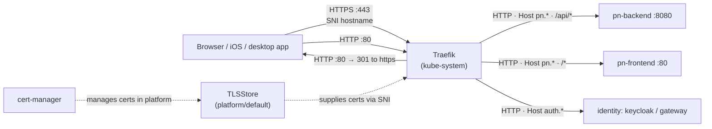
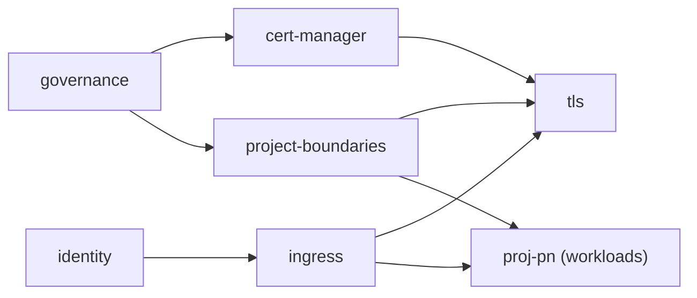
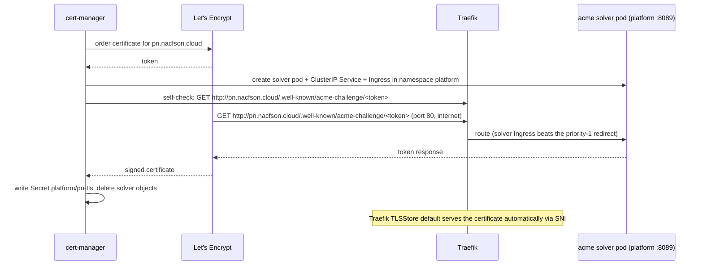

# TLS Certificates (cert-manager + Let's Encrypt)

**Status**: Platform-owned edge TLS termination (Constitution Amendment 2.2.0, Spec 008)
**Environments**: `vps-k3s` (Let's Encrypt production), `local-k3s` (self-signed)
**Hosts**: `pn.nacfson.cloud`, `auth.nacfson.cloud`

---

## 1. Problem

Users and apps reach the platform through Traefik on port 443. Traefik had no certificate for our hosts, so it served its built-in self-signed certificate:

```text
$ curl -svk https://pn.nacfson.cloud/ 2>&1 | grep -E 'subject:|issuer:'
*  subject: CN=TRAEFIK DEFAULT CERT
*  issuer: CN=TRAEFIK DEFAULT CERT
```

Browsers show a warning. Native apps (iOS, desktop) reject the connection before any `/api` request is sent. In the app, this looks like "the frontend cannot reach the backend", but everything inside the cluster works:

| Hop | Result before this change |
|---|---|
| Frontend pod → backend (DNS, NetworkPolicy, nginx proxy) | ✅ |
| Traefik → backend (`/api/auth/language-options` → `200`, `/api/auth/me` → `401`) | ✅ |
| Traefik → frontend (`/` → `200`) | ✅ |
| **Device → Traefik (TLS)** | ❌ self-signed certificate |

The old Project PN setup ended TLS in an nginx on the VM itself. The platform moved port 443 to Traefik, but no certificate was configured for it.

## 2. How a request flows

TLS ends at Traefik, the edge reverse proxy. Traffic inside the cluster stays plain HTTP. All TLS certificates and private keys live centrally in namespace `platform` and are referenced by `TLSStore platform/default`. Project routes declare routing only (`tls: {}`) and let Traefik match certificates by SNI.



| Kubernetes object | Traditional equivalent |
|---|---|
| Traefik (ingress controller) | The public reverse proxy (nginx, HAProxy, ALB) |
| `TLSStore` (`platform/default`) | Central SSL certificate bundle and SNI dispatcher |
| `IngressRoute` | The reverse proxy's config (`server {}` / `location {}`) |
| `Certificate` (cert-manager) | "Keep a valid cert for this hostname": request it, then renew it |
| TLS `Secret` (`pn-tls`, `auth-tls`) | The `ssl_certificate` / `ssl_certificate_key` files (platform-only) |
| `ClusterIssuer` | Where certificates come from (Let's Encrypt, self-signed) |
| `NetworkPolicy` | Firewall rules (iptables, security groups) |

## 3. What changed

| File | Change |
|---|---|
| [deploy/platform/cert-manager/upstream/cert-manager.yaml](../deploy/platform/cert-manager/upstream/cert-manager.yaml) | Unmodified cert-manager **v1.21.2** release manifest (vendored; Flux has no helm-controller). |
| [deploy/platform/cert-manager/kustomization.yaml](../deploy/platform/cert-manager/kustomization.yaml) | Namespace labels and `prune: disabled`, plus CPU/memory requests and limits (preflight Rule 4). |
| [deploy/platform/tls/cluster-issuers.yaml](../deploy/platform/tls/cluster-issuers.yaml) | `selfsigned`, `letsencrypt-staging`, `letsencrypt-prod`. ACME HTTP-01 solvers use `serviceType: ClusterIP`. |
| [deploy/platform/tls/certificates.yaml](../deploy/platform/tls/certificates.yaml) | All edge certificates in `platform` (`auth-tls`, `pn-tls`) with explicit `renewBefore: 720h`. |
| [deploy/platform/tls/tls-store.yaml](../deploy/platform/tls/tls-store.yaml) | **New.** Central `TLSStore default` listing all platform certificates. `defaultCertificate` stays unset. |
| [deploy/platform/ingress/http-redirect.yaml](../deploy/platform/ingress/http-redirect.yaml) | Port 80 catch-all → permanent redirect to HTTPS (priority 1). |
| [deploy/platform/ingress/traefik-middleware.yaml](../deploy/platform/ingress/traefik-middleware.yaml) | Adds Middleware `redirect-to-https`. |
| [deploy/platform/ingress/ingress-allowlist.yaml](../deploy/platform/ingress/ingress-allowlist.yaml) | `websecure` only, serves sign-in route. |
| [deploy/projects/pn/workloads/ingress-route.yaml](../deploy/projects/pn/workloads/ingress-route.yaml) | `websecure` only, declares `tls: {}` (certificate selected automatically by SNI). |
| `deploy/projects/pn/boundary/acme-solver-network-policy.yaml` | **Deleted.** Solver pods run entirely in `platform`, removing project boundary exceptions. |
| [deploy/platform/governance/manual-change-policy.yaml](../deploy/platform/governance/manual-change-policy.yaml) | Scoped cert-manager exceptions to platform namespaces (`['platform', 'cert-manager']`). |
| [clusters/vps-k3s/layers.yaml](../clusters/vps-k3s/layers.yaml) | Flux layers `cert-manager` and `tls`. Patches the real hostnames and `letsencrypt-prod`. |
| [clusters/local-k3s/layers.yaml](../clusters/local-k3s/layers.yaml) | Flux layers `cert-manager` and `tls`, with base values (self-signed). |
| [scripts/platform-preflight.py](../scripts/platform-preflight.py) | Edge TLS rules TLS-1 through TLS-6 enforcing platform-owned certificates and `tls: {}`. |
| [scripts/verify-tls.sh](../scripts/verify-tls.sh) | **New.** Automated operator tool verifying certificate readiness, expiry, and external HTTPS. |

### Flux layer order



The `ClusterIssuer` and `Certificate` kinds exist only after cert-manager installs its CRDs, so `tls` waits for `cert-manager`. Project layers do not hold or manage TLS objects and depend only on their standard ingress and boundary layers.

### Centralized TLSStore Architecture

- Traefik edge ingress routes traffic cluster-wide. It supports a single global `TLSStore` named `default` (in namespace `platform`).
- Traefik automatically matches incoming TLS client handshakes to certificates in `TLSStore default` using SNI.
- Project IngressRoutes declare `tls: {}` without naming any Secret, certResolver, or options.
- `spec.defaultCertificate` remains unset. Unknown or unlisted hostnames (and raw IP access) receive Traefik's internal fallback certificate, guaranteeing zero cross-tenant certificate leakage.
- Project namespaces (`proj-pn`, etc.) contain **zero** TLS Secrets, zero private keys, zero solver workloads, zero solver network policies, and zero admission exceptions (Constitution Principle I & V, Amendment 2.2.0).

## 4. How issuance works (HTTP-01)



Renewal is automatic. cert-manager renews 30 days before expiry (`renewBefore: 720h`) and repeats the same steps entirely within namespace `platform`.

Each piece exists for a reason:

| Item | Why |
|---|---|
| `serviceType: ClusterIP` | HTTP-01 challenge solvers use ClusterIP Services, avoiding NodePort quota blocks in project namespaces. |
| Admission policy exception | Scoped strictly to `['platform', 'cert-manager']`. Projects cannot create or alter ACME resources. |
| `TLSStore platform/default` | Single source of truth for edge certificates; isolates secrets from project workloads. |
| `renewBefore: 720h` | Guarantees renewal attempts begin 30 days before expiry, regardless of CA lifetime (FR-006). |
| Redirect route at priority 1 | All port 80 traffic goes to HTTPS, except ACME challenges, whose routes have a higher priority. |
| Pod Security `restricted` | cert-manager solver pods run as non-root with seccomp `RuntimeDefault` and drop all capabilities. |

## 5. Prerequisites (check before merge)

1. **DNS** points to the node:
   ```sh
   dig +short pn.nacfson.cloud auth.nacfson.cloud     # expect 168.110.101.69 for both
   ```
2. **Port 80 and 443 are reachable from the internet.** Open them in the OCI Security List or NSG **and** in the host firewall (Oracle Linux images block most ports by default). Run this from a laptop, not from the VM:
   ```sh
   curl -s -o /dev/null -w '%{http_code}\n' http://pn.nacfson.cloud/      # expect 200 now (301 after rollout)
   curl -sk -o /dev/null -w '%{http_code}\n' https://pn.nacfson.cloud/    # expect 200
   ```
   On the VM:
   ```sh
   sudo firewall-cmd --list-all 2>/dev/null || sudo iptables -S INPUT | head -20
   ```
3. **No Cloudflare proxy** in front (the record is DNS-only). With the Cloudflare proxy on, HTTP-01 still works, but set SSL mode to **Full (strict)**.

## 6. Rollout

Merge the PR to `main`. Flux applies the layers in order. Watch the progress (read-only access is enough):

```sh
flux get kustomizations                       # governance → cert-manager → tls become Ready
kubectl get pods -n cert-manager              # 3 pods Running
kubectl get clusterissuer                     # letsencrypt-prod READY=True
kubectl get certificate -A                    # pn-tls, auth-tls READY=True (usually 1–2 min)
```

While a certificate is being issued:

```sh
kubectl get certificaterequest,order,challenge -A
kubectl describe challenge -n proj-pn         # shows the HTTP-01 state and error messages
```

## 7. Verification

From a laptop:

```sh
# Trusted certificate, no -k needed
curl -sI https://pn.nacfson.cloud/api/auth/language-options | head -1          # HTTP/2 200
curl -sI https://auth.nacfson.cloud/realms/platform/protocol/openid-connect/auth | head -1

# Issuer and expiry
echo | openssl s_client -connect pn.nacfson.cloud:443 -servername pn.nacfson.cloud 2>/dev/null \
  | openssl x509 -noout -issuer -subject -enddate     # issuer: Let's Encrypt (R1x/E x)

# HTTP redirects to HTTPS
curl -sI http://pn.nacfson.cloud/ | grep -iE '^(HTTP|location)'                 # 301/308 → https://
```

Then open `https://pn.nacfson.cloud` in a browser and in the iOS app. There should be no certificate warning, and API calls should succeed.

## 8. Troubleshooting

| Symptom | Check | Likely fix |
|---|---|---|
| `cert-manager` layer not Ready | `kubectl get pods -n cert-manager`, `flux logs --kind=Kustomization --name=cert-manager` | Image pull or resource limits; read the pod events. |
| `tls` layer: `failed calling webhook "webhook.cert-manager.io"` | `kubectl get validatingwebhookconfiguration cert-manager-webhook -o jsonpath='{.webhooks[0].clientConfig.caBundle}' \| head -c 20` | An empty caBundle means cainjector was blocked. Check `kubectl logs -n cert-manager deploy/cert-manager-cainjector` for `Manual change rejected`. |
| cert-manager logs show `Manual change rejected` | The admission policy message | A resource type or namespace is missing from the cert-manager exception in `manual-change-policy.yaml`. |
| Challenge `pending`, self-check `connection timed out` | `kubectl describe challenge -n platform` | Port 80 is closed in OCI/host firewall. Solvers run in `platform`. |
| Challenge self-check `404` | `kubectl get ingress -n platform`, Traefik logs | The solver Ingress isn't picked up. Check that the `traefik` IngressClass exists: `kubectl get ingressclass`. |
| Challenge `invalid`, then `429 rateLimited` | `kubectl describe order -n platform` | Let's Encrypt rate limit. Switch the vps patch to `letsencrypt-staging`, fix the cause, then switch back. |
| Browser still shows `TRAEFIK DEFAULT CERT` | `kubectl get secret pn-tls -n platform`, `kubectl get tlsstore -n platform default` | The Secret is not created yet, or the Secret is not listed in `TLSStore platform/default`. |

## 9. Operator checks

Automated verification is provided by `scripts/verify-tls.sh` (read-only):

```bash
# Cluster check: verifies Ready condition, renewal overdue, and >= 14 days to expiry
./scripts/verify-tls.sh

# External check: tests actual TLS handshakes against public endpoints via openssl
./scripts/verify-tls.sh --external
```

- When run on a cluster, it prints name, `spec.dnsNames`, `Ready` condition, `status.notAfter`, `status.renewalTime` and `status.lastFailureTime` for every Certificate in `platform`.
- Exits 1 if any certificate is not Ready, `renewalTime` is more than 1 hour in the past, or fewer than 14 days remain to `notAfter`.
- With `--external`, connects to each hostname on port 443 with `-verify_return_error`, failing if handshake fails or the issuer is `TRAEFIK DEFAULT CERT`.

## 10. Add a hostname

To add a new hostname, follow the contract in [specs/008-platform-tls-termination/contracts/certificate-inventory.md](../specs/008-platform-tls-termination/contracts/certificate-inventory.md):

1. Append a `Certificate` (`<label>-tls`) to `deploy/platform/tls/certificates.yaml` with base values (`<label>.example.com`, `selfsigned`).
2. Append `- secretName: <label>-tls` to `deploy/platform/tls/tls-store.yaml`.
3. Add a `tls` layer patch in `clusters/vps-k3s/layers.yaml` for the real hostname and `letsencrypt-prod`.
4. Make sure DNS for the hostname points to the public entry point and port 80 is reachable.
5. In the project's IngressRoute, declare `entryPoints: [websecure]`, `tls: {}`, and `match: Host(<real-hostname>)`.
6. Preflight verifies the inventory invariants and route coverage (TLS-1 … TLS-6).

## 11. Operations

- **Expiry check:** `./scripts/verify-tls.sh` or `kubectl get certificate -n platform`
- **Force renewal (break-glass):** `cmctl renew pn-tls -n platform`, or delete the Secret `pn-tls` in namespace `platform` so cert-manager re-issues it.
- **Upgrade cert-manager:** replace `upstream/cert-manager.yaml` with the new release file, update the URL and sha256 in `deploy/platform/cert-manager/kustomization.yaml`, then run `./scripts/render-validate.sh vps-k3s` and `local-k3s`.

## 12. Rollback

Revert the PR. Flux then restores the baseline state. Preflight ensures invalid project TLS configurations are rejected before merge.
