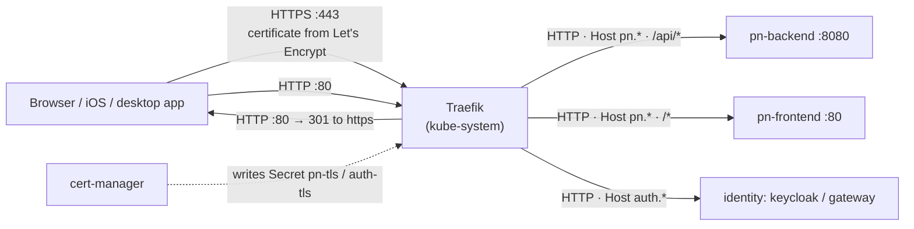
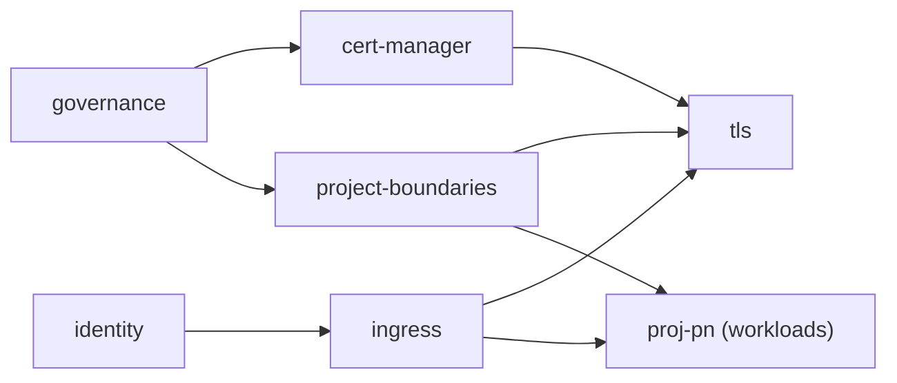
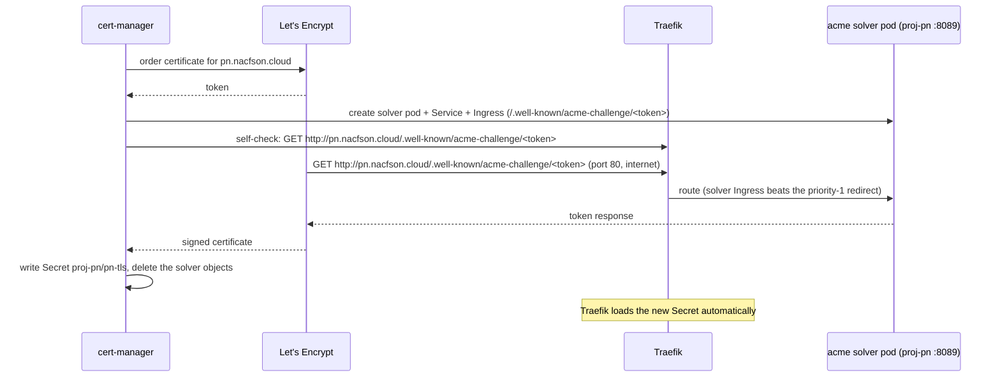

# TLS Certificates (cert-manager + Let's Encrypt)

**Status**: Implemented on branch `feat/platform-tls-cert-manager`
**Environments**: `vps-k3s` (Let's Encrypt production), `local-k3s` (self-signed)
**Hosts**: `pn.nacfson.cloud`, `auth.nacfson.cloud`

---

## 1. Problem

Users and apps reach the platform through Traefik on port 443. Traefik had no certificate for our hosts, so it served its built-in self-signed certificate:

```text
$ curl -svk https://pn.nacfson.cloud/ 2>&1 | grep -E 'subject:|issuer:'
*  subject: CN=TRAEFIK DEFAULT CERT
*  issuer: CN=TRAEFIK DEFAULT CERT
```

Browsers show a warning. Native apps (iOS, desktop) reject the connection before any `/api` request is sent. In the app, this looks like "the frontend cannot reach the backend", but everything inside the cluster works:

| Hop | Result before this change |
|---|---|
| Frontend pod → backend (DNS, NetworkPolicy, nginx proxy) | ✅ |
| Traefik → backend (`/api/auth/language-options` → `200`, `/api/auth/me` → `401`) | ✅ |
| Traefik → frontend (`/` → `200`) | ✅ |
| **Device → Traefik (TLS)** | ❌ self-signed certificate |

The old Project PN setup ended TLS in an nginx on the VM itself. The platform moved port 443 to Traefik, but no certificate was configured for it.

## 2. How a request flows

TLS ends at Traefik, the edge reverse proxy. Traffic inside the cluster stays plain HTTP. AWS (ALB + ACM), Google Cloud (HTTPS LB + managed certificates) and most self-hosted Kubernetes clusters use the same design.



| Kubernetes object | Traditional equivalent |
|---|---|
| Traefik (ingress controller) | The public reverse proxy (nginx, HAProxy, ALB) |
| `IngressRoute` | The reverse proxy's config (`server {}` / `location {}`) |
| `Certificate` (cert-manager) | "Keep a valid cert for this hostname": request it, then renew it |
| TLS `Secret` (`pn-tls`) | The `ssl_certificate` / `ssl_certificate_key` files |
| `ClusterIssuer` | Where certificates come from (Let's Encrypt, self-signed) |
| `NetworkPolicy` | Firewall rules (iptables, security groups) |

## 3. What changed

| File | Change |
|---|---|
| [deploy/platform/cert-manager/upstream/cert-manager.yaml](../deploy/platform/cert-manager/upstream/cert-manager.yaml) | **New.** Unmodified cert-manager **v1.21.2** release manifest (vendored; Flux has no helm-controller). |
| [deploy/platform/cert-manager/kustomization.yaml](../deploy/platform/cert-manager/kustomization.yaml) | **New layer.** Namespace labels and `prune: disabled`, plus CPU/memory requests and limits (preflight Rule 4). |
| [deploy/platform/tls/cluster-issuers.yaml](../deploy/platform/tls/cluster-issuers.yaml) | **New.** `selfsigned`, `letsencrypt-staging`, `letsencrypt-prod` (HTTP-01 through Traefik). |
| [deploy/platform/tls/certificates.yaml](../deploy/platform/tls/certificates.yaml) | **New.** `platform/auth-tls` and `proj-pn/pn-tls`. Base values are `example.com` with the `selfsigned` issuer. |
| [deploy/platform/ingress/http-redirect.yaml](../deploy/platform/ingress/http-redirect.yaml) | **New.** Port 80 catch-all → permanent redirect to HTTPS (priority 1). |
| [deploy/platform/ingress/traefik-middleware.yaml](../deploy/platform/ingress/traefik-middleware.yaml) | Adds Middleware `redirect-to-https`. |
| [deploy/platform/ingress/ingress-allowlist.yaml](../deploy/platform/ingress/ingress-allowlist.yaml) | `websecure` only, plus `tls.secretName: auth-tls`. |
| [deploy/projects/pn/workloads/ingress-route.yaml](../deploy/projects/pn/workloads/ingress-route.yaml) | `websecure` only, plus `tls.secretName: pn-tls`. |
| [deploy/projects/pn/boundary/acme-solver-network-policy.yaml](../deploy/projects/pn/boundary/acme-solver-network-policy.yaml) | **New.** Lets Traefik reach the temporary ACME solver pod on TCP 8089. |
| [deploy/platform/governance/manual-change-policy.yaml](../deploy/platform/governance/manual-change-policy.yaml) | Narrow exceptions for cert-manager service accounts, and adds `cert-manager` to the managed namespaces. |
| [clusters/vps-k3s/layers.yaml](../clusters/vps-k3s/layers.yaml) | New Flux layers `cert-manager` and `tls`. Patches the real hostnames and `letsencrypt-prod`. |
| [clusters/local-k3s/layers.yaml](../clusters/local-k3s/layers.yaml) | New Flux layers `cert-manager` and `tls`, with the base values (self-signed). |
| [scripts/render-invariants.py](../scripts/render-invariants.py) | Treats `ValidatingWebhookConfiguration`, `MutatingWebhookConfiguration` and `ClusterIssuer` as cluster-scoped. |
| [scripts/platform-preflight.py](../scripts/platform-preflight.py) | Adds `cert-manager` to `PLATFORM_NAMESPACES`, so it counts as platform reservation, not as a project. |
| [.github/workflows/lint.yaml](../.github/workflows/lint.yaml) | yamllint skips the vendored upstream manifest. |

### Flux layer order



The `ClusterIssuer` and `Certificate` kinds exist only after cert-manager installs its CRDs, so `tls` waits for `cert-manager`. Nothing waits for `tls`. Until a certificate is ready, Traefik keeps serving its default certificate, as it does today.

### Why the certificates live in the `tls` platform layer

- Traefik reads a TLS Secret only from the IngressRoute's own namespace, so `pn-tls` must be in `proj-pn`.
- The project layer may only render `Deployment`, `Service`, `ConfigMap` and `IngressRoute` (render invariant 6). Projects must not request certificates for arbitrary hostnames.
- Because of that, the platform owns the hostname-to-certificate mapping, the same way it owns the hostname patches in `clusters/<env>/`.

## 4. How issuance works (HTTP-01)



Renewal is automatic. cert-manager renews 30 days before expiry (certificates last 90 days) and repeats the same steps.

Each piece exists for a reason:

| Item | Why |
|---|---|
| `allow-acme-http01-solver` NetworkPolicy | `project-pn-isolation` admits Traefik only on 80/8080. The solver listens on 8089. |
| Admission policy exception (namespaced) | `gitops-managed-namespaces` denies writes from every service account outside Flux. cert-manager must write `secrets`, solver `pods`/`services`/`ingresses`, ACME `orders`/`challenges` and `events`. The exception allows **only** those resource types, and only for `system:serviceaccount:cert-manager:*`. |
| Admission policy exception (cluster) | cainjector must `UPDATE` the `caBundle` of **its own** webhook configurations (`cert-manager-webhook`). Without it, the cert-manager webhook never becomes trusted and every `Certificate` apply fails. |
| `cert-manager` added to the managed namespaces | Manual changes in the new namespace are rejected, as in every other platform namespace (render invariant 8). |
| Redirect route at priority 1 | All port 80 traffic goes to HTTPS, except ACME challenges, whose routes have a higher priority. |
| ResourceQuota (unchanged) | The solver pod (10m/64Mi requests, 100m/64Mi limits) fits in `project-pn-quota`. Current use is 400m CPU / 640Mi memory of 850m / 1536Mi. |
| Pod Security `restricted` (unchanged) | cert-manager solver pods run as non-root with seccomp `RuntimeDefault` and drop all capabilities. |

## 5. Prerequisites (check before merge)

1. **DNS** points to the node:
   ```sh
   dig +short pn.nacfson.cloud auth.nacfson.cloud     # expect 168.110.101.69 for both
   ```
2. **Port 80 and 443 are reachable from the internet.** Open them in the OCI Security List or NSG **and** in the host firewall (Oracle Linux images block most ports by default). Run this from a laptop, not from the VM:
   ```sh
   curl -s -o /dev/null -w '%{http_code}\n' http://pn.nacfson.cloud/      # expect 200 now (301 after rollout)
   curl -sk -o /dev/null -w '%{http_code}\n' https://pn.nacfson.cloud/    # expect 200
   ```
   On the VM:
   ```sh
   sudo firewall-cmd --list-all 2>/dev/null || sudo iptables -S INPUT | head -20
   ```
3. **No Cloudflare proxy** in front (the record is DNS-only). With the Cloudflare proxy on, HTTP-01 still works, but set SSL mode to **Full (strict)**.

## 6. Rollout

Merge the PR to `main`. Flux applies the layers in order. Watch the progress (read-only access is enough):

```sh
flux get kustomizations                       # governance → cert-manager → tls become Ready
kubectl get pods -n cert-manager              # 3 pods Running
kubectl get clusterissuer                     # letsencrypt-prod READY=True
kubectl get certificate -A                    # pn-tls, auth-tls READY=True (usually 1–2 min)
```

While a certificate is being issued:

```sh
kubectl get certificaterequest,order,challenge -A
kubectl describe challenge -n proj-pn         # shows the HTTP-01 state and error messages
```

## 7. Verification

From a laptop:

```sh
# Trusted certificate, no -k needed
curl -sI https://pn.nacfson.cloud/api/auth/language-options | head -1          # HTTP/2 200
curl -sI https://auth.nacfson.cloud/realms/platform/protocol/openid-connect/auth | head -1

# Issuer and expiry
echo | openssl s_client -connect pn.nacfson.cloud:443 -servername pn.nacfson.cloud 2>/dev/null \
  | openssl x509 -noout -issuer -subject -enddate     # issuer: Let's Encrypt (R1x/E x)

# HTTP redirects to HTTPS
curl -sI http://pn.nacfson.cloud/ | grep -iE '^(HTTP|location)'                 # 301/308 → https://
```

Then open `https://pn.nacfson.cloud` in a browser and in the iOS app. There should be no certificate warning, and API calls should succeed.

## 8. Troubleshooting

| Symptom | Check | Likely fix |
|---|---|---|
| `cert-manager` layer not Ready | `kubectl get pods -n cert-manager`, `flux logs --kind=Kustomization --name=cert-manager` | Image pull or resource limits; read the pod events. |
| `tls` layer: `failed calling webhook "webhook.cert-manager.io"` | `kubectl get validatingwebhookconfiguration cert-manager-webhook -o jsonpath='{.webhooks[0].clientConfig.caBundle}' \| head -c 20` | An empty caBundle means cainjector was blocked. Check `kubectl logs -n cert-manager deploy/cert-manager-cainjector` for `Manual change rejected`. |
| cert-manager logs show `Manual change rejected` | The admission policy message | A resource type is missing from the cert-manager exception in `manual-change-policy.yaml`. |
| Challenge `pending`, self-check `connection timed out` | `kubectl describe challenge -n proj-pn` | Port 80 is closed in OCI/host firewall, or the solver NetworkPolicy is missing. |
| Challenge self-check `404` | `kubectl get ingress -n proj-pn`, Traefik logs | The solver Ingress isn't picked up. Check that the `traefik` IngressClass exists: `kubectl get ingressclass`. |
| Challenge `invalid`, then `429 rateLimited` | `kubectl describe order -n proj-pn` | Let's Encrypt rate limit. Switch the vps patch to `letsencrypt-staging`, fix the cause, then switch back. |
| Browser still shows `TRAEFIK DEFAULT CERT` | `kubectl get secret pn-tls -n proj-pn`, `kubectl logs -n kube-system deploy/traefik \| grep -i tls` | The Secret is not created yet, or the name in the IngressRoute is wrong. |

## 9. Operations

- **Expiry check:** `kubectl get certificate -A -o custom-columns=NS:.metadata.namespace,NAME:.metadata.name,READY:.status.conditions[0].status,EXPIRES:.status.notAfter,RENEW:.status.renewalTime`
- **Force renewal (break-glass):** `cmctl renew pn-tls -n proj-pn`, or delete the Secret `pn-tls` so cert-manager issues a new one.
- **Add a hostname for a new project:** add a `Certificate` to `deploy/platform/tls/certificates.yaml` in the project namespace, a `tls.secretName` on the project IngressRoute, a solver NetworkPolicy in the project boundary, and the hostname patch in `clusters/vps-k3s/layers.yaml`.
- **Upgrade cert-manager:** replace `upstream/cert-manager.yaml` with the new release file, update the URL and sha256 in `deploy/platform/cert-manager/kustomization.yaml`, then run `./scripts/render-validate.sh vps-k3s` and `local-k3s`.

## 10. Rollback

Revert the PR. Flux then:

- restores `web` + `websecure` on both IngressRoutes without `tls` (back to the Traefik default certificate),
- removes the redirect route and the `tls` layer objects (Certificates and Issuers; the Secrets stay as orphans),
- removes the cert-manager workloads. The `cert-manager` namespace stays, because of `prune: disabled`.

For a faster partial rollback, keep cert-manager and remove only the `tls:` blocks.

## 11. Validation run for this change

| Check (same as CI) | vps-k3s | local-k3s |
|---|---|---|
| yamllint (`deploy/`, `clusters/`) | ✅ | ✅ |
| `python3 -m unittest discover tests/preflight` (14 tests) | ✅ | ✅ |
| `scripts/render-validate.sh` (flux build + kubeconform strict + render invariants) | ✅ | ✅ |
| `scripts/platform-preflight.py` against the `origin/main` baseline | ✅ PASSED | ✅ PASSED |

The cluster has not been tested yet. Sections 6–7 are the post-merge checks.
