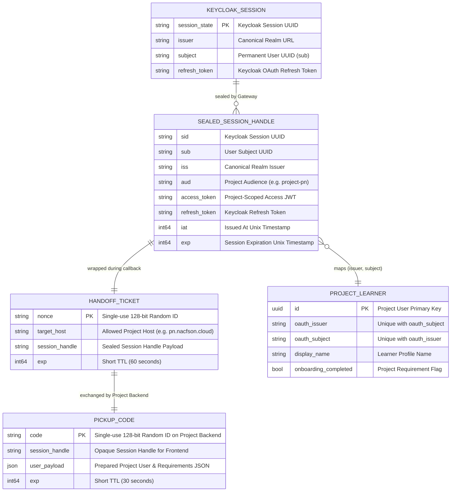
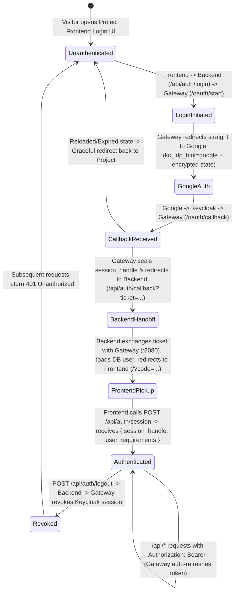

# Data Model: Backend-First Headless Login Logic & Shared Project Authentication

**Feature**: `009-host-scoped-shared-auth`
**Date**: 2026-10-14

## 1. Entity Overview

---

## 2. Core Data Structures

### 2.1 Stateless Encrypted OIDC `StatePayload` (Gateway)

Used during `/oauth/start` ➔ Keycloak/Google ➔ `/oauth/callback`. Encrypted with AES-256-GCM using `SHA-256(HMACSecret)` from OpenBao Vault (zero browser cookies required).

| Field | Type | Validation / Constraints | Description |
| :--- | :--- | :--- | :--- |
| `target_url` | `string` (`json:"target_url"`) | Must match `AllowedReturnHosts` (`https://<project-host>/...`) | Project backend callback or return URL |
| `code_verifier` | `string` (`json:"cv"`) | 43-char base64url PKCE verifier (256-bit entropy) | Embedded inside AES-GCM encrypted state so no `OIDC_AUTH_STATE` cookie is needed |
| `nonce` | `string` (`json:"nonce"`) | 128-bit random hex/base64url | Prevents replay attacks |
| `ts` | `int64` (`json:"ts"`) | `now - ts <= 600` (10-minute window) | Creation timestamp in Unix seconds |

---

### 2.2 Opaque Sealed `SessionHandleData` (`session_handle`) (Gateway)

Created by `Gateway` upon successful code exchange with Keycloak, encrypted with AES-256-GCM + HMAC using the Gateway's Vault secret. Passed as an opaque string (`Authorization: Bearer <session_handle>`) between `Frontend ➔ Project Backend ➔ Internal Gateway`.

| Field | Type | Validation / Constraints | Description |
| :--- | :--- | :--- | :--- |
| `sid` | `string` (`json:"sid"`) | Non-empty UUID | Keycloak `session_state` ID for online revocation |
| `sub` | `string` (`json:"sub"`) | Non-empty UUID / string | Permanent user identifier within `iss` |
| `iss` | `string` (`json:"iss"`) | Must match `CanonicalIssuer()` (`KEYCLOAK_PUBLIC_URL` fallback `KEYCLOAK_ISSUER_URL`) | Canonical OIDC realm issuer |
| `aud` | `string` (`json:"aud"`) | Must match `deriveProjectAudience(targetHost)` (e.g., `project-pn`) | Strict per-project audience binding |
| `tokens` | `map[string]string` (`json:"tokens"`) | Keyed by `aud` | Short-lived project-scoped Keycloak access token |
| `rt` | `string` (`json:"rt"`) | Non-empty OAuth refresh token | Used by `Gateway` internally to refresh expired access tokens |
| `iat` | `int64` (`json:"iat"`) | `now - iat < SessionTimeout` (8h default) | Session creation timestamp |

---

### 2.3 One-Time Callback `HandoffTicket` (Gateway ➔ Project Backend)

Issued by `Gateway` at the end of `/oauth/callback` when redirecting the browser to `https://<project-host>/api/auth/callback?ticket=<ticket>`.

| Field | Type | Validation / Constraints | Description |
| :--- | :--- | :--- | :--- |
| `ticket_id` | `string` | 128-bit random single-use ID | Consumed once on `POST /auth/exchange` (or verified via sealed payload) |
| `host` | `string` | Must match `X-Forwarded-Host` / `host` of calling Project Backend | Prevents cross-project ticket redemption |
| `session_handle` | `string` | Valid sealed `SessionHandleData` | Opaque session handle delivered to Project Backend |
| `sub` | `string` | Verified subject | Returned directly in exchange JSON |
| `iss` | `string` | Verified canonical issuer | Returned directly in exchange JSON |
| `exp` | `int64` | 60-second TTL | Short-lived bridge window |

---

### 2.4 One-Time Frontend `PickupCode` (Project Backend ➔ Project Frontend)

Managed by the Shared Verification Module inside each Project Backend to bridge the browser redirect from `/api/auth/callback` to the Frontend UI (`https://<project-host>/?code=<code>`) without cookies.

| Field | Type | Validation / Constraints | Description |
| :--- | :--- | :--- | :--- |
| `code` | `string` | 128-bit random single-use ID, deleted immediately on first `POST /api/auth/session` | One-time pickup key |
| `session_handle` | `string` | Non-empty opaque handle | Returned in JSON body `{ "session_handle": "...", ... }` |
| `user` | `any` (JSON) | Prepared by Project Backend's user loader hook | Project-specific user profile & requirements |
| `expires_at` | `time.Time` | `now + 30s` | Automatically evicted after 30 seconds or first use |

---

## 3. State Transitions

