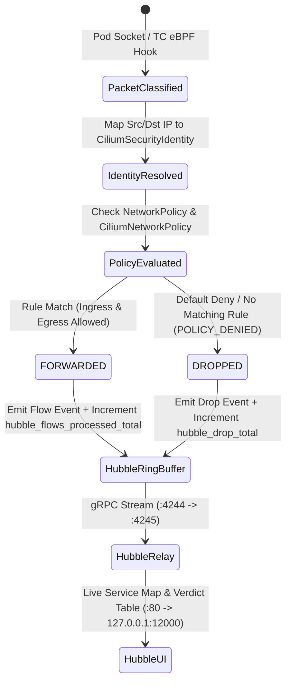

# Data Model: Cilium + Hubble CNI & Visual Platform Network Observability

**Feature**: [spec.md](spec.md) · **Research**: [research.md](research.md) · **Date**: 2026-10-16

This feature introduces declarative Kubernetes, FluxCD, and Cilium CRD objects rather than application database tables. The entities below define the exact schemas, invariants, and state transitions enforced by GitOps and `platform-preflight`.

---

## 1. FluxCD CNI Reconciliation Layer (`cni`)

Declared in [`clusters/local-k3s/layers.yaml`](../../clusters/local-k3s/layers.yaml) and [`clusters/vps-k3s/layers.yaml`](../../clusters/vps-k3s/layers.yaml).

| Field | Value / Type | Constraint / Invariant |
| :--- | :--- | :--- |
| `apiVersion` | `kustomize.toolkit.fluxcd.io/v1` | Flux Kustomization API |
| `kind` | `Kustomization` | — |
| `metadata.name` | `cni` | Root platform CNI layer |
| `metadata.namespace` | `flux-system` | Required by `render-invariants.py` Invariant 6 |
| `spec.path` | `./deploy/platform/cni` | Single Git-owned CNI manifest bundle (`FR-002`) |
| `spec.prune` | `true` | Prunes removed CNI objects |
| `spec.wait` | `true` | Waits for `cilium`, `cilium-operator`, `hubble-relay`, `hubble-ui`, and Cilium CRDs before dependent layers run |
| `spec.interval` / `timeout` | `5m` / `5m` | Standard platform layer cadence |
| Downstream Dependent | `Kustomization/vault` | `vault.spec.dependsOn` includes `{name: governance}` and `{name: cni}` so `CiliumNetworkPolicy` CRD is established before `vault` reconciles |

---

## 2. Cilium & Hubble Workloads (`deploy/platform/cni/`)

All workloads reside in `namespace: kube-system` (included in `PLATFORM_NAMESPACES` in [`scripts/platform-preflight.py`](../../scripts/platform-preflight.py)).

| Resource | Image (Pinned Tag + Digest) | Containers | CPU (`req` / `lim`) | Memory (`req` / `lim`) | Exposed Ports / Services |
| :--- | :--- | :--- | :--- | :--- | :--- |
| `DaemonSet/cilium` | `quay.io/cilium/cilium:v1.20.3@sha256:95cfa5c2427cc6b452c00908778d0566311f572589284af949d06a013db1a849` | 6 × `initContainers` 1 × `cilium-agent` | `10m` / `100m` (×6) `100m` / `500m` | `16Mi` / `64Mi` (×6) `192Mi` / `384Mi` | `:4244/TCP` (`Service/hubble-peer`) `:9965/TCP` (`Service/hubble-metrics`) `:9962/TCP` (agent Prometheus) |
| `Deployment/cilium-operator` | `quay.io/cilium/operator-generic:v1.20.3@sha256:efdd8d89d6d8f63d21a065fa2f9e17614a2b3ac9371b221af9355f63829e2dbc` | `cilium-operator` (`replicas: 1`) | `25m` / `200m` | `64Mi` / `192Mi` | `:9963/TCP` (operator Prometheus) |
| `Deployment/hubble-relay` | `quay.io/cilium/hubble-relay:v1.20.3@sha256:c6f819d9c5e0b35ccac63b9f2f1ae213fd9be50588e15d5a444d5d305ad317b5` | `hubble-relay` (`replicas: 1`) | `15m` / `150m` | `48Mi` / `128Mi` | `:4245/TCP` (`Service/hubble-relay`, `ClusterIP`) |
| `Deployment/hubble-ui` | `quay.io/cilium/hubble-ui:v0.13.6@sha256:049a80a03585c043d0c3121bdc518c72b0fd42bae07e4bcce0fdb8f1e88041d0` `quay.io/cilium/hubble-ui-backend:v0.13.6@sha256:83b3fc763f3d49948c306bf49b08277383e195904b9ca5c0c0022b2112628787` | `frontend` (`replicas: 1`) `backend` (`replicas: 1`) | `10m` / `100m` `15m` / `100m` | `32Mi` / `64Mi` `48Mi` / `96Mi` | `:80/TCP` → `:8081/TCP` (`Service/hubble-ui`, `ClusterIP`) |

### Validation Rules
- **Zero Secrets**: `deploy/platform/cni/` MUST NOT contain any `Secret` resource (`hubble.tls.enabled=false`).
- **Zero Extra Namespaces**: `deploy/platform/cni/` MUST NOT declare any `Namespace` resource; every namespaced object MUST explicitly set `metadata.namespace: kube-system` (`render-invariants.py` Invariant 3 & Invariant 8).
- **Zero Public Exposure**: Neither `hubble-ui` nor `hubble-relay` may be referenced by any `IngressRoute` or `Ingress` (`FR-010`).

---

## 3. OpenBao API Server Egress Policy (`openbao-apiserver-egress`)

Declared in [`deploy/platform/vault/network-policy.yaml`](../../deploy/platform/vault/network-policy.yaml) alongside the existing `networking.k8s.io/v1` `NetworkPolicy` objects.

| Field | Value / Type | Purpose / Constraint |
| :--- | :--- | :--- |
| `apiVersion` | `cilium.io/v2` | Cilium CRD schema validated by `kubeconform` via Datree CRDs catalog |
| `kind` | `CiliumNetworkPolicy` | Platform-only entity-aware policy (`FR-006`) |
| `metadata.name` | `openbao-apiserver-egress` | — |
| `metadata.namespace` | `vault` | Scoped strictly to the `vault` namespace |
| `spec.endpointSelector.matchLabels` | `app.kubernetes.io/name: openbao` | Applies only to the OpenBao StatefulSet pods |
| `spec.egress[0].toEntities` | `["kube-apiserver"]` | Matches Cilium reserved identity `7` (`kube-apiserver`), permitting `TokenReview` calls to `10.43.0.1:443` / `<NODE_IP>:6443` while blocking `reserved:world` internet egress |
| `spec.egress[0].toPorts[0].ports` | `[{port: "443", protocol: TCP}, {port: "6443", protocol: TCP}]` | Restricts egress to HTTPS API server ports only |

Companion update in [`deploy/platform/vault/network-policy.yaml`](../../deploy/platform/vault/network-policy.yaml):
- Remove the `ipBlock: { cidr: 0.0.0.0/0 }` egress entry from `NetworkPolicy/openbao-ingress-policy`.
- Add `NetworkPolicy/openbao-backup-policy` in `namespace: vault` selecting `app.kubernetes.io/name: openbao-backup` with egress to `app.kubernetes.io/name: openbao` on TCP port `8200` so scheduled Raft snapshots succeed under Cilium's strict default-deny enforcement.

---

## 4. Network Flow Verdict & Metrics Export Boundary

Produced at runtime by `cilium-agent` (`kube-system`) and aggregated by `hubble-relay` (`kube-system`).

| Interface | Endpoint | Protocol | Consumers |
| :--- | :--- | :--- | :--- |
| **Hubble Peer** | `hubble-peer.kube-system.svc.cluster.local:4244` | gRPC | `hubble-relay` (Phase 1) |
| **Hubble Relay** | `hubble-relay.kube-system.svc.cluster.local:4245` | gRPC (`Observer` service) | `hubble-ui` backend (Phase 1), `hubble` CLI / future collectors (Phase 2) |
| **Hubble UI** | `hubble-ui.kube-system.svc.cluster.local:80` | HTTP (`ClusterIP` only) | Operator browser via [`scripts/open-hubble-ui.sh`](../../scripts/open-hubble-ui.sh) (`http://127.0.0.1:12000`) |
| **Hubble Metrics** | `hubble-metrics.kube-system.svc.cluster.local:9965/metrics` | HTTP (`text/plain` OpenMetrics) | Verification probes (`SC-005`) & future Prometheus/Grafana stack (`FR-012`) |
