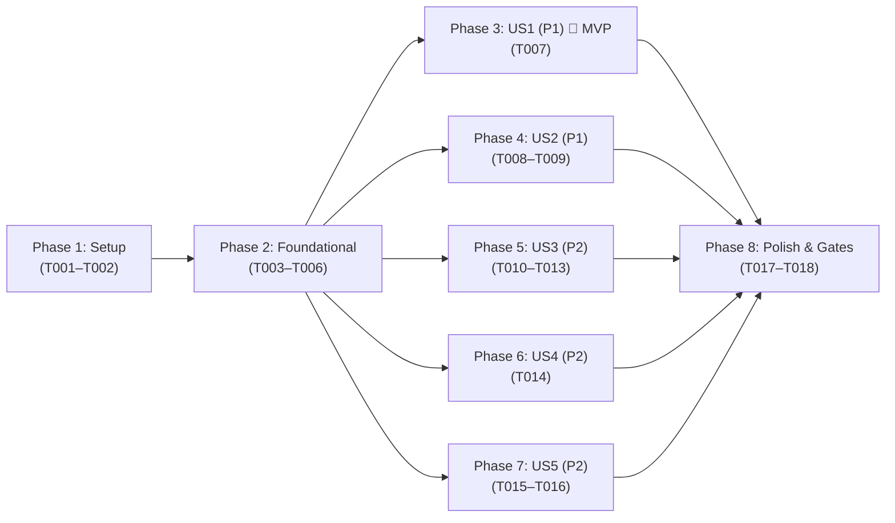

# Tasks: Cilium + Hubble CNI & Visual Platform Network Observability

**Input**: Design documents from `/specs/010-cilium-hubble-observability/`
**Prerequisites**: [plan.md](plan.md) (required), [spec.md](spec.md) (required), [research.md](research.md), [data-model.md](data-model.md), [contracts/](contracts/), [quickstart.md](quickstart.md)

**Tests**: Preflight unit tests (`tests/preflight/test_platform_preflight.py`), automated runtime verification (`scripts/open-hubble-ui.sh --verify`), and offline render/schema/lint validations (`scripts/render-validate.sh`, `scripts/platform-preflight.py`, `shellcheck`, `ansible-playbook --syntax-check`) are included to enforce constitutional and preflight gates (`FR-009`, `FR-013`, `SC-001`–`SC-006`).

**Organization**: Tasks are grouped by user story (`US1`–`US5`) to enable independent implementation and verification of each story increment.

## Format: `[ID] [P?] [Story] Description`

- **[P]**: Can run in parallel (different files, no dependencies on incomplete tasks)
- **[Story]**: Which user story this task belongs to (`[US1]`–`[US5]`)
- Exact repository-relative file paths are included in every task description

---

## Phase 1: Setup (Shared Infrastructure)

**Purpose**: Create the Git-owned CNI layer directory structure and configure CI YAML linting ignore rules for the vendored upstream Cilium manifest.

- [X] T001 Create directory structure `deploy/platform/cni/` and `deploy/platform/cni/upstream/` per `specs/010-cilium-hubble-observability/plan.md`
- [X] T002 [P] Update `.github/workflows/lint.yaml` to add `deploy/platform/cni/upstream/` to the `yamllint` `ignore` list alongside `deploy/platform/cert-manager/upstream/`

---

## Phase 2: Foundational (Blocking Prerequisites)

**Purpose**: Vendor the pinned Cilium `v1.20.3` + Hubble UI `v0.13.6` manifest bundle, enforce explicit container CPU/memory requests and limits for `platform-preflight.py`, and wire the `cni` FluxCD Kustomization layer into both cluster environments (`FR-001`, `FR-002`, `FR-003`, `FR-008`, `FR-009`, `FR-011`, `SC-002`, `SC-004`, `SC-006`).

**⚠️ CRITICAL**: No user story work can begin until this phase is complete.

- [X] T003 Render the pinned Cilium `v1.20.3` (`quay.io/cilium/cilium:v1.20.3@sha256:95cfa5c2427cc6b452c00908778d0566311f572589284af949d06a013db1a849`, `quay.io/cilium/operator-generic:v1.20.3@sha256:efdd8d89d6d8f63d21a065fa2f9e17614a2b3ac9371b221af9355f63829e2dbc`, `quay.io/cilium/hubble-relay:v1.20.3@sha256:c6f819d9c5e0b35ccac63b9f2f1ae213fd9be50588e15d5a444d5d305ad317b5`) and Hubble UI `v0.13.6` (`quay.io/cilium/hubble-ui:v0.13.6@sha256:049a80a03585c043d0c3121bdc518c72b0fd42bae07e4bcce0fdb8f1e88041d0`, `quay.io/cilium/hubble-ui-backend:v0.13.6@sha256:83b3fc763f3d49948c306bf49b08277383e195904b9ca5c0c0022b2112628787`) static manifest into `deploy/platform/cni/upstream/cilium.yaml` with `ipam.mode=kubernetes`, `kubeProxyReplacement=false`, `operator.replicas=1`, `envoy.enabled=false`, `tls.secretsNamespace.create=false`, `tls.secretsNamespace.name=kube-system`, `tls.secretSync.enabled=false`, `hubble.tls.enabled=false`, and `hubble.eventBufferCapacity=4095` (enforcing `Zero Secrets`, `Zero Extra Namespaces`, and explicit `metadata.namespace: kube-system` on every namespaced object) (`FR-001`, `FR-002`, `FR-003`, `FR-008`, `FR-011`, `SC-002`, `SC-006`)
- [X] T004 Create `deploy/platform/cni/kustomization.yaml` referencing `upstream/cilium.yaml` and patching explicit CPU/memory `requests` and `limits` onto every container and `initContainer` (`DaemonSet/cilium` 6 × `initContainers` `10m`/`16Mi` req, `100m`/`64Mi` lim; `cilium-agent` `100m`/`192Mi` req, `500m`/`384Mi` lim; `Deployment/cilium-operator` `25m`/`64Mi` req, `200m`/`192Mi` lim; `Deployment/hubble-relay` `15m`/`48Mi` req, `150m`/`128Mi` lim; `Deployment/hubble-ui` `frontend` `10m`/`32Mi` req, `100m`/`64Mi` lim and `backend` `15m`/`48Mi` req, `100m`/`96Mi` lim; totaling `+225m` CPU request and `+1248Mi` memory limit in `platformReservations`) (`FR-009`, `SC-004`)
- [X] T005 [P] Update `clusters/local-k3s/layers.yaml` to add the root Flux `Kustomization` `cni` (`apiVersion: kustomize.toolkit.fluxcd.io/v1`, `metadata.namespace: flux-system`, `spec.path: ./deploy/platform/cni`, `spec.prune: true`, `spec.wait: true`, `spec.interval: 5m`, `spec.retryInterval: 1m`, `spec.timeout: 5m`) and add `- name: cni` to `vault.spec.dependsOn` (`FR-002`)
- [X] T006 [P] Update `clusters/vps-k3s/layers.yaml` to add the root Flux `Kustomization` `cni` (`apiVersion: kustomize.toolkit.fluxcd.io/v1`, `metadata.namespace: flux-system`, `spec.path: ./deploy/platform/cni`, `spec.prune: true`, `spec.wait: true`, `spec.interval: 5m`, `spec.retryInterval: 1m`, `spec.timeout: 5m`) and add `- name: cni` to `vault.spec.dependsOn` (`FR-002`)

**Checkpoint**: `deploy/platform/cni/` builds cleanly with `flux build kustomization cni` and `kubectl kustomize deploy/platform/cni`.

---

## Phase 3: User Story 1 - Visual diagnosis of internal network flows and policy drops via Hubble UI alone (Priority: P1) 🎯 MVP

**Goal**: Provide a live visual service dependency graph and `Forwarded` / `Dropped` flow table in Hubble UI backed by Hubble Relay and a bounded in-memory ring buffer (`FR-003`, `FR-004`, `FR-008`, `FR-011`, `SC-001`, `SC-006`).

**Independent Test**: Render `deploy/platform/cni/` and verify that `ConfigMap/cilium-config` (`hubble-event-buffer-capacity: "4095"`), `ConfigMap/hubble-relay-config`, `Deployment/hubble-relay`, `Deployment/hubble-ui`, `Service/hubble-peer` (`:4244`), `Service/hubble-relay` (`:4245`), and `Service/hubble-ui` (`:80` → `:8081`) are configured so Hubble UI streams live `Forwarded` and `Dropped` flows from `hubble-relay.kube-system.svc.cluster.local:4245`.

### Implementation for User Story 1

- [X] T007 [US1] Verify and configure `ConfigMap/cilium-config` (`enable-hubble: "true"`, `hubble-listen-address: ":4244"`, `hubble-disable-tls: "true"`, `hubble-event-buffer-capacity: "4095"`), `ConfigMap/hubble-relay-config` (`peer-service: "hubble-peer.kube-system.svc.cluster.local:4244"`, `disable-server-tls: true`, `disable-client-tls: true`), `Service/hubble-peer` (`4244/TCP`), `Service/hubble-relay` (`4245/TCP`), and `Service/hubble-ui` (`80/TCP` → `8081/TCP`, `type: ClusterIP`) in `deploy/platform/cni/upstream/cilium.yaml` (`FR-003`, `FR-004`, `FR-008`, `FR-011`, `SC-001`, `SC-006`)

**Checkpoint**: User Story 1 artifacts in `deploy/platform/cni/` are complete and ready to stream `Forwarded` and `Dropped` verdicts to Hubble UI.

---

## Phase 4: User Story 2 - Seamless enforcement of existing portable network policies and tightened Vault API egress (Priority: P1)

**Goal**: Enforce all `NetworkPolicy` boundaries via Cilium's eBPF datapath without modifying Traefik ingress/TLS or tenant `proj-*` `NetworkPolicy` manifests, replace OpenBao's broad `ipBlock: 0.0.0.0/0` egress workaround with an entity-scoped `CiliumNetworkPolicy` targeting `toEntities: ["kube-apiserver"]`, and allow scheduled OpenBao backups to reach OpenBao `:8200` (`FR-006`, `FR-007`, `SC-003`).

**Independent Test**: Run `./scripts/render-validate.sh local-k3s`, `./scripts/render-validate.sh vps-k3s`, and `python3 -m unittest discover tests/preflight` to verify `CiliumNetworkPolicy/openbao-apiserver-egress` passes `kubeconform` schema validation and `platform-preflight.py`, while `proj-pn` retains 100% standard `networking.k8s.io/v1` `NetworkPolicy`.

### Implementation for User Story 2

- [X] T008 [US2] Update `deploy/platform/vault/network-policy.yaml` to remove `ipBlock: { cidr: 0.0.0.0/0 }` from `NetworkPolicy/openbao-ingress-policy`, add `CiliumNetworkPolicy/openbao-apiserver-egress` (`apiVersion: cilium.io/v2`, `kind: CiliumNetworkPolicy`, `metadata.namespace: vault`, `spec.endpointSelector.matchLabels: {"app.kubernetes.io/name": "openbao"}`, `spec.egress[0].toEntities: ["kube-apiserver"]`, `spec.egress[0].toPorts[0].ports: [{port: "443", protocol: TCP}, {port: "6443", protocol: TCP}]`), and add `NetworkPolicy/openbao-backup-policy` in `namespace: vault` selecting `app.kubernetes.io/name: openbao-backup` with egress to `app.kubernetes.io/name: openbao` on TCP port `8200` (`FR-006`, `FR-007`, `SC-003`)
- [X] T009 [US2] Add unit test `test_23_cni_reservation_and_openbao_cnp_accepted` in `tests/preflight/test_platform_preflight.py` verifying that the rendered `deploy/platform/cni/` layer (`+225m` CPU, `+1248Mi` memory in `platformReservations`) and `deploy/platform/vault/network-policy.yaml` (`CiliumNetworkPolicy/openbao-apiserver-egress`) pass `scripts/platform-preflight.py` while `proj-pn` remains on standard `networking.k8s.io/v1` `NetworkPolicy` (`FR-006`, `FR-007`, `FR-009`, `SC-003`, `SC-004`)

**Checkpoint**: `deploy/platform/vault/network-policy.yaml` enforces strict `kube-apiserver` entity egress and passes `kubeconform` and `platform-preflight` tests.

---

## Phase 5: User Story 3 - Deterministic host bootstrap and 1/n resource budget compliance (Priority: P2)

**Goal**: Clean up stale legacy Flannel/CNI interfaces (`flannel.1`, `cni0`, `/etc/cni/net.d`, `/var/lib/cni`) during host preparation, configure K3s to boot with `--flannel-backend=none --disable-network-policy`, stage and apply `deploy/platform/cni/` idempotently during Ansible VM bootstrap so the node and CoreDNS reach `Ready`, and verify Cilium rollout in `bootstrap/tasks/verify.yml` (`FR-001`, `FR-002`, `FR-009`, `SC-004`).

**Independent Test**: Run `ansible-playbook -i 'syntax-check-vm,' -u ubuntu -e 'k3s_version=v1.35.9+k3s1' -e 'gitops_environment=local-k3s' bootstrap/bootstrap.yml --syntax-check` and verify all bootstrap tasks parse cleanly and enforce the CNI staging and rollout checks.

### Implementation for User Story 3

- [X] T010 [P] [US3] Update `bootstrap/bootstrap.yml` Stage 0 host preparation to clean up stale Flannel/CNI interfaces and state (`ip link delete flannel.1 2>/dev/null || true`, `ip link delete cni0 2>/dev/null || true`, `rm -rf /etc/cni/net.d /var/lib/cni`) and update `bootstrap/templates/k3s.service.j2` to set `ExecStart=/usr/local/bin/k3s server --flannel-backend=none --disable-network-policy` (`FR-001`, `FR-002`)
- [X] T011 [P] [US3] Update `bootstrap/tasks/preflight.yml` to assert on `localhost` that `{{ playbook_dir }}/../deploy/platform/cni` exists and is a directory before host installation begins (`FR-002`)
- [X] T012 [US3] Update `bootstrap/tasks/install.yml` to check whether `daemonset/cilium` is already present in `kube-system` (`cni_preexisting`) and, when absent, copy `{{ playbook_dir }}/../deploy/platform/cni/` to `/var/lib/nacfson-bootstrap/cni/` (`mode: "0600"`, `owner: root`) and apply it via `k3s kubectl apply --server-side -k /var/lib/nacfson-bootstrap/cni/` after `/etc/rancher/k3s/k3s.yaml` is created (`FR-002`)
- [X] T013 [US3] Update `bootstrap/tasks/verify.yml` to verify `k3s kubectl --request-timeout=5s -n kube-system rollout status daemonset/cilium --timeout=300s` and `k3s kubectl --request-timeout=5s -n kube-system rollout status deployment/cilium-operator --timeout=300s` prior to the `coredns` rollout check (`FR-001`, `FR-002`)

**Checkpoint**: Bootstrap playbook (`bootstrap/bootstrap.yml`) cleans up legacy Flannel interfaces, configures `--flannel-backend=none --disable-network-policy`, installs `deploy/platform/cni/`, and passes `--syntax-check`.

---

## Phase 6: User Story 4 - Seamless future expansion path from Hubble UI alone to Grafana (Priority: P2)

**Goal**: Enable Hubble's internal OpenMetrics endpoint (`:9965/metrics` with `dns`, `drop`, `tcp`, `flow` metrics) and Hubble Relay gRPC stream (`:4245`) in Phase 1 while deploying zero Grafana, Prometheus, or Loki pods (`FR-003`, `FR-005`, `SC-002`).

**Independent Test**: Inspect `deploy/platform/cni/upstream/cilium.yaml` and rendered cluster manifests to confirm `hubble-metrics-server: ":9965"`, `hubble-metrics: "dns drop tcp flow"`, `Service/hubble-metrics` (`:9965`), and `Service/hubble-relay` (`:4245`) are present and zero `grafana`, `prometheus`, or `loki` workloads exist.

### Implementation for User Story 4

- [X] T014 [US4] Configure and verify in `deploy/platform/cni/upstream/cilium.yaml` that `ConfigMap/cilium-config` sets `hubble-metrics-server: ":9965"`, `hubble-metrics: "dns drop tcp flow"`, `prometheus-serve-addr: ":9962"`, and `operator-prometheus-serve-addr: ":9963"`, that `Service/hubble-metrics` exposes port `9965/TCP` in `namespace: kube-system`, and that zero Grafana, Prometheus, or Loki workloads are declared (`FR-003`, `FR-005`, `SC-002`)

**Checkpoint**: Prometheus metrics (`:9965/metrics`) and Relay gRPC (`:4245`) endpoints are pre-wired in `deploy/platform/cni/` with zero extra observability pods.

---

## Phase 7: User Story 5 - Private operator-only access to Hubble UI and telemetry endpoints (Priority: P2)

**Goal**: Keep `hubble-ui`, `hubble-relay`, and `hubble-metrics` strictly private (`ClusterIP` only, zero public `IngressRoute`) and provide `scripts/open-hubble-ui.sh` with both local port-forward tunnel mode (`http://127.0.0.1:12000`) and `--verify` mode implementing all 5 `FR-013` verification checks (`FR-010`, `FR-013`, `SC-001`, `SC-002`, `SC-003`, `SC-005`).

**Independent Test**: Run `shellcheck scripts/open-hubble-ui.sh` and `python3 -m unittest discover tests/preflight` to verify the helper script passes linting and no public ingress exposes Hubble services.

### Implementation for User Story 5

- [X] T015 [US5] Create executable operator helper and verification script `scripts/open-hubble-ui.sh` supporting: (1) default tunnel mode (`./scripts/open-hubble-ui.sh [--port <local-port>]`) that checks pod readiness and runs `kubectl -n kube-system port-forward svc/hubble-ui "${PORT:-12000}:80" --address 127.0.0.1`, and (2) automated verification mode (`./scripts/open-hubble-ui.sh --verify`) that validates all 5 `FR-013` checks: Cilium/Hubble pod health + zero Grafana/Prometheus/Loki pods (`SC-002`), standard `NetworkPolicy` + OpenBao `CiliumNetworkPolicy/openbao-apiserver-egress` enforcement (`SC-003`), Hubble `FORWARDED`/`DROPPED` flow verdict capture (`SC-001`), `:9965/metrics` internal scrapability (`SC-002`), and `ClusterIP`-only private Hubble exposure with zero public ingress routes (`SC-005`) (`FR-010`, `FR-013`)
- [X] T016 [US5] Add assertion in `tests/preflight/test_platform_preflight.py` verifying that `Service/hubble-ui` and `Service/hubble-relay` in `deploy/platform/cni/` are `type: ClusterIP` and that no rendered `IngressRoute` or `Ingress` in `local-k3s` or `vps-k3s` references `hubble-ui`, `hubble-relay`, or `hubble-metrics` (`FR-010`, `SC-005`)

**Checkpoint**: `scripts/open-hubble-ui.sh` is executable, passes `shellcheck`, supports `--verify` (`FR-013`), and private-only `ClusterIP` exposure is verified by unit tests.

---

## Phase 8: Polish & Cross-Cutting Concerns

**Purpose**: Synchronize all required platform documentation (`SPEC.md`, `ARCHITECTURE.md`, `DEPENDENCIES.md`, `docs/bootstrap-scope.md`, and `INDEX.md` per `FR-012`) and run the complete offline validation suite from `quickstart.md`.

- [X] T017 [P] Update `SPEC.md`, `ARCHITECTURE.md`, `DEPENDENCIES.md`, `docs/bootstrap-scope.md`, and `INDEX.md` to document the `cni` FluxCD layer (`./deploy/platform/cni`), pinned Cilium `v1.20.3` and Hubble UI `v0.13.6` images/digests, `CiliumNetworkPolicy/openbao-apiserver-egress`, K3s `--flannel-backend=none --disable-network-policy` bootstrap staging, `scripts/open-hubble-ui.sh`, and the Phase 2 Grafana expansion path (`FR-012`)
- [X] T018 Run full offline validation gates (`python3 -m unittest discover tests/preflight`, `./scripts/render-validate.sh local-k3s`, `./scripts/render-validate.sh vps-k3s`, `scripts/platform-preflight.py`, `shellcheck scripts/open-hubble-ui.sh`, and `ansible-playbook -i 'syntax-check-vm,' -u ubuntu -e 'k3s_version=v1.35.9+k3s1' -e 'gitops_environment=local-k3s' bootstrap/bootstrap.yml --syntax-check`) per `specs/010-cilium-hubble-observability/quickstart.md` (`SC-002`, `SC-003`, `SC-004`, `SC-005`)

---

## Dependencies & Execution Order

### Phase Dependencies



- **Setup (Phase 1)**: No dependencies — can start immediately.
- **Foundational (Phase 2)**: Depends on Setup (`T001`–`T002`) — BLOCKS all user stories (`US1`–`US5`).
- **User Stories (`Phase 3`–`Phase 7`)**: All depend on Foundational (`Phase 2`) completion:
  - `US1` (Phase 3) and `US4` (Phase 6) validate/configure `deploy/platform/cni/upstream/cilium.yaml`.
  - `US2` (Phase 4) modifies `deploy/platform/vault/network-policy.yaml` and `tests/preflight/test_platform_preflight.py`.
  - `US3` (Phase 5) modifies `bootstrap/bootstrap.yml`, `bootstrap/templates/k3s.service.j2`, and `bootstrap/tasks/{preflight,install,verify}.yml`.
  - `US5` (Phase 7) creates `scripts/open-hubble-ui.sh` (with default tunnel and `--verify` modes) and extends `tests/preflight/test_platform_preflight.py`.
- **Polish (Phase 8)**: Depends on completion of `Phase 3`–`Phase 7`.

### Parallel Opportunities

- **Phase 1**: `T001` and `T002` touch different paths (`deploy/platform/cni/` vs. `.github/workflows/lint.yaml`) and can run in parallel.
- **Phase 2**: `T005` (`clusters/local-k3s/layers.yaml`) and `T006` (`clusters/vps-k3s/layers.yaml`) can run in parallel after `T003`–`T004`.
- **Across User Stories (after Phase 2)**:
  - `T008` (`deploy/platform/vault/network-policy.yaml` in `US2`), `T010` (`bootstrap/bootstrap.yml` & `bootstrap/templates/k3s.service.j2` in `US3`), `T011` (`bootstrap/tasks/preflight.yml` in `US3`), and `T015` (`scripts/open-hubble-ui.sh` in `US5`) modify completely disjoint files and can execute in parallel.

---

## Parallel Example: Foundational & Story Tasks

```bash
# Parallel cluster layer wiring in Phase 2:
Task T005: "Update clusters/local-k3s/layers.yaml to add the root Flux Kustomization cni and add cni to vault.spec.dependsOn"
Task T006: "Update clusters/vps-k3s/layers.yaml to add the root Flux Kustomization cni and add cni to vault.spec.dependsOn"

# Parallel story implementation across US2, US3, and US5:
Task T008: "Update deploy/platform/vault/network-policy.yaml with CiliumNetworkPolicy/openbao-apiserver-egress"
Task T010: "Update bootstrap/bootstrap.yml and bootstrap/templates/k3s.service.j2 with --flannel-backend=none --disable-network-policy"
Task T015: "Create executable operator helper and verification script scripts/open-hubble-ui.sh"
```

---

## Implementation Strategy

### MVP First (`Phase 1` + `Phase 2` + `US1` + `US2`)

1. Complete **Phase 1 (Setup)** and **Phase 2 (Foundational)** to establish `deploy/platform/cni/` and Flux `cni` layer wiring.
2. Complete **Phase 3 (`US1`)** and **Phase 4 (`US2`)** so Cilium + Hubble Relay + Hubble UI and OpenBao's `CiliumNetworkPolicy` render cleanly and pass `platform-preflight.py`.
3. **STOP and VALIDATE**: Run `./scripts/render-validate.sh local-k3s` and `python3 -m unittest discover tests/preflight`.

### Full Incremental Delivery (`US3` + `US4` + `US5` + `Phase 8`)

4. Complete **Phase 5 (`US3`)** to wire K3s `--flannel-backend=none --disable-network-policy`, legacy Flannel cleanup, and Ansible CNI bootstrap staging.
5. Complete **Phase 6 (`US4`)** and **Phase 7 (`US5`)** to verify Prometheus `:9965/metrics` hooks and add `scripts/open-hubble-ui.sh` (including `--verify`).
6. Complete **Phase 8 (Polish)** to update all `FR-012` docs (`SPEC.md`, `ARCHITECTURE.md`, `DEPENDENCIES.md`, `docs/bootstrap-scope.md`, `INDEX.md`) and pass all CI quality gates.
